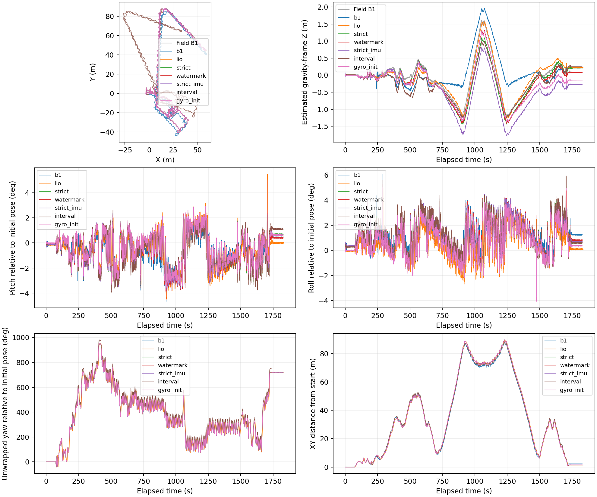
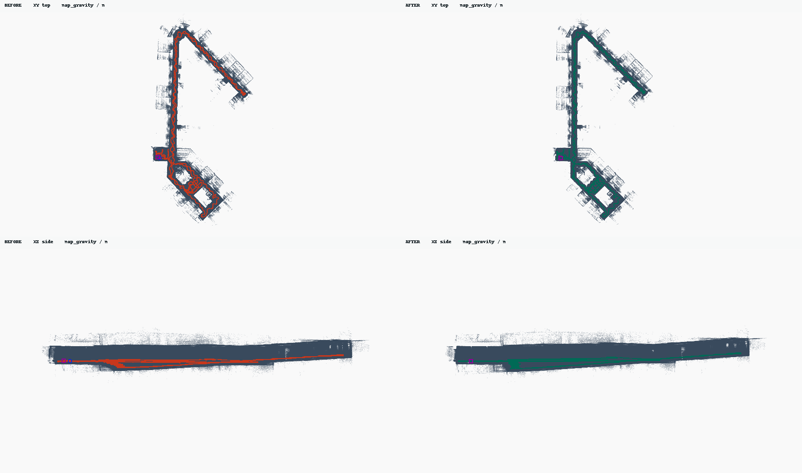
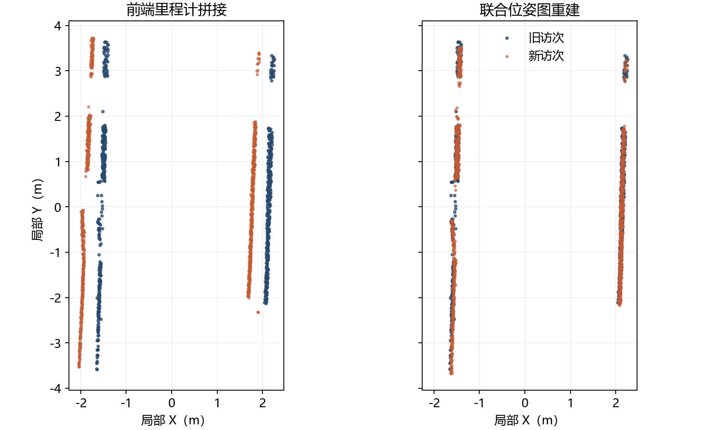

# 走廊建图的时间分窗、垂向漂移与历史地图重建

主实验为 2026 年 11 月 27 日第二轮人工推车走廊建图。现场 B1 估计行程 707.1 m，重力系高度极差 2.821 m，回到胶带位置时首末静止窗口的三维均值相距 1.356 m。本轮在 Orange Pi 5 Ultra 上从原始三路数据重新估计运动，导出局部关键帧，分别检验前端时间处理、惯性初始化、视觉贡献和后端闭环。**交付地图选用严格时间分窗前端与离线联合位姿图。** 五处预先留出的重访区域均降低了点距，两个有充分重叠的墙面从约 40 cm 双层收紧至 2–5 cm。优化后整条轨迹的高度极差反而增加。正式 B1 仍是现场默认，候选通过同一套启动、回放、查看和停止入口选择。

## 原始输入和基线

第二轮原始 Bag 为 148 个 SQLite 分片、74.1 GiB，包含 18,355 帧 Mid-360S 点云、366,943 条 IMU 和 18,288 帧相机图像。一次 B1 诊断回放使用生产回调、同步器和估计器，以 rosbag2 记录顺序输入原始 CDR，同时采集点时间统计、估计状态、最终点面匹配和关键帧。三路接收数均与 Bag 相符。1,527 个关键帧共保存 8,177,567 个几何点和 949,867 个可见彩色点。后端各项对照直接使用同次导出。

现场 B1 轨迹使用发布墙钟，按秒重采样的估计路程为 707.1 m。离线 B1 使用测量时刻，得到 710.8 m、18,284 个 LIO 更新。现场归档有 18,251 个姿态，启动时数据到达和处理次序也有差异。以下前端比较均在重力对齐系计算。胶带窗口取相对起始有效状态的 10–60 s 与 1775–1825 s；前端表比较位置均值，后端另按稠密位置分量中位数统计。去平面 RMS 是轨迹 Z 减去关于 XY 拟合平面的均方根。[前端测量与输入计数](corridor-20261127/frontend_metrics.json)

## 前端实际改动

**按采集时刻分配点。** Livox 输入的点时刻为扫描头加纳秒 `offset_time`，预处理后偏移保存在以毫秒为单位的 `curvature`。共 367,099,104 个输入点经过时间平滑判定，本袋改写数为零。5,777 个扫描内有两个实际接纳的图像切点。B1 将上窗余点整批交给下一窗，18,285 个窗共分配 97,532,745 个点，其中 102,017 个超出使用窗末超过 1 µs，占 0.1046%，分布在 5,970 个窗口，最大提前 0.314594 ms。这些点也都越过了用于去畸变的状态传播区间。[上游 PR #466](https://github.com/hku-mars/FAST-LIVO2/pull/466)

严格模式将每个扫描按真实回波时刻切分。每窗消费半开区间内的前缀，保留原扫描头与余点，交叠扫描归并后排序。在线等单调扫描起点达到图像时刻，再交付该窗；直接读包模式在真实 EOF 按剩余有效点的覆盖上限排空。修复后共分配 97,532,728 点，未分配的 17 个已开扫描余点逐个核对均晚于最后图像，另有 37 个未开扫描、204,665 点也在输入尾部。初始化窗使用 159,181 点，随后 97,373,547 点均在正确的传播窗内变换，窗口间计数闭合。使用点 ID 和匀速解析轨迹的回归另外验证了重合时间、精确边界和重叠扫描。中间版本 `strict` 与部署版 `watermark` 的本袋逐窗计数、时域和去畸变统计相同，第一个后验差异出现在 VIO，相差 0.0464 mm。[分窗规则、诊断和回归](image-windows.md)

**在正确的 IMU 区间插值。** 传播程序把每个区间的平均角速率和世界系加速度存在尾节点。B1 逆向去畸变在头节点取这两个量，使用的是前一区间的运动。在候选 `--interval-deskew` 中，从头节点取位姿和速度，从尾节点取该区间的运动量。变角速与轴向加速度的解析回归中，最大点误差由 0.149994 m 降至 0.000000224 m。真实袋里降低了高度极差，但对重复地面的一致性有代价。此项可单独切换。[生产回归用例](../tests/interval_motion_regression.cpp)

**状态与点云共用估计时刻。** 在有有效点面约束的 LIO 更新完成时，使用该次去畸变结束时刻与后验姿态建立索引。保存局部点为 `p_imu = R_imu_lidar p_lidar + t_imu_lidar`；配套姿态为 `T_odom_imu`，其中 `odom` 数值对应 `camera_init`。帧间累计达到 1 m、15° 或 5 s 就选一帧。相机仅为同一参考时刻、可正确投影的最近可见点着色。后台写盘完成才提交索引，旁路读取已提交文件。导航源 `/culvert_source/scan` 发布 LiDAR 局部云，`/culvert_source/state` 发布同戳 IMU 位姿。建图后端持有 `map→odom`，使用本次重力定义初始地图朝向；`odom→base_link` 由导航适配器结合底盘外参表达。本轮未重新标定底盘杠杆臂。[关键帧接口](keyframes.md) · [坐标与后端接口](../backend/README.md)

## 姿态、观测与垂向变化

| 第二轮配置 | P0 三维差（m） | 估计 Z 极差（m） | 去平面 Z RMS（m） |
| --- | ---: | ---: | ---: |
| 现场 B1 | 1.356 | 2.821 | 0.367 |
| 离线 B1，原时间窗、原视觉 | 2.372 | 2.433 | 0.379 |
| 纯 LIO，扫描时轴 | 1.390 | 2.839 | 0.414 |
| 中间严格分窗 strict | 1.443 | 2.541 | 0.365 |
| 最终扫描水位 watermark | 1.427 | 2.738 | 0.380 |
| strict + IMU 噪声 1.0 / 0.1 | 1.612 | 2.590 | 0.369 |
| watermark + 对应区间去畸变 | 1.420 | 2.264 | 0.396 |
| watermark + 静止陀螺均值初始化 | 1.583 | 2.658 | 0.372 |



初始 IMU 实收 464 条，跨度 2.316 s。配置计数阈值为 30，程序整批处理，实际采样量由首个输入组决定。初始化重力在 `camera_init` 为 [3.4361, 0.1545, −9.1872] m/s²，B1 过程中重力向量相对首状态的最大变化为 0.1074 m/s²。原版从约零陀螺偏置开始，结束时为 [−0.00378, −0.00033, −0.01053] rad/s，加计偏置为 [0.0893, −0.1591, 0.0257] m/s²。以首个静止窗口陀螺均值 [−0.003914, 0.002112, −0.017452] rad/s 初始化后，五个冻结区点距仅两处低于 watermark。原 IMU 噪声组为 `acc_cov=0.5, gyr_cov=0.3`，两种惯性对照都保留为候选。[配置与逐版本状态](corridor-20261127/frontend_metrics.json) · [上游 IMU 讨论](https://github.com/hku-mars/FAST-LIVO2/issues/84) · [上游估计讨论](https://github.com/hku-mars/FAST-LIVO2/issues/237)

B1 在 1,553 个水平移动至少 0.2 m 的非重叠一秒步段中，把相对初姿的倾斜平面投影到实际 XY 行进方向，预测升降与估计 ΔZ 的 Spearman 相关为 0.787。转动分量达 15° 的 747 段中，|ΔZ| 的 P95 为 20.6 mm，其余 806 段为 25.5 mm。姿态和升降来自同一估计器，相关性中也含真实路面坡度。图中保留整段 yaw、roll、pitch 以便逐段检查。

B1 的 18,284 次同戳 LIO/VIO 对中，18,283 次实际执行了视觉状态更新。更新位置模长 P95 为 15.9 mm，其中 |ΔZ| P95 为 9.0 mm。最低与最高亮度五分位的位置改正 P95 为 10.7、21.1 mm，低纹理与高纹理为 9.6、21.3 mm。纯 LIO 在部分冻结区点距更低，但失去颜色，其高度极差和去平面 RMS 都更大。该对照也把图像切窗改为扫描切窗。保留 LIVO 作为彩色建图前端。[图像分组和逐帧统计方法](../tools/compare_corridor.py)

相机元数据帧号连续、SDK 丢包计数为零。18,288 个共享图像头中有三次重复、三次约 200 ms 的间隔，SDK 取帧到发布最大延迟 221.94 ms。可用共享钟追踪覆盖 11,099 次读取，其中 11,098 次在非并发窗口与最近写入完全相同。IMU 源戳存在一次 9.97549 ms 的长间隔。曝光发生时刻与 LiDAR 的绝对对齐仍需独立量测；本袋不足以把这些稀少事件归为整段形变的主因。

## 雷达约束和地面实验

B1 最终迭代共 30,913,180 个点面对应，绝对残差均值 20.7 mm、RMS 34.4 mm。依据重力法向和相对 LiDAR 高度分类，下方近平面占 9.6%、上方近平面占 25.9%、墙面占 53.1%。进一步在静止陀螺初始化整包对照里，每约一秒记录最终匹配实际使用的方差及六维矩阵。1,739 个有效更新共 2,951,456 个对应。权重为固定项 0.001 m²、平面方差和点协方差法向投影三项之和的倒数。地面、顶面和墙面的平均权重分别为 949、788、797 m⁻²；对竖直平移信息的贡献分别为 26.87%、59.33%、1.17%，对绕重力轴转动的信息有 90.31% 来自墙面。

按各帧实际 RMS 杠杆臂统一角增量尺度，杠杆臂中位数为 5.58 m。信息矩阵最小／最大特征值比的中位数为 0.0763，最弱方向的缩放转动范数中位数为 0.950，竖直平移绝对投影中位数为 0.145。独立重构对称矩阵、复算特征值的最大相对误差低于 3×10⁻¹⁵。局部垂向具有直接约束，远距离重访仍可能积累姿态和位置误差。[实际权重和弱方向](corridor-20261127/weighted_geometry.json)

对倾装雷达下方回波独立拟合平面，使用不同回波核对法向、残差和二维支撑。B1 的 1,527 个关键帧中 1,484 帧通过；坡度 P50/P95 为 1.46°/2.64°，最大 9.37°。在已有点面估计地面支撑弱的时刻，检查最近 2 s 内历史地面片与当前地面片的真实支撑交集。B1 仅三处具备交集，前两处 16.4、6.3 mm 的创新低于可分辨尺度，第三处 83.2 mm 的创新伴随 9.18° 法向突变。在包括静止陀螺初始化的六组 LIVO 回放中均无满足连续性和可分辨性的关键帧。保留观测工具，前端未加入全局水平先验或重复地面因子。[局部地面的提取与判定](../tools/ground_support.py)

## 回环、地图重建与留出评价

采用 liangheming 的独立 PGO 结构和 Hero 的历史关键帧重建思路，为本项目的同戳局部云实现输入、候选筛选和图装配。配准使用 small_gicp 1.0.1，优化使用 GTSAM 4.3a1 的 Pose3 Levenberg–Marquardt。固定首姿，按原相邻姿态差建里程计边。自动检索从已走过的路径按时间、路程和位置提名，用中心组和互不重叠的邻帧组分别求 GICP，检查双向覆盖、点距、方向可观性、两解差及图残差。根据本袋相邻 GICP 与里程计的六轴差异估计尺度，各闭环再结合邻组重复性、臂长、覆盖及弱方向放大方差，对白化残差使用 Huber 1.8。小规模批量求解可在独立进程内完成，避免把校正写回前端 ESKF。[实现、依赖版本和上游出处](../backend/README.md)

先在 B1 的胶带重访上验证单边。首末静止窗中位分离从 2.372 m 降至 0.012 m，五个冻结区中却有四处点距变差。纯自动图接纳 23/58 条候选，P0 降至 0.0085 m；在此基础上加入胶带先验形成 24 边联合图。固定这 24 条边，仅将回环标准差乘以 0.5 或 2，部分历史关键帧的位置相对中心设置改变 0.87 m 或 1.18 m。P0 一处闭合不足以选择权重。

最终 watermark 联合图在 1,519 个节点上评估 58 个配准候选，接纳 28 条，组装 1,547 个因子。首末中位差从 1.42644 m 降到 0.01044 m，优化后末减首 XYZ 为 [−4.8, +8.9, +2.8] mm。每个历史点按所属关键帧的优化位姿重投影，强度、颜色位和时刻保留；优化前后各有 8,138,600 点几何图和 945,066 点彩色图。关键帧高度极差由 2.735 m 增至 3.374 m。[联合图统计](corridor-20261127/joint_summary.json) · [全点回读](corridor-20261127/map_verification.json)



五处重访在看配准结果前按 B1 轨迹冻结。两访次中心前后各两帧，以及两中心水平半径 4 m 柱体内的回波，均从离线配准与权重估计剔除。其他前端按同一组传感器时刻匹配最近关键帧。以下为新访次到旧访次点距中位数，单位 m。[冻结时刻](corridor-20261127/frozen_regions.json)

| 区域 | 1 | 2 | 3 | 4 | 5 |
| --- | ---: | ---: | ---: | ---: | ---: |
| watermark 原始 | 0.305 | 0.982 | 0.338 | 0.282 | 0.487 |
| watermark 联合图 | 0.287 | 0.388 | 0.325 | 0.274 | 0.433 |

对于有方向支撑的同一表面，另按法向、覆盖率、点数及切向展布复核。区域 5 两侧墙面双访次 P90−P10 厚度分别从 0.3825→0.0184 m、0.4017→0.0455 m，两墙间距由旧访次 3.6684 m 对应到新访次优化后的 3.6592 m。区域 3 一面墙从 0.1262 m 收紧至 0.0237 m。区域 4 一对所谓地面的法向差 89.61°，区域 2 的墙角一侧缺少同向支撑，两项已从有效测量剔除。五区未识别出有足够跨高度支撑的门宽。[全部表面关联与剔除理由](corridor-20261127/surface_quality.json)



另外冻结 B1 提议的 315 对地面片，把不同轨迹应用到相同的原生局部回波，只比较实际相交的地面足迹。七种组合共同覆盖 249 对时，高差绝对值 P95 为 B1 289.9 mm、单 P0 图 398.9 mm、B1 联合图 63.2 mm、watermark 联合图 37.0 mm。加入最终前端与因果图再比较，六种组合共同覆盖 101 对，B1、watermark、区间去畸变、静止陀螺初始化、watermark 联合图和因果重建依次为 300.0、225.2、292.7、191.8、40.9、26.0 mm。两个交集各自共享同一分母。地面片来自同袋，其中有些位置参与了建图。[六组共同交集与各自覆盖数](corridor-20261127/ground_comparison.json)

官方 STD 使用固定提交在 RK3588 编译运行。153 个子图中有 152 个提取出描述子，跨历史间隔后命中 5 次。已知胶带末组未命中初组。一次匹配在 GICP 后仍使重力翻转 176.3°，双向覆盖却有 58.0%/63.7%，可直接证伪该位姿。首版自动回环采用位置、时间、邻帧和几何联合验证。未获独立地点标注的走廊候选仍保留其测量与拒绝理由，现有数据无法给出全场误检率。[STD 适配与复算](../backend/std_probe.py)

## ARM64 部署与运行

第二轮 watermark 直接读包耗时 1,053.5 s，前端峰值 RSS 843.5 MiB，关键帧和诊断目录约 193 MiB。处理采样 P50/P95 为 24.7/41.1 ms，采样队列峰值为 LiDAR 2、IMU 46、图像 2。离线联合后端耗时 29.10 s，峰值 RSS 148.3 MiB，含两套地图与轨迹的原始 21 件产物约 297 MB。静止陀螺试验中途从小核转大核，其耗时不作同核性能对照。

将 watermark 的 1,519 个索引按采集顺序投递给 ROS 2 因果旁路，独立订阅读到全部 1,519 个同源时戳的 `map→odom`。33 次有效更新，单次检索 P50/P95/最大为 0.314/0.708/2.205 s。实际广播校正下的稠密 P0 差为 0.01094 m；结束时用最终接受边重建，P0 为 0.01349 m，重建耗时 4.13 s。旁路自身计时 31.25 s 截止索引读完，重建另计，峰值 RSS 124.9 MiB。因果试验使用完整已到达历史，独立留出评价采用上文离线联合图。[因果校正与资源](corridor-20261127/causal_summary.json)

**第一轮独立 Bag 和真实 DDS 通路。** 第一轮推车包通过标准候选入口按 1× 速率回放。三路实际发送和接收均为 LiDAR 7,119、IMU 142,286、图像 7,067。另一个 ROS 进程收到了 7,064 对同戳状态和局部云，全部 389 个关键帧都有同戳 TF、状态和点云，坐标系和云字段全数通过。14 次图更新后正常结束并重建，优化前后每张图有 2,076,053 个几何点和 244,120 个彩色点。逐点独立回读的最大坐标差 2.89 µm。会话耗时 721.7 s，前端 RSS 峰值 781.8 MiB，旁路 176.3 MiB。前端采样处理时间 P50/P95/最大为 33.3/71.4/148.8 ms，LiDAR/IMU/图像队列采样最大值 3/59/2，收尾各进程退出码均为 0。[独立 ROS 订阅](corridor-20261127/first_dds_wire.json) · [端到端会话结果](corridor-20261127/first_dds_session.json)

第一轮终点为随意停车。复用上述关键帧另行运行纯自动离线图，未给出胶带窗口。67 个候选中入图 23 条，3 个空间留出区的新到旧点距依次从 0.6138→0.6192、0.1010→0.1004、0.1023→0.1022 m，两处变化不足 1 mm，第一处退化 5.4 mm。关键帧高度极差从 0.399 m 降至 0.374 m。这个独立包验证了运行和重建，也说明第二轮观察到的明显几何改善没有在所有路线重复出现。[第一轮纯自动图](corridor-20261127/first_automatic.json)

已部署候选位于 `/data/robot/livo_pgo_dev/candidate`，正式 B1 位于 `/home/orangepi/fast_livo2`。在香橙派上可直接查看成品，重新求解时指定新的输出目录。

```bash
R=/data/robot/livo_pgo_dev
cd "$R/candidate"
./view.sh --pgo "$R/backend_dev/watermark_joint" --check
./view.sh --pgo "$R/backend_dev/watermark_joint" --before --check
# 在板端图形会话中打开优化后地图
./view.sh --pgo "$R/backend_dev/watermark_joint"
```

```bash
R=/data/robot/livo_pgo_dev
S=/data/robot/maps/fast_livo2/runs/corridor_baseline02_20261127T111905Z_NqWFM0
cd "$R/candidate"
trial=$(mktemp -d "$R/trial.XXXXXX")
./replay.sh --offline "$S/raw_bag" "$trial/front" \
  --params "$S/20261127T111909Z_85997cf277/resolved.yaml" --strict-windows
./replay.sh --pgo --index "$trial/front/keyframes/index.csv" \
  --gravity "$trial/front/gravity_events.jsonl" --out "$trial/joint" \
  --mode combined --p0-windows 10 60 1775 1825 --frozen docs/corridor-20261127/frozen_regions.json
./view.sh --pgo "$trial/joint" --check
```

正常 ROS 2 数据通路使用 `./replay.sh BAG --strict-windows --loop-backend`，接外设的候选入口为 `./start.sh --strict-windows --loop-backend`，同一候选目录用 `./status.sh` 查看，`./stop.sh` 停止并保存。普通会话的 `map/` 是连续前端归档，`pgo/` 是独立全局重建。回到正式 B1 时使用原正式目录的入口。源码重建使用 `./build.sh algorithm`，后端 ARM64 wheel 锁及独立前缀安装命令见后端说明。[后端依赖与运行](../backend/README.md)

Windows 完整交付位于项目的 `data/corridor_runs/20261127_second_mapping/pgo/watermark_joint`。几何图为 `map_before.pcd` 与 `map_after.pcd`，彩色图为 `map_rgb_before.pcd` 与 `map_rgb_after.pcd`。同目录的 `trajectory_dense_before.tum`、`trajectory_dense_after.tum` 供逐时比较，`edges.json`、`factors.json` 保存配准与权重。第一轮标准联合会话的关键帧和地图在 `data/corridor_runs/20261127_first_mapping/candidate_dds`。最终提交的运行代码在板端重新编译，分窗、变运动去畸变、局部点云与颜色接口、六维信息矩阵的独立回归均通过；最后用 14.4 s 短包验证无闭环的正常收尾，三路收发差为零，3 个关键帧成功重建。

## 尚待解答的几何问题

当前证据能定位点窗越界和运动插值区间错误，也能说明多处可靠重访提高了重复结构的一致性。全程垂向形变仍同时受真实坡度、姿态估计及同源地图误差影响，五个冻结区也都来自同一次采集。要决定是否替换现场默认，以及是否需要进一步调整 ESKF 观测权重，最有区分度的数据是沿程若干独立高差、平面墙段和门口尺寸，以及跨次双向行驶中的可识别重访。实时 TF 在长查询期间会滞后于前端关键帧，固定地图导航还需外参和跨次重定位实测。
