# FAST-LIVO2 第三轮走廊长时间实物建图实验技术报告

**实验日期**　2026 年 11 月 28 日，北京时间（UTC+8）

**实物对象**　Orange Pi 5 Ultra、Mid-360S、硬件触发工业相机、人工推车

**评估对象**　`candidate_z_20261128`，第三代候选首次在本轮新采集轨迹上运行

**工程决议建议**　结束本阶段走廊建图的集中算法攻关，采用本次交付提交作为三维先验地图制作及后续重定位研发基线。

同一批现场关键帧经过两个后端，改善出现在不同的空间尺度。全程自动回环把首末关键帧分离由 **1.211 m 降到 13.02 mm**，并在 H4 将两面墙的双访厚度从约 25 cm 收至 17、23 mm。随后，完整惯性方向与结构联合优化把 **1,248 个固定地面格的去平面 RMS 从 424.82 降到 137.27 mm**，与第二轮旧数据上的 363.12→122.58 mm 重现相近的相对收益。代价也可实测：首末分离回升至 33.56 mm，H4 两面墙厚度回升至 24、32 mm，上部斜廊整体坡度下降而段内起伏略增。

| 同一批 1,287 个关键帧 | A 第三代前端 | B 全程自动回环 | C 惯性方向与共享平面联合 |
|---|---:|---:|---:|
| 关键帧折线长，m | 641.188 | 641.200 | 641.350 |
| 关键帧 Z 极差，m | 3.459871 | 3.712558 | 0.961573 |
| 首末关键帧三维分离，mm | 1,211.31 | 13.02 | 33.56 |
| 首尾静止窗稠密位置中位数分离，mm | 1,208.94 | 5.40 | 20.32 |
| B 冻结格地面最佳平面倾角，° | 1.551 | 1.998 | 0.575 |
| 同格地面去平面 RMS，mm | 524.70 | 424.82 | 137.27 |
| 409 个固定结构留出块点面 RMS，mm | 138.82 | 13.530 | 13.328 |
| 重建几何点 / RGB 点 | 6,962,792 / 803,792 | 6,962,792 / 803,792 | 6,962,792 / 803,792 |

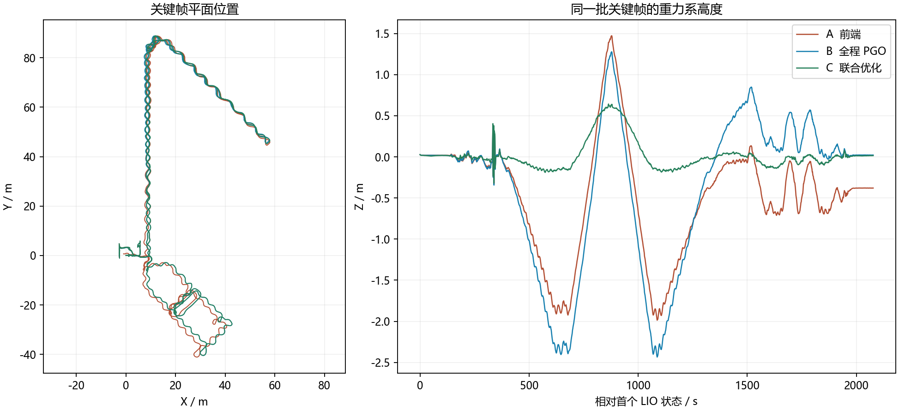

## 1　实验目的、版本与比较设计

本次评估回答三个工程问题：新前端在现场长时间运行时能否按测量时间消费输入，回环能否在无人指定起终点的条件下修正历史地图，离线联合优化能否在开发结束后新采的一条路线上再次收紧跨段高程。场地仍是前两轮使用的实验室和所在楼层。操作员自行控制路线、速度和停靠，计算沿用本轮关键帧、自动留出区以及实际地面点。相同楼层提供了可辨认的建筑结构，新实采提供了不同的传感器序列。

| 版本标识 | 本轮证据 |
|---|---|
| 交付提交 | `f6d0792e9aeb5e3825b916451918ac56cba9f1cb` |
| 算法核心 | `59c47ee53aa931bd7766ae0c9045ae8e48083969` |
| 现场 ELF 的归档 SHA256 | `9e9fc891dcef46c6859e215467fb1ad9620a7f215a6991e60e9b9eef22fe0bcd` |
| 板端目录 | `/data/robot/livo_pgo_dev/candidate_z_20261128`；保留本机硬件识别适配 |
| 启动参数 | `./start.sh --strict-windows --interval-deskew --static-rate-update --loop-backend --diagnostics`，另以 `--runs-dir` 指向本轮数据根 |
| 配置与坐标 | 固定本次初始化重力定义 `map_gravity`；`imu.interval_deskew`、`imu.static_rate_update` 均启用，实时图像偏移 +0.1 s，LiDAR、IMU 偏移为 0 |
| 三个主要比较对象 | A 取 `pgo/map_before.pcd`，B 取 `pgo/map_after.pcd`，C 取 `structure/map_after.pcd`。在线实际发布和停机后在线终图另列。 |

## 2　硬件、连接与实物流程

实验平台为人工推动的实验小车。RK3588 上运行 ROS 2 Humble，Mid-360S 提供约 10 Hz 雷达扫描和约 200 Hz 内置 IMU，MV-CU013-A0UC 工业相机经硬件触发、USB 取帧。图像分辨率 1280×1024，输出 RGB8；相机使用本机已部署内外参。现场参数包括最小雷达距离 0.5 m、预处理筛点间隔 3、滑动局部激光图、30 m 视觉局部图。原始数据与会话成品写入板上 NVMe。以下网络及拆装流程依据操作员现场记录，启动、融合、录包和退出结果另有机器归档。

1. 在实验室静止启动候选，建立固定重力坐标，启动在线回环及独立七话题录包。Windows 随后断开手机热点，香橙派独立运行。
2. 操作员推动小车通过实验室、长直主廊、上部斜廊及下部多个连接段。管线持续写出估计状态、原生关键帧、几何和 RGB 回波。两次经过同一走廊可有相反行进方向、不同横向位置及可见范围。
3. 回程后恢复连接，发出停止请求。建图日志终态为 complete，雷达待机返回码为 0，归档中有待机后 2 s 零点流、零 IMU 记录，相机退出码为 0 并恢复设置。录包器排空缓存并报告 Recording stopped。在线旁路读完 1,287 帧，用最终边重建两套历史地图。
4. 在该次关键帧上执行全程自动 PGO，提取首尾静止和运动补偿方向，完成全局结构联合优化。用户在 CloudCompare 查看成品后结束现场实验、关机、拆出香橙派，之后重新上电。
5. 本次分析经系统已登记的 ED25519 信任记录严格校验 USB SSH，复核登录身份、主机和 aarch64 架构。板上按分片提取所需时戳、IMU 和诊断；完整点云、截图处理及报告保存在 Windows。结构块复核只在已有轨迹上计算残差。

## 3　一次采集中的五种时长

| 时钟与对象 | 本轮起止或定义 | 跨度 |
|---|---|---:|
| 系统会话 | 15:26:48.660579142–16:02:01.177360954，主机墙钟 | 单调计时 2,112.517 s |
| Bag 记录 | 15:27:01.784995978–16:01:49.675291872，首末消息记录时间 | 2,087.890295894 s |
| 操作员移动阶段 | MOVE_START 15:28:33.705377009 至 STOP_REQUEST 16:01:48.472764295 | 1,994.767387286 s，即 33 分 14.77 秒 |
| 稠密 LIO 测量 | 首个有效 LIO 为 Sensor 原点 `1590192670200220672 ns`，一窗一后验 | 2,080.800 s |
| 关键帧测量 | 首个至最后一个入图关键帧；末尾仍有稠密状态 | 2,076.800 s |

在稠密 A 轨迹上按整秒线性插值，取每一秒的三维弦长除以真实间隔。以 0.05 m/s 为活动门限，累计 1,834 s 超过门限，首个活动窗在传感器 127 s，最后一个结束于 1,996 s；门限换成 0.02、0.10、0.15 m/s，活动时间分别为 1,858、1,791、1,749 s。它们估计有可辨位移的时间，可与包含驻留的操作员区间一起理解。第三轮实际行程有数种合理口径：现场归档发布时戳轨迹按 1 s 重采样为 645.039 m，同一前端按传感器时戳的稠密 LIO 为 645.191 m，稀疏关键帧弦长为 641.188 m。停靠、转角和采样间距都会影响累积量。[活动门限敏感性](corridor-third-20261128/maps/motion_metrics.json) · [逐秒位移](corridor-third-20261128/maps/motion_windows.csv)

七话题共 607,211 条，169 个 SQLite 文件共 84.47 GiB；归档原前端几何 / RGB 点分别为 35,912,381 / 5,883,721。后端每张历史地图使用关键帧选择出的子集。输入、估计、关键帧和历史图四个层次均能回查至对应计数。[主要指标](corridor-third-20261128/metrics.json)

## 4　七话题完整性与时间同步

第三轮 Bag 有 169 个 SQLite 分片，合计 90,699,190,272 字节（84.47 GiB）。按各片行号依次读取，共 607,211 条，逐片总数和各话题累计数均与收尾后的 metadata 相符。Bag 记录跨度 2,087.890 s。以下用相邻的同话题消息计算间隔，频率为“间隔数 / 首末跨度”，P95 是线性插值分位数。图像和点云只读 12 字节消息头。小型相机 JSON 消息读其字段，IMU 读角速率和加速度。原始 IMU 在首尾两个 20 s 窗与既有独立 ROS 解码工具的均值逐轴相符，误差小于 10⁻¹²。[逐片清单](corridor-third-20261128/frontend/bag_shards.csv) · [逐流时钟及异常计数](corridor-third-20261128/frontend/topic_clocks.csv) · [异常消息定位表，gzip CSV](corridor-third-20261128/frontend/interval_outliers.csv.gz) · [诊断输入校验](corridor-third-20261128/frontend/source_fingerprints.json)

| 话题 | 消息数 | Bag 频率 Hz | Bag 间隔 P50 / P95 / P99 / 最大 ms | 源字段及其间隔 P50 / P95 / P99 / 最大 ms |
|---|---:|---:|---:|---|
| /livox/lidar | 20,886 | 10.0033 | 100.09 / 106.20 / 113.36 / 194.03 | 雷达头　99.84 / 100.32 / 100.32 / 100.33 |
| /livox/imu | 417,574 | 199.9976 | 4.90 / 7.71 / 12.77 / 46.33 | IMU 头　4.90 / 5.89 / 5.93 / 6.67 |
| /hik_camera/image_timeshare | 20,850 | 10.0001 | 99.91 / 119.74 / 132.22 / 366.68 | 共享雷达头　99.84 / 100.32 / 100.32 / 300.00 |
| /hik_camera/camera_info_timeshare | 20,850 | 10.0000 | 99.88 / 119.74 / 132.26 / 366.49 | 同图像头　99.84 / 100.32 / 100.32 / 300.00 |
| /hardware_sync/camera_metadata | 20,850 | 10.0000 | 99.88 / 120.15 / 132.86 / 366.53 | 主机单调时钟取帧　100.01 / 100.80 / 102.40 / 286.59 |
| /hardware_sync/camera_events | 104,242 | 49.9912 | 0.16 / 105.59 / 118.87 / 366.00 | 主机单调时钟回调　20.35 / 49.78 / 50.12 / 200.19 |
| /hardware_sync/camera_clock | 1,959 | 0.9395 | 1,084.46 / 1,112.92 / 1,126.93 / 1,143.95 | 主机单调时钟开始锁存　1,085.27 / 1,111.32 / 1,123.82 / 1,136.45 |

雷达与 IMU 头均严格递增，雷达源频率 10.0000 Hz，IMU 源频率 199.9991 Hz。雷达头间隔始终在 99.840–100.325 ms，IMU 头在 3.065–6.673 ms。Bag 中 22,489 个 IMU 间隔超过 7.5 ms，源头超过 7.5 ms 的间隔为 0。录制和 DDS 调度共同影响到达间隔。相机事件混有五种回调，同帧可产生多条，49.99 Hz 表示事件总速率。图像 Bag 时间与其共享雷达头相减，中位数为 205,658,158.080 s，两个 epoch 明显不同。传感器事件先后和状态切窗用设备时间，启动、录包和系统资源用主机时间。

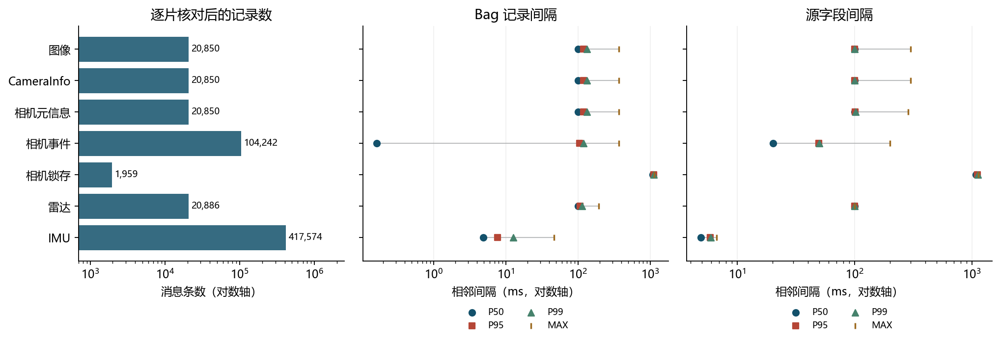

### 触发、曝光和共享头

相机以 1280×1024 外触发取帧，设备帧号 0–20,849 连续且唯一。元信息、图像和 CameraInfo 各 20,850 条，CameraInfo 和图像按序逐个同戳。所有图像头都能在 Bag 中逐整数纳秒找到对应雷达扫描头。驱动 USB 计数 20,850 帧、错误帧 0，逐帧元信息上报丢包总数 0。驱动累计取帧超时 1 次、退出码 0，并记录参数恢复成功。元信息的逐帧曝光、增益、触发索引和 frame counter 全程只有零值。驱动设置快照启用连续自动曝光，快照时读取的曝光值 262 µs 只对应读取瞬间。

相机锁存前后有 1,959 次主机单调时间括号，读写返回码均为 0，括号宽度 P50/P95 为 1.92/5.95 ms。以主机括号中点拟合相机 ticks，预拟合残差偏离中位数超过 100 ms 的只有第 1,831 行（从零数，分片 157、rowid 753）。该行设备计数较前一次**倒退 4,194,246,400 ticks**，相对有效序列拟合低约 42.950 s，下一行恢复。在其余 1,958 行拟合出 99.998915 MHz，残差有符号 P5/P95 为 −1.37/+1.81 ms，最大 +8.32 ms。驱动查询设备 tick 频率的接口无有效读数，文中设备间隔均用这次拟合换算。异常值与邻点插值的差接近 2³² ticks（相差约 10,549 ticks），有一次高位字计数错位的数值特征，设备内部读取链路缺少更细观测。此异常仅见于锁存消息，帧设备计数保持连续。

在同一相机设备时钟下，逐帧间隔为 100.000875–100.001085 ms。Bag 中 Line0 上升沿/下降沿各 20,849 条，FrameStart/ExposureStart/ExposureEnd 各 20,848 条。对每个 ExposureStart 找下一个 ExposureEnd，20,848 对有效正间隔中，曝光时长 P5/P50/P95 为 29.996/29.996/29.996 ms，最短 0.312 ms。回调中 block ID 没有验证，同帧关联依据时间最近原则，个别事件缺口可使最近事件落在相邻帧。驱动累计写出 104,257 个事件，Bag 记录少 15 个，驱动事件队列报告丢弃 0 个。来源与记录端的计数各自保留，这 15 个事件缺少逐项归因。

图像头有 5 次重复、4 次大于 150 ms，共 9 个异常间隔。启动处的帧 1、2、13、14、15 分别为 200.16、0、300、0、0 ms。帧 12 从 SDK 返回到发布结束耗时 283.98 ms，但设备帧计数仍连续。运行中的帧 16,234 和 16,729 重复上一雷达头，后一帧分别跨 200.16 和 199.685 ms。读写追踪直接显示两次读区间与一次共享文件 write 的包围区间重叠，均读到上次已完成写入的值。其余 13,765 个可唯一判定的读区间与最后已完成写入逐值相符。滚动日志只保有帧 7,083–20,849 的 13,767 个读记录，早期五个异常仅能定位到帧号、设备节拍和主机取帧/发布时序。[九个异常及相邻帧](corridor-third-20261128/frontend/camera_anomalies.csv)

驱动滚动帧日志保留帧 8,192–20,849。当前版本 CSV 表头比实际行多列出一个 SDK 主机时间，按源码写入顺序解析末列的 RGB 转换耗时，12,658 帧的 P50/P95/最大为 7.02/23.21/44.37 ms。SDK 取帧至驱动发布结束 P50/P95/P99 为 12.47/33.18/41.90 ms，最大 283.98 ms，共 4 次超过 100 ms。取帧至图像 Bag 记录 P50/P95 为 18.40/39.07 ms。相机先完成取帧，随即读取雷达共享时间，用以填 Image 和 CameraInfo 的头，算法内部再加 100 ms。校正后图像戳到最近 IMU 戳的有符号差在 −2.934 至 +2.924 ms，反映 200 Hz IMU 对融合切点的采样覆盖。已录相机事件、共享头与雷达之间缺少能溯源到同一次脉冲的公共绝对曝光时间，100 ms 配置仍是实验所用对齐约定。

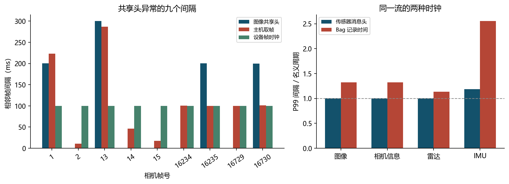

### 相机 latch 计数值的证据边界

相机程序依次执行 `DeviceTimestampLatch` 命令并读取 `DeviceTimestamp`，日志记录 SDK 返回码和寄存器读数。此次设备 XML 将该 8 字节字段描述为 ns；两个时钟频率参数的主动读取都只返回非零状态码，没有频率值。1,959 条 latch 记录剔除一个异常点后，与主机单调时钟拟合得到 **10.000108 ns/原始计数**，相当于 **99.998915 MHz**。该比例来自本次测量，不宜直接依照 XML 把每个计数折算为 1 ns。

异常点的零基序号为 1831，命令及读取返回码均为 0，前一条、该条、后一条的原始值依次为 262757918641、258563672241、262968453833。按相邻两次主机时刻插值，该条约少 **4,294,956,747 个计数**，与 2³² 相差约 10,549 个计数。高 32 位呈 `0x3d → 0x3c → 0x3d`，相对于全程拟合的主机时刻残差为 +42.950 s。现有记录只定位到一次 latch 读数异常，尚不能确定寄存器、高低字读取、相机固件或主机接口中的具体成因，也无法由这一条读数推导曝光误差。[原始值、返回码和拟合结果](corridor-third-20261128/frontend/extra_static/summary.json) · [设备 XML 字段及原件校验](corridor-third-20261128/frontend/extra_static/archive_evidence.json)

### 从 Bag 到融合状态的逐级数量

| 环节 | 雷达 | IMU | 图像或切窗 |
|---|---:|---:|---:|
| Bag | 20,886 | 417,574 | 20,850 图像 |
| 前端输入回调 | 20,818 | 416,367 | 20,812 图像 |
| 输入尾部计数 | 7 项 | 153 项 | 0 帧 |
| 同步及状态 | — | 35 个初始化样本 | 20,809 窗、20,807 对 LIO/VIO 状态、20,806 帧执行视觉更新 |

Bag 比回调多出 68 条雷达、1,207 条 IMU 和 38 帧图像。20,818 次雷达预处理头全部与 Bag 的第 68 至 20,885 条雷达记录匹配（从零数），第一条 IMU 初始化样本恰好来自 Bag 的第 1,207 条。图像头加 0.1 s 后与 20,809 个切窗终点按 1 µs 精度匹配，首个可匹配帧是 39，最后是 20,849。前 39 帧均未成为切点，后续 20,811 帧全部找到切点，其中两帧重复用了已有切点。回调在检查重复头及首个雷达前就计数，首个同步窗的日志已经记到两次图像回调。计数和时间序列支持启动覆盖差及重复头筛除，逐张回调缺少帧号，故无法逐帧指定前 39 帧中的哪 38 帧没有进入回调。每窗分 LIO、VIO 两阶段，合计 41,618 次同步。前两个窗完成 IMU 初始化；头个 VIO 状态标记为未更新，随后 20,806 帧取得光度更新。

## 5　第三代前端的惯性、姿态及视觉融合

### 静止陀螺观测在何时生效

本次开启严格图像分窗、IMU 区间去畸变和静止角速率更新。以首个 LIO 状态为 0 s，状态跨度 2,080.800 s。初始化采用 2 个输入组内连续的 35 个 IMU 样本，跨度 170.0 ms，达到配置门限 30 后内部计数为 36。原始加速度均值 (−0.339592, −0.001156, +0.941261)，算法按 9.803645 m/s² 每原始单位转换。原始角速率均值 (−0.004535, +0.001269, −0.018268) rad/s，首个 LIO 陀螺偏置接近零。

源码在每个 LIO 传播前检查上一状态。窗口累计至少 4 s、至少 700 个新 IMU 样本，相对起始位移在 0.025 m 内、旋转不超过 0.006 rad、速度不超过 0.08 m/s、最新样本距切点不超过 0.1 s。窗口最大单轴陀螺标准差须小于 0.004 rad/s，均值模须小于 0.04 rad/s。通过后以三轴平均角速率观测陀螺偏置，观测标准差 0.0015 rad/s，通过状态协方差把修正传播到其余状态。窗口重置，下一批 IMU 会参与新的统计。该观测没有加入速度等于零或预设高度的量测。

用严格切窗时间、推进前的 VIO 后验、原始 200 Hz IMU 和同一门限重算，得到 **49 个满足条件的窗口**。起段 31 个在 4.100–125.600 s，末段 18 个在 2,009.400–2,078.500 s。23 个窗各有 800 个样本，26 个各有 820 个。末段 18 条与实际 static gyro update 日志逐时刻（1 µs 内）和样本数相符。早期算法文本已被滚动覆盖，前 31 个来自状态与 IMU 重算。表中列出每次观测均值、标准差、创新三轴、更新前偏置、下一帧 VIO 偏置及证据类别。由于完整状态协方差和角速更新刚完成时的状态没有逐次持久化，下一帧差值还含传播、LIO 和 VIO 修正。[49 个窗逐次审计](corridor-third-20261128/frontend/static_updates.csv)

独立交叉检查比较了更新前 VIO 后验至下一 LIO 后验的陀螺偏置净阶跃。对 31 个早段候选，各取前后 10 个普通周期作对照，全部 31 次的阶跃幅值和沿创新方向的投影都高于同窗的 20 个对照。阶跃幅值为相邻中位数的 6.13–1,853.89 倍，阶跃与创新方向夹角的余弦最小 0.9951。用有日志的末段做同样检查，18/18 次都成立。首段若完全忽略门限、只按全段阶跃幅值取前 31，则命中 29 个候选。前 31 个同时具有门限与状态响应证据，仍缺少原始触发日志。[独立偏置阶跃核对](corridor-third-20261128/frontend/extra_static/state_step_evidence.csv) · [样本、对照与锁存复核](corridor-third-20261128/frontend/extra_static/summary.json)

首个候选窗的原始三轴均值为 (−0.004216, +0.001255, −0.017731) rad/s，更新前偏置为 (−0.000178, +0.000030, −0.000495) rad/s，创新模 0.017746 rad/s，下一帧 VIO 后验偏置净变化 0.014951 rad/s。全体 49 窗创新模中位数 0.000114、P95 为 0.000761 rad/s，末次为 0.0000935 rad/s。MOVE_START 记录在当地 15:28:33.705，最近相机帧取帧比标记晚 48.9 ms，对应约 85.60 s，其后仍有 10 个起段候选窗。LIO 位置相对 5–25 s 均值在 127.40 s 首次超出 5 cm，133.80 s 首次超出 0.5 m。现场标记能够定位操作时刻，对物理起步时刻仍需外部观测。125.60–2,009.40 s 之间无重算触发。

### 静止更新的独立状态核证

第三轮档案直接保留了 **18 条**完成陀螺零角速度更新的日志。早段另 **31 个**按门限复原的候选时刻，逐个都在状态记录中出现方向与创新一致的陀螺偏置阶跃；终段 18 条有日志的更新表现出相同特征。综合证据支持 49 次更新。前 31 次的证据等级是状态交叉核证，缺少分支执行后的逐次日志。

本轮 mapper 的实录命令带有 `--disable-external-lib-logs`，会话 `roslog/` 下的五个文件全部为 0 字节。输入计数器和会话汇总只列出输入、同步、视觉及剩余队列 10 项，结束标记只记 1,287 个关键帧、41,614 条状态。诊断的七份 CSV 均无静止更新标志，Bag 的七条话题也未收录 `/rosout`。按采集 boot ID 和时段查板端 journal，整个历史 boot 已不在当前账号可见的 journal 列表。源码在 Kalman 注入及协方差复位后发出 `static gyro update`，当前留存档案没有提供另一份 49 行直接记录。[板端档案及诊断表头](corridor-third-20261128/frontend/extra_static/archive_evidence.json)

逐个候选对齐传播起点的前一帧 VIO 后验与紧随其后的 LIO 后验，取两者三轴陀螺偏置之差。该差量覆盖静止更新、传播及本帧激光更新。随后同戳的 VIO 更新另外计算。对照使用前后各十个普通传播周期，约各 1 s，同样计算偏置变化。逐次检验两项，一是候选偏置变化的幅值，二是沿本窗口创新方向的有符号投影；创新取窗口平均角速率减更新前陀螺偏置。本项只复用候选时刻和创新，不用静止筛选门限生成检验结果。

| 状态核证指标 | 早段 31 个候选，4.10–125.60 s | 终段 18 条日志，2009.40–2078.50 s |
|---|---:|---:|
| 幅值、沿创新投影均严格超过同窗口全部 20 个对照 | 31/31 | 18/18 |
| 幅值 / 邻域中位数，最小 / 中位 / 最大 | 6.13 / 27.67 / 1853.89 | 1.77 / 5.91 / 14.19 |
| 偏置变化与创新方向余弦，最小 / 中位 | 0.99506 / 0.99993 | 0.97844 / 0.99664 |
| 沿创新投影 / 创新范数，中位 | 0.61263 | 0.60722 |
| 前一 VIO 至当前 LIO 的偏置变化中位，rad/s | 0.00007389 | 0.00006605 |
| 同一戳随后 VIO 的偏置变化中位，rad/s | 0.00000144 | 0.00000644 |

另从 0–126.60 s 的 1,267 个连续传播周期中仅按偏置变化幅值排名，最高的 31 个有 29 个命中早段候选。其余两个候选分别在 44.60 s、117.50 s，在各自局部邻域仍是最大阶跃。状态档只记录姿态和位置的六项对角方差，缺少陀螺偏置自身协方差与姿态—偏置互协方差。早段 30/31、终段 16/18 的姿态方差迹变化仍落在对应邻域范围内，无法据此反推增益矩阵或逐次证明 Kalman 注入量。以上排名及倍率是描述性对照，序列具有时间相关性。[49 行状态与对照统计](corridor-third-20261128/frontend/extra_static/state_step_evidence.csv) · [统计汇总](corridor-third-20261128/frontend/extra_static/summary.json) · [独立复算脚本](corridor-third-20261128/frontend/extra_static/check_state_steps.py)

### 静止段的车体状态与偏置

以 5–25 s、2,059–2,079 s 两个传感器时间窗检查首尾静止状态，各含 4,000 条 IMU 和 201 / 200 个 LIO 状态。角速残差为原始三轴平均角速率减该窗 LIO 平均陀螺偏置。比力残差在每个 LIO 状态附近 ±0.05 s 平均原始加速度，扣除偏置、用该状态姿态旋到 odom，再加估计重力，最后求窗口平均向量的模。[首中末状态分布](corridor-third-20261128/frontend/phase_estimator.csv) · [完整三轴及分布](corridor-third-20261128/frontend/metrics.json)

| 量 | 起始 5–25 s | 结束 2,059–2,079 s |
|---|---:|---:|
| 原始平均角速率，rad/s | (−0.004132, +0.001163, −0.017690) | (−0.002089, −0.001594, −0.009347) |
| 原始角速率总体标准差，rad/s | (0.001848, 0.001789, 0.002127) | (0.001220, 0.000955, 0.002816) |
| 原始加速度均值，驱动原始单位 | (−0.339306, −0.001134, +0.940808) | (−0.338870, −0.002183, +0.938847) |
| 原始加速度总体标准差，同上 | (0.005325, 0.003589, 0.002333) | (0.005754, 0.002766, 0.002780) |
| 平均陀螺偏置，rad/s | (−0.004006, +0.001150, −0.016971) | (−0.002115, −0.001576, −0.009317) |
| 平均角速残差模，rad/s | 0.000729 | 0.0000435 |
| 平均加速度偏置，m/s² | (+0.00051, +0.00700, −0.00006) | (+0.03777, −0.10300, +0.03628) |
| 平均比力残差，m/s² | (−0.00225, +0.08294, −0.00611) | (+0.12169, +0.01106, +0.04053) |
| 平均比力残差模，m/s² | 0.08319 | 0.12873 |
| 校正比力方向相对固定地图上方向 | 0.493° | 1.473° |
| 位置 / 姿态相对窗中心的 P95 半径 | 0.92 mm / 0.057° | 2.31 mm / 0.118° |
| 速度模 P50，LIO → 同戳 VIO | 0.0230 → 0.00326 m/s | 0.1107 → 0.00704 m/s |

末段角速均值更贴近估计偏置，而比力残差、姿态散布与 LIO 后验速度同时增大。末段 LIO 速度可超过静止门限，此门限取的是下一次传播前的 VIO 后验，末段 VIO 速度 P95 为 0.01454 m/s。全程估计重力模由 9.8100 变为 9.7668 m/s²，相对首状态的重力夹角最大 1.468°。这些量支持继续区分偏置、姿态和每阶段校正的影响，缺少定姿、温度或速度真值，末段残差无法唯一分解为加计温漂、外参误差或实际倾斜。

### 切窗、去畸变、雷达与视觉约束

20,818 个雷达回调输入 416,358,528 点，预处理输出 112,219,962 点。20,809 个窗从源队列取出 112,185,085 点，分配 112,179,241 点，末尾保留 5,844 点待下窗，另 6 个尚未打开的新扫描含 34,877 点。两条等式逐项闭合，每窗点数和相邻 carry 连续性均没有异常。回调计数中的末尾 7 项还含已打开但只消费部分的扫描。相对窗首或窗尾超过 1 µs 的越界点均为 0，有 314 点位于窗尾 1 µs 带内。2 个初始化窗分别占 5,476 和 5,479 点，剩余 **112,168,286 点全部参加区间去畸变**，20,807 个去畸变窗中未变换点、点时间逆序、传播区间外超过 1 µs 的点均为 0。分窗宽度中位数 99.84 ms，最大 200.16 ms。这里验证的是时间归属和处理覆盖，去畸变后的空间误差需要几何参考测量。

20,807 个 LIO 更新的最终点面匹配累计 35,912,381 个，逐窗匹配数 P50/P95 为 1,648/2,293，最小 150（首窗），迭代次数为 3–5。逐窗平均绝对残差 P50/P95/最大为 20.3/33.0/64.9 mm。按所有匹配点加权的平均绝对残差为 21.38 mm，RMS 为 35.19 mm。以法向与重力方向、平面相对传感器上下位置归类，地面候选占 9.83%（均值 11.25 mm）、顶面候选 25.26%（18.86 mm）、墙面候选 53.16%（21.27 mm）、其余 11.75%（35.80 mm）。这是当前扫描到已有地图的拟合，长期共同漂移仍可保留较小的局部残差。

采样的 1,978 个六维信息矩阵均标记有效，经杠杆臂归一化的条件数 P50/P95/最大为 12.30/25.77/45.65。地面与顶面候选贡献约 85.6% 的采样竖向平移信息，墙面贡献约 90.3% 的偏航旋转信息。该诊断没有把点数或单次信息矩阵转换为绝对地图高程精度。

视觉处理 20,807 帧，其中 20,806 帧执行光度更新，接受 333,103 个更新步骤，平均每个更新帧 16.01 步。将同时间戳的 LIO 后验与 VIO 后验配对，位置差 P50/P95/最大为 5.35/16.47/51.95 mm，姿态差为 0.160°/0.462°/2.019°。位置修正最大值在 214.40 s，姿态修正最大值在 215.10 s，两窗分别有 862、816 个点面匹配。两组记录表明视觉确实修改了估计，日志未记录全程逐帧的光度残差、遮挡率或真值误差。起始静止窗内逐窗点面平均绝对残差的中位数为 9.88 mm，末窗为 25.56 mm；同戳视觉位置修正中位数由 1.71 升至 9.41 mm。[按分钟的状态与残差](corridor-third-20261128/frontend/estimator_60s.csv) · [最大修正与对应雷达支持](corridor-third-20261128/frontend/estimator_extremes.csv)

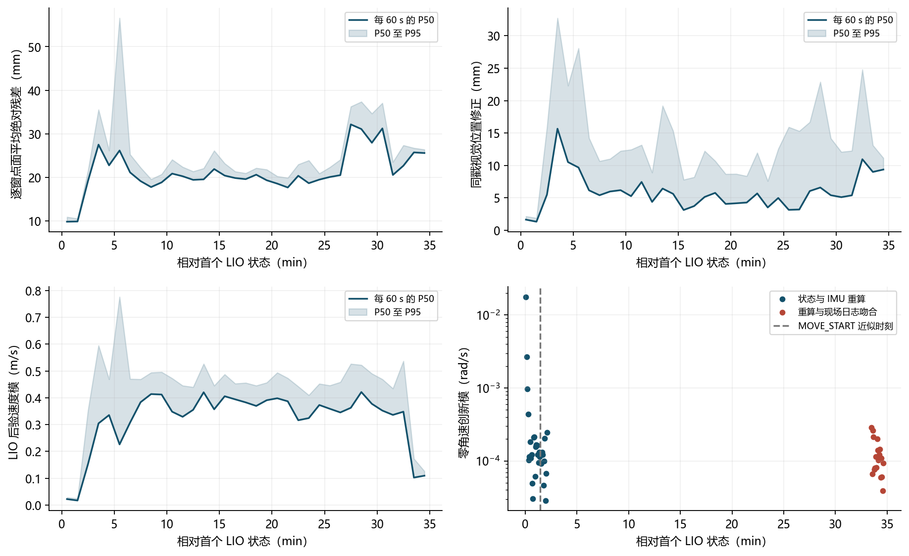

### 横滚、俯仰、偏航、速度与累计高度

以下采用实录固定变换 R_GC 把 LIO 的 IMU 位置、姿态和速度从 camera_init 旋至 map_gravity，验证初始化重力映射为 (0, 0, −9.81) m/s²。姿态为 IMU 在重力系中的姿态，按固定轴 x、y、z 分解横滚、俯仰、偏航。5–25 s 静止窗中位数为 −0.656°、+19.811°、−0.174°，包含传感器初始安装或握持倾角。偏航没有外部航向基准。全程 20,807 个 LIO 状态的横滚范围 −3.548° 至 +4.454°，俯仰 +15.554° 至 +23.483°。从首帧开始连续展开偏航，观测范围 −277.86° 至 +1,289.28°；末帧模 360° 的偏航为 −3.117°。速度模 P50/P95/最大为 0.357/0.476/1.344 m/s，重力系竖直速度 P5/P50/P95 为 −0.0838/−0.0113/+0.0561 m/s。

原始 camera_init 的 Z 极差 22.066 m，首末净差 −0.703 m。旋至 map_gravity 后，相对首点高度在 877.70 s 达到最高 +1.448 m，在 1,086.80 s 达到最低 −2.014 m，极差 3.461 m，首末净差 −0.407 m。将每步正、负高度变化分别累加，原生约 10 Hz 轨迹得到上行 34.607 m、下行 35.014 m，按 1 s 等间隔重采样后为上行 12.401 m、下行 12.807 m；后者覆盖 2,080 个整秒，净差 −0.406 m。两者的差异说明累积量对高频状态波动敏感，包括实际升降和估计波动，累计上行不能直接当成地面爬升。

在 2,080 个互不重叠的一秒窗中，1,789 个满足水平位移 ≥0.10 m。用窗中点的 IMU 姿态和状态速度对照该窗两端的重力系高差。运动窗每秒高差 P5/P50/P95 为 −22.56/+0.17/+22.20 mm；对应轨迹倾角 P5/P95 为 −3.52°/+3.47°。表给出同一组运动窗的线性与秩相关系数，序列有时间相关性。

| 配对变量 | Pearson r | Spearman ρ |
|---|---:|---:|
| 相对静止窗俯仰变化，与每秒有符号高差 | −0.358 | −0.863 |
| 相对静止窗横滚变化，与每秒有符号高差 | +0.036 | +0.065 |
| 偏航角速率绝对值，与每秒绝对高差 | +0.027 | −0.085 |
| 状态速度模，与每秒绝对高差 | +0.378 | +0.240 |
| 状态竖直速度，与每秒有符号高差 | +0.648 | +0.288 |

改变水平位移门限至 0.05 / 0.20 m 后，俯仰与有符号高差的秩相关为 −0.854 / −0.880。334–340 s 出现多个大幅起伏，334–335 s 下降 0.667 m，337–338 s 上升 0.671 m，明显影响线性相关。姿态、高度和速度均来自同一个估计器，路线方向、真实斜坡、持握运动和姿态估计偏差都可能同时改变这些数值，无法从相关系数确定漂移成因。[逐秒姿态、速度及累计高度](corridor-third-20261128/frontend/attitude_elevation_1s.csv)

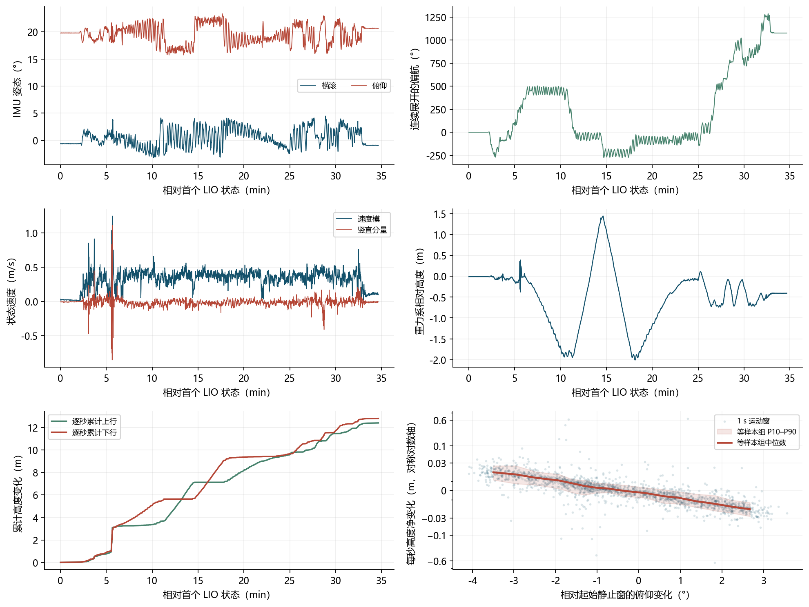

### 视觉点、后验不确定度与末段几何复核

**视觉使用了多少点。** 检索阶段先检查参考图像块和当前图像块的可采样性及光度门限，然后把通过的点加入当前视觉子图。used_points 是这个子图的点数。局部地图的 points 是维护后仍存活的 VisualPoint 数，features 是这些点的观测记录数。一次检索只用到局部地图的一部分，单个地图点可以有多次观测。visual_lru.csv 每约 1 s 记录一次，首尾 20 s 窗分别有 19 个样本。下表各单元格为 P50 / P95，分位数采用线性插值。[分布及源码指纹](corridor-third-20261128/frontend/visual_uncertainty.json)

| 视觉量 | 全程 1,973 个样本 | 起始 5–25 s | 结束 2,059–2,079 s |
|---|---:|---:|---:|
| 当前子图检索点数 | 227 / 270 | 269 / 274.2 | 261 / 266.1 |
| 维护后的局部地图点数 | 2,469 / 2,917 | 521 / 527.3 | 648 / 661.2 |
| 地图观测记录数 | 9,494 / 12,167.8 | 521 / 527.3 | 2,385 / 2,412.3 |
| 检索点数 / 同帧维护后的局部地图点数 | 9.07% / 49.46% | 52.20% / 54.43% | 40.27% / 41.12% |

全程抽样检索点数最小 0、最大 281、均值 224.0，仅首帧为 0。滚动控制台还保留帧号 12,700–20,800 上每百帧一次的 82 条检索计数，其中 9 条与缓存采样重合且逐项一致。两者合并能恢复 2,046 个不同帧的检索点数，占 20,807 帧的 9.83%。实际参与一次更新的点在每个金字塔层、每次迭代重新投影；落在相机后方、投影非有限或图像块越界的候选会被跳过。配置每块 8×8 像素，内部 n_meas 按成功构造的像素残差行累加。归档缺少逐迭代 n_meas 和点身份，无法给全程每帧实际贡献雅可比的独立点数、像素行数或独立点留存率。能够逐帧确认的是 20,806 个状态发生视觉更新、首帧标记为未更新，共接受 333,103 步。源码位置为 src/fast_livo/src/vio.cpp 第 799–838、847–868、1598–1605、1639、1649–1654、1688、1832–1834、1876–1878、1899–1924 行。

**六项后验方差。** 20,807 对同戳状态逐一匹配，含首帧 VIO_no_update。状态表写入协方差矩阵的前六项对角线。前三项是右乘小角度扰动在局部姿态切空间的分量，后三项是 camera_init 坐标系的位置误差分量。数据未保存完整交叉协方差，无法将三项位置对角线直接旋成 map_gravity 的竖向方差，也不能将三个小角方差直接解释为欧拉角方差。源码位置为 src/fast_livo/src/keyframe_export.cpp 第 207–214 行、include/common_lib.h 第 187–188 行与 src/vio.cpp 第 866–868 行。表中方差使用 rad² 或 m²，末列对每一对状态先做除法再取中位数。[所有分位数、方差、标准差及首末值](corridor-third-20261128/frontend/posterior_variance.csv)

| 分量 | LIO 方差 P50 / P95 | VIO 方差 P50 / P95 | 成对 VIO/LIO 方差比 P50 |
|---|---:|---:|---:|
| var_rx | 2.872e-07 / 6.088e-07 | 4.522e-08 / 1e-07 | 0.147 |
| var_ry | 1.806e-07 / 4.053e-07 | 2.51e-08 / 8.564e-08 | 0.155 |
| var_rz | 1.367e-07 / 2.913e-07 | 3.172e-08 / 5.947e-08 | 0.253 |
| var_x | 1.557e-06 / 2.41e-06 | 3.189e-07 / 8.07e-07 | 0.199 |
| var_y | 1.916e-06 / 3.291e-06 | 3.655e-07 / 9.28e-07 | 0.179 |
| var_z | 1.295e-06 / 1.95e-06 | 2.698e-07 / 6.229e-07 | 0.197 |

执行光度更新的 20,806 对状态在六个分量上均有 VIO 方差小于同戳 LIO 方差，首个无更新状态六项完全相同。以下将同两段静止窗口的对角方差逐样本开平方，旋转换算为度、位置换算为 mm；括号内始终依 x、y、z 顺序。

| 静止窗、后验 | 旋转 1σ P50 / P95（°） | 位置 1σ P50 / P95（mm） |
|---|---|---|
| 起始 LIO | (0.026, 0.025, 0.027) / (0.028, 0.025, 0.029) | (1.123, 1.147, 1.061) / (1.167, 1.196, 1.082) |
| 起始 VIO | (0.002, 0.002, 0.002) / (0.002, 0.002, 0.002) | (0.148, 0.113, 0.097) / (0.156, 0.121, 0.106) |
| 结束 LIO | (0.022, 0.020, 0.024) / (0.023, 0.020, 0.025) | (1.085, 1.050, 0.976) / (1.092, 1.060, 0.985) |
| 结束 VIO | (0.003, 0.002, 0.003) / (0.003, 0.003, 0.003) | (0.173, 0.131, 0.094) / (0.181, 0.136, 0.113) |

这些数值量化滤波器对当前状态的内部信心。首尾窗口三轴位置分量的单轴标准差通常只有毫米量级，前端累计相对位移同时可以达到米级；共享地图漂移、模型近似和系统误差未通过这些单帧对角量得到覆盖率验证。

**末段几何。** 将 LIO 位姿经实录 R_GC 旋至 map_gravity，首尾两个静止窗各取三轴中位数。末窗减首窗为 (−0.9430, +0.6432, −0.3983) m，水平间距 1.141 m。首/末窗内部高度极差仅 1.42/3.41 mm，标准差 0.28/0.58 mm。末段局部轨迹稳定与整段累计分离同时存在，实际放回位置仍需现场独立参考。全匹配点的点面 RMS 由首窗 18.01 增至末窗 39.17 mm。墙面候选为 17.26→46.02 mm，顶面候选为 10.79→22.49 mm，地面候选为 10.81→28.78 mm。首尾每窗点面匹配数中位数 2,076→2,093，说明末段残差增大时仍有数量接近的匹配。[末段按表面分类的实测统计](corridor-third-20261128/frontend/visual_uncertainty.json)

**第二轮核对。** 重读第二轮“严格分窗＋区间去畸变＋静止更新”的原始状态、姿态变换和资源日志，六个小文件逐个校验 SHA256。两轮都先用各自实录 R_GC 转到 map_gravity，取全部前端 LIO 状态，无加权最小二乘拟合 z=ax+by+c，再计算高度残差 RMS。第二轮 18,284 状态得到 Z 极差 2.627513 m、去平面 RMS 0.356563 m，与历史交付一致。第三轮 20,807 状态为 3.461304 m、0.530423 m，后者大 0.173860 m（48.8%）。去掉的是一张全局倾斜平面，真实坡度变化与累积漂移都会进入残差；两轮路线和采集条件不同。

| 同类资源与观测量 | 第二轮新前端离线 | 第三轮新前端现场 |
|---|---:|---:|
| 进程资源周期采样 RSS 峰值 | 850.16 MiB（787 个样本） | 1,059.24 MiB（会话资源表） |
| 视觉维护位置的 RSS 峰值 | 849.46 MiB | 1,059.50 MiB |
| 图像缓冲采样峰值 | 431.25 MiB | 563.75 MiB |
| 最后一次视觉采样仍保有的图像 | 343 | 450 |
| 抽样检索点数 P50 / P95 | 221 / 259 | 227 / 270 |

第二轮进程资源周期采样还给出峰值 PSS 838.70 MiB，离线脚本结束时另从子进程资源使用记录读取的峰值 RSS 为 849.76 MiB，历史报告将它四舍五入为 849.8 MiB。二者采集接口不同。第三轮缺少同期逐进程 PSS；第二轮离线运行时长 1,607.67 s 与第三轮的 2,080.80 s 传感器跨度也有不同含义。资源采集实现见 runtime/offline.py 第 77–99 行。

统计入口为[视觉与状态复算脚本](corridor-third-20261128/frontend/visual_uncertainty.py)，参数 raw 指第三轮前端诊断，second 指第二轮 front_static 归档，source 指算法树 src/fast_livo，out 指结果目录。

## 6　连续运行的时延、队列与资源

处理耗时按主机单调时钟约每秒抽取当前一次成功同步循环，共 2,013 个样本。从进入 IMU/状态估计到结束的 P50/P95/最大为 32.91/63.26/110.87 ms，含当次回调与同步的完整循环为 35.65/64.25/111.30 ms，均有 2 个采样超过 100 ms。一次循环可能是 LIO 或 VIO 半段，采样不能覆盖所有慢帧。抽样雷达队列 P50/最大为 2/3，图像为 2/2，IMU 为 41/51。停机最终图像队列 0、雷达 7、IMU 153。末尾继续到达的雷达/IMU 与图像停止时刻不同，最终计数与同步中的抽样峰值各有口径。[时延与队列分窗](corridor-third-20261128/frontend/processing_60s.csv)

系统共采样 1,041 次，前端进程 RSS 中位数 799.8 MiB、P95 929.2 MiB、峰值 1,059.2 MiB，独立视觉维护点读到最高 1,059.5 MiB。启动后 600–1,200 s 的 RSS 拟合斜率 +0.29 MiB/min，1,200–1,800 s 为 +0.99，1,800–2,105 s 为 **+35.27 MiB/min**（843.1→1,054.4 MiB）。在线后端、相机、驱动、归档各自峰值为 182.8、189.1、131.2、230.3 MiB；峰值时刻可能不同。系统可用内存最低 12.85 GiB，数据盘可用空间 119.49→33.43 GiB，减少 86.06 GiB。RSS 含共享页。会话自身没有逐秒 PSS、CPU 占用、温度或 I/O 等待序列。[系统资源采样](corridor-third-20261128/frontend/resources_samples.csv) · [按分钟的资源](corridor-third-20261128/frontend/resources_60s.csv)

板端另保存了当日 sysstat 的 sa28。共读出 5 组八核整机及每核记录，去掉跨越启动或停机的首末区间，三段完整落在采集期间的约十分钟平均如下。这里列“100 − idle”，其中包含 I/O 等待。按八核平均百分比折算约 3.0–3.1 个非空闲核；单个核在这三段内的最高非空闲均值为 50.96%。窗口平均可掩盖瞬时满核，且包含录包、前端、后端及系统任务。[全机与每核历史数据](corridor-third-20261128/frontend/historical_cpu.csv) · [温度和其他历史档案查核](corridor-third-20261128/frontend/historical_cpu_source.json)

| 采样结束时间（UTC+8） | 区间 s | 八核 100 − idle | 用户态（不含 nice） | nice 用户态 | 内核态 | I/O 等待 |
|---|---:|---:|---:|---:|---:|---:|
| 15:40:17 | 615 | 37.78% | 11.03% | 17.80% | 7.62% | 0.14% |
| 15:50:17 | 600 | 38.45% | 11.66% | 17.82% | 7.68% | 0.14% |
| 16:00:17 | 600 | 38.85% | 11.82% | 18.07% | 7.70% | 0.12% |

sar 对 sa28 的温度查询明确返回“所请求活动在文件中不可用”。板上查核的 atop、collectl、PCP 和 Armbian 硬件监测历史位置均未留下相应文件。由此无法给出采集期间的实测温度或判定热降频。

视觉缓存有 1,973 次采样。最后一次在第 20,806 帧，仍保有 450 张图像、562.5 MiB 像素缓冲，其中受保护图像 412.5 MiB，全程采样最大值分别为 563.75 和 435.0 MiB。末次累计创建 19,487 张、释放 19,037 张，最后引用释放也为 19,037 次、总计 23.24 GiB；同一次仅保留 450 张，与计数相符。压力淘汰点、外部引用脱离事件均为 0，维护耗时 P50/P95/最大为 2.51/5.35/31.48 ms。末段资源增加与保留图像数变化同时出现，现有 RSS 和缓存统计足以描述本轮趋势，尚不能给出任意时长的内存上界。[缓存分窗](corridor-third-20261128/frontend/visual_cache_60s.csv)

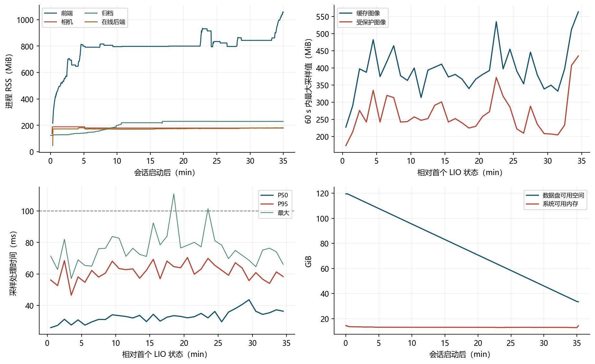

### 与第二轮新前端相比

第二轮使用同一“区间去畸变＋静止更新”算法整袋离线运行，第三轮是在现场并行运行传感器、录包、融合与在线后端。表中的静止段分别用每轮自身的首末 20 s 窗，第二轮首/末窗为 20–40 / 1,780–1,800 s。两轮覆盖不同路线、时长、观测条件和资源采样方式。

| 指标 | 第二轮新前端整袋离线 | 第三轮新前端现场实时 |
|---|---:|---:|
| 雷达 / IMU / 图像回调 | 18,355 / 366,943 / 18,288 | 20,818 / 416,367 / 20,812 |
| LIO 状态 / 执行视觉更新帧 | 18,284 / 18,283 | 20,807 / 20,806 |
| 接受视觉步 / 每更新帧 | 294,033 / 16.08 | 333,103 / 16.01 |
| 静止更新 | 33 条记录，起段 14、末段 19 | 49 个重算窗，起段 31、末段 18，末段均有日志 |
| 首 / 末陀螺残差模，rad/s | 0.000356 / 0.0000556 | 0.000729 / 0.0000435 |
| 首 / 末比力残差模，m/s² | 0.0543 / 0.0573 | 0.0832 / 0.1287 |
| 首 / 末校正比力与固定竖直夹角 | 0.371° / 1.272° | 0.493° / 1.473° |
| 前端峰值 RSS，MiB | 849.8（离线进程） | 1,059.2（会话采样） |

两轮的末段陀螺误差都在 10⁻⁵ rad/s 量级。第三轮末窗的比力残差是第二轮的 2.25 倍。第二轮自身保持同一 Bag 的消融结果提供了更直接的算法对照。仅区间去畸变 → 增加静止更新后，首窗 z 轴陀螺残差从 −0.012821 降至 −0.000345 rad/s，末窗从 −0.000290 降至 −0.00000355 rad/s，同戳轨迹去平面 RMS 从 0.3957 降至 0.3566 m。第三轮没有对相同原始数据关闭静止更新再运行，单凭跨轮差值无法归因于算法版本。[机器可读两轮对照](corridor-third-20261128/frontend/metrics.json)

现场诊断与 Bag 字段的提取、依赖、运行参数及统计复现入口见[复现说明](corridor-third-20261128/frontend/reproduce.md)。

## 7　在线回环、实时发布与历史重建

第三轮两种离线解都显著缩小了起终点分离。以首尾各 20 秒静止窗的稠密位置中位数计算，A 原前端为 **1.20894 m**，B 离线纯 PGO 为 **0.00540 m**，C 离线 PGO 加结构约束为 **0.02032 m**。路线中段的改善有明显位置差异。H4、H5 的两次观测对齐改善最清楚，H2 在三个解下的源侧覆盖始终只有约 38%。H3 地面是五处中唯一同时满足三组实测足迹条件的地面，C 将 B 在同一 XY 处的垂直高差从 +38.62 mm 拉回至 −9.33 mm。第三轮没有独立测量的六自由度轨迹真值，这些数值衡量同次重访的一致性。

### 在线实际发布与终图

在线侧车为 1,287 个关键帧各发布一条 `map → odom`，逐条校验了发布 ID 和纳秒时间戳。首次修订使用源帧 72，等到帧 74 到齐，在首帧后 229.40 s 生效。末次修订在帧 1281、2051.50 s 生效。65 次有候选的查询共评价 89 对，33 次修订分别增加一条边，直至 33 条。首轮含邻帧噪声估计，耗时 2.408 s；全程查询中位 0.348 s、P95 0.686 s、最长 2.408 s，累计 25.777 s。侧车从启动到读尽数据为 2087.26 s，进程峰值 RSS 185.18 MiB，停采后的终图重建另耗 4.12 s。查询耗时来自算法内单调时钟，发布档记录的是测量戳，无法从两者求出订阅端接收延迟。[逐次查询](corridor-third-20261128/loops/online_queries.csv) · [逐次修订](corridor-third-20261128/loops/online_revisions.csv)

按源帧 ID 0–150、151–500、501–821、822–1200、1201–1286 分段，在线接受边分别为 **7、0、13、7、6** 条，离线 B 为 **4、0、10、5、5** 条。在线接受边的两访时间间隔为 75.6–1980.3 s，中位 341.0 s。末 120 s 内，原前端平面位置均位于起始静止中心 3 m 内的在线边为 27/1256、12/1267、12/1273、12/1279。首次在终段识别该邻域的源帧是 1256，至帧 1258、1968.70 s 发布修订。离线边为 12/1267、12/1276、12/1285。离线计划的胶带窗为空，两边都由几何搜索得出。3 m 是本报告对“P0 附近”的回顾性筛选半径，不能凭这一半径把两个传感器中心视为同一物理坐标。[逐边时间与坐标](corridor-third-20261128/loops/edge_diagnostics.csv)

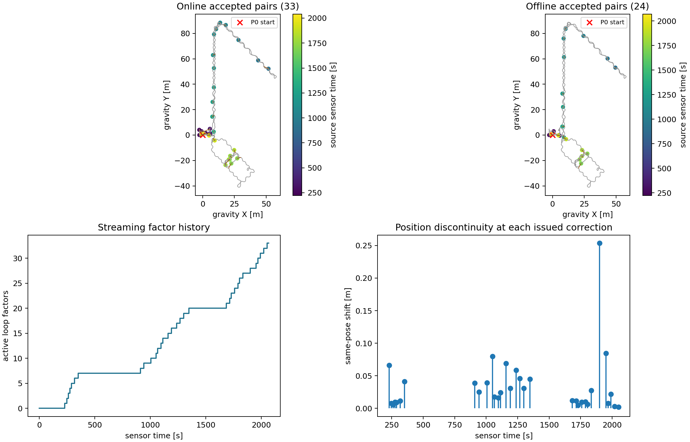

实际发布历史用每一帧当时的校正变换，稠密时刻使用最近一次已发布关键帧的校正。在线终图在 EOF 以后用 33 条最终边重算整个历史，稠密时刻按历史校正平移线性插值、旋转 SLERP，端点采用最近校正。两段历史在 20,807 个相同稠密位姿上的位置差中位 **0.0965 m**、P95 **0.4564 m**、最大 **0.5861 m**，最大值出现在 869.60 s。接收端自行插值、渲染或延迟后的画面没有逐帧记录，本表重建的是侧车发出的校正历史。

相对首次重力变换，发布历史使同一车体位姿相对原前端的位置改变量中位 1.382 m，最大 2.777 m（帧 925），末帧为 1.204 m。第 28 次修订在帧 1206、1901.20 s 接受边 812/1204，对同一车体位姿带来全程最大单次位置跳变 **0.254 m** 和旋转跳变 **1.076°**。单看 TF 平移列，其最大单步变化为 0.678 m（帧 596），该步在实际车体位置仅产生 0.080 m 的改变量。旋转中心与车体位置的距离会使两种平移量不同。[修订跳变量](corridor-third-20261128/loops/online_revisions.csv)

| 轨迹 | 首末关键帧 3D 距离 m | 稠密静止窗末减首 ΔX / ΔY / ΔZ m | 静止窗平面 / 3D 距离 m | 稠密全程 Z 极差 m |
|---|---:|---|---:|---:|
| A 原前端 | 1.21131 | −0.94296 / +0.64322 / −0.39827 | 1.14145 / 1.20894 | 3.461 |
| 在线实际发布 | 0.01410 | −0.00208 / +0.00362 / −0.00432 | 0.00417 / 0.00600 | 4.498 |
| 在线终图 | 0.01410 | −0.00230 / +0.00167 / −0.00233 | 0.00284 / 0.00368 | 4.406 |
| B 离线纯 PGO | 0.01302 | −0.00289 / −0.00320 / +0.00325 | 0.00431 / 0.00540 | 3.714 |
| C 离线 PGO 加结构约束 | 0.03356 | −0.00658 / +0.01911 / −0.00209 | 0.02021 / 0.02032 | 1.012 |

静止窗沿用现场离线文件，以首个状态测量戳为零，分别为 [5,25] s 与 [2059,2079] s，各含 201、200 个稠密 LIO 位姿，按三个坐标分别取中位数。最后关键帧在 2076.80 s，最后一条稠密位姿在 2080.80 s。首尾关键帧距离与静止窗中位距离有不同的采样口径。C 的起始窗自身点到中位位置的 P95 半径为 11.47 mm，末窗为 2.62 mm，B 对应为 0.91、2.31 mm。[窗口中位坐标、样本数与半径](corridor-third-20261128/loops/metrics.json)

## 8　全程自动回环、候选筛选及协方差

B 从全程里程计提出 199 对候选，在拟合前冻结五个验证区，按时间分层选取 45 个源时刻、58 对待检边，接受 **24/58（41.4%）**。在线按逐时到达的数据触发 65 次有候选查询，接受 **33/89（37.1%）**。两者有 13 对完全相同的待检帧，最终精确共有 12/72、876/1062、12/1267 三对。相邻关键帧可能观察同一地点，因此精确帧对交集不能解释为地点识别召回率。C 继承 B 的 24 个回环因子，再加入平面和方向约束。B 的配准阶段 10.57 s、重建 2.05 s、总耗时 22.21 s、进程峰值 RSS 148.41 MiB。[逐候选完整指标与坐标](corridor-third-20261128/loops/edge_diagnostics.csv)

| 候选拒因，允许一对边出现多项 | 在线 | 离线 B |
|---|---:|---:|
| 与已接受时段或源观测重叠 | 33 | 16 |
| 最弱平移方向观测不足 | 10 | 8 |
| 双向覆盖不足 | 8 | 5 |
| 不相交邻组复核不一致 | 6 | 3 |
| 两个历史位置的几何解释竞争 | 4 | 4 |
| 主配准未收敛 | 1 | 2 |
| 内点残差过大 | 1 | 1 |

主组用中心及 ±2 帧，独立复核组用 ±1 帧。项目筛选要求双方在 0.32 m 内的覆盖均至少 38%，内点 RMS 至多 0.19 m，平移法向矩阵最小特征值至少 0.035，尺度归一化六维最小特征值至少 0.0015。邻组须收敛、至少 60 个内点，测量差至多 0.30 m 和 5°。相似走廊沿轴几何观测薄弱，双向覆盖和邻组一致性能排除一部分错误匹配。缺少带地点真值的正负样本，本轮通过率不足以给出误识率。

| 接受边指标 | 在线中位 [最小, 最大] | 离线 B 中位 [最小, 最大] |
|---|---:|---:|
| 源覆盖 | 0.762 [0.525, 0.954] | 0.737 [0.575, 0.954] |
| 目标覆盖 | 0.725 [0.460, 0.984] | 0.727 [0.434, 0.985] |
| GICP 内点最近邻 RMS，m | 0.1255 [0.0944, 0.1590] | 0.1231 [0.0970, 0.1664] |
| 主组与邻组平移差，m | 0.0135 [0.0016, 0.1367] | 0.0119 [0.0014, 0.2148] |
| 主组与邻组旋转差，° | 0.188 [0.042, 2.747] | 0.193 [0.045, 0.689] |
| 平移法向矩阵最小特征值 | 0.217 [0.0354, 0.2950] | 0.209 [0.0353, 0.2880] |
| 图优化后因子位置残差，m | 0.0044 [0.0007, 0.0273] | 0.0038 [0.0002, 0.0272] |
| 图优化后因子旋转残差，° | 0.071 [0.005, 1.494] | 0.060 [0.010, 0.179] |
| 六维白化残差范数 | 0.117 [0.019, 0.884] | 0.097 [0.021, 0.200] |

每条边保留了源坐标系右扰动的 6×6 完整协方差。算法取本次相邻帧重复性、主组/邻组测量差和配准残差给出的尺度下限，再沿几何最弱方向放大方差。在线只用首次查询前可得数据估计基础尺度，48 组全部采用。B 在完整历史抽取 48 组，采用 46 组。在线接受边按 `rx,ry,rz,tx,ty,tz` 顺序的边缘标准差中位数为 [0.01286, 0.01186, 0.01125] rad 和 [0.06015, 0.05391, 0.05343] m；B 为 [0.01250, 0.01276, 0.01081] rad 和 [0.05576, 0.05237, 0.05278] m。以最弱平移轴绝对最大坐标分量计，在线 X/Y/Z 为 17/16/0 条，B 为 8/15/1 条。每条边最大方向方差膨胀系数的中位值分别为 4.47、3.91。逐边六维白化残差均低于 Huber 转折 1.8，终态 Huber 权重全为 1。小的图内残差反映已纳入因子的拟合情况，协方差来自同次相对观测。[协方差、弱轴、邻组残差和终态权重](corridor-third-20261128/loops/edge_diagnostics.csv)

B 的归档权重敏感性试验固定这 24 条边，将回环标准差乘 0.5 或 2。相对名义解，位置改变量的中位数分别为 0.037 和 0.083 m，最大值分别为 0.098 和 0.208 m。三组首末关键帧距离都约 0.013 m，显示首尾距离对中段轨迹偏差不够敏感。[权重敏感性及各区数值](corridor-third-20261128/loops/metrics.json)

首尾朝向另用两静止窗内的稠密 IMU 姿态做四元数弦距均值。在固定地图轴上取末窗均值乘起窗均值的逆，其旋转角 A/B/C 为 2.951°、0.621°、0.694°。与首尾平移一样，这些是两个实录姿态集合的分离量。现场没有独立复位夹具或测量记录来确认本轮回到了完全相同的物理位姿。[静止窗相对姿态](corridor-third-20261128/maps/static_orientation.json)

## 9　全局地面高度、倾斜与去平面残差

在本轮仅回环图 B 上选定 55,833 个地面候选点，并跟踪相同原生激光记录，1,248 个有效格的去平面 RMS 从 B 的 **424.82 mm 降至 C 的 137.27 mm，下降 67.7%**。第二轮相同类型的比较是 975 格、363.12→122.58 mm，下降 66.2%。第三轮复现了接近的相对降幅，最终 RMS 比第二轮高 14.69 mm。两轮的路线覆盖、关键帧和可识别格不同，不能按同一批物理位置逐格相减。

**点与格的对应。** A、B、C 分别为前端、仅回环、结构与惯性联合优化的地图，各有 6,962,792 条原生 XYZI 记录。两种后端调用同一个按关键帧、帧内点序写图的重建函数。两份优化前原生 PCD 的 SHA256 相等，三份比较图形状相同、全量强度列逐项相等。先对各几何图使用 CloudCompare 2.13.2 的 5 cm 空间抽稀，得到 A/B/C 各 1,646,124 / 1,381,168 / 1,379,321 个点。沿用第二轮识别参数，在抽稀点序列每三点取一个候选，距本阶段最近轨迹 XY 小于 2.5 m、相对轨迹 Z 介于 −1.3 与 −0.2 m。20 邻点最远距离小于 0.5 m、局部最小特征值占比小于 4%、局部法向与竖直轴的锐角小于 15°。A/B/C 各有 46,649 / 55,833 / 58,572 个地面候选。

A 或 B 冻结时，先把该阶段候选点查回全分辨率 PCD 的精确行号，再从三份原生图的同一行取 XYZ。两组最大回查距离均为 0，因对应歧义排除 0 点。按冻结阶段 XY 的向下取整索引分 1 m 格，每格至少 4 点。A 冻结的 1,100 格实际纳入 46,396 点，B 冻结的 1,248 格纳入 55,709 点。独立重选时，各图用自己的轨迹与坐标重新识别水平点及格网，A/B/C 各有 1,100 / 1,248 / 1,239 个合格格，三图在同一整数 XY 索引上共同支持 862 格。独立交集匹配空间位置，可包括不同原生点。

每格取 X、Y、Z 各自中位数，各格等权，在每个阶段用自己的坐标最小二乘拟合 z=ax+by+c，倾角为 arctan(√(a²+b²))。残差为格中位 Z 减拟合 Z 的垂直差。P95 为绝对垂直残差的 95 分位。高度极差及空间分位跨度均在格中位 Z 上求得。

| 比较区域 | 阶段 | 格数 | 高度极差 m | 高度 P95−P05 m | 平面倾角 ° | 去平面 RMS mm | 绝对残差 P95 mm |
|---|---|---|---|---|---|---|---|
| 冻结 A 同点 | A | 1,100 | 3.607 | 2.663 | 1.612 | 524.83 | 953.20 |
| 冻结 A 同点 | B | 1,100 | 3.892 | 3.047 | 1.924 | 446.03 | 808.24 |
| 冻结 A 同点 | C | 1,100 | 0.889 | 0.727 | 0.543 | 142.88 | 244.40 |
| 冻结 B 同点 | A | 1,248 | 3.592 | 2.525 | 1.551 | 524.70 | 954.73 |
| 冻结 B 同点 | B | 1,248 | 3.861 | 2.963 | 1.998 | 424.82 | 794.51 |
| 冻结 B 同点 | C | 1,248 | 0.872 | 0.721 | 0.575 | 137.27 | 247.86 |
| 独立重选交集 | A | 862 | 3.551 | 2.682 | 1.658 | 532.99 | 957.75 |
| 独立重选交集 | B | 862 | 3.835 | 3.034 | 2.070 | 431.15 | 791.64 |
| 独立重选交集 | C | 862 | 0.877 | 0.731 | 0.589 | 137.65 | 240.70 |

B 冻结格的去平面有符号残差全极差 A/B/C 为 2.320 / 2.000 / 0.579 m。对应地面格中位高度为 −1.022 / −0.599 / −0.600 m；B→C 的中位基本相同，变化主要发生在分布的两端。三图独立重选共同格的残差全极差为 2.202 / 1.891 / 0.559 m。[各分母高度分布及有符号残差极值](corridor-third-20261128/floor_distribution.csv)

**大尺度起伏与格内厚度。** 前四项同行数字均按 A / B / C 排列。空间 P90−P10 描述格与格之间的起伏，格内宽度先在同格各点的 Z 上取 P90−P10，再在全部格上统计其典型值和上尾。

| 比较区域 | 空间高度 P90−P10 m | 空间残差 P90−P10 m | 格内宽度中位 mm | 格内宽度 P95 mm | 残差相关系数 AB / AC / BC |
|---|---|---|---|---|---|
| 冻结 A 同点 | 1.808 / 2.632 / 0.560 | 1.361 / 1.192 / 0.383 | 40.2 / 34.8 / 22.0 | 270.9 / 61.6 / 43.2 | 0.980 / 0.973 / 0.987 |
| 冻结 B 同点 | 1.697 / 2.574 / 0.525 | 1.405 / 1.120 / 0.352 | 47.2 / 35.1 / 21.8 | 271.6 / 58.5 / 40.9 | 0.984 / 0.971 / 0.985 |
| 独立重选交集 | 1.970 / 2.663 / 0.607 | 1.354 / 1.136 / 0.350 | 42.8 / 38.5 / 22.6 | 413.3 / 58.9 / 42.4 | 0.976 / 0.964 / 0.987 |

仅回环阶段把 A 冻结格的局部厚度 P95 从 270.9 降到 61.6 mm，同时最优平面倾角由 1.612° 增至 1.924°、高度极差由 3.607 增至 3.892 m。联合优化后，极差收至 0.889 m，绝对残差 P95 由 808.24 降至 244.40 mm。A 冻结格中，B 的最大正残差在格 (56,43)、最大负残差在 (42,−30)，分别为 +1.012 和 −0.957 m。C 的两端分别在 (51,48) 和 (39,−26)，为 +0.261 和 −0.301 m。B、C 残差仍有很强的空间相关，说明起伏幅值收缩，较高与较低的区域仍大体位于相同支路。跨格 Z 相关系数也保存在 JSON 中。

三图独立重选时，全局 RMS 的 B→C 降幅为 68.1%。第二轮独立重选的 959 个共同格是 363.75→122.79 mm。下图用相同 A 固定格位置及跨阶段统一色标呈现形状。地图中的坡度和高度都相对于本次 map_gravity 坐标系，现场绝对标高和实际建筑坡度仍缺少独立测量。

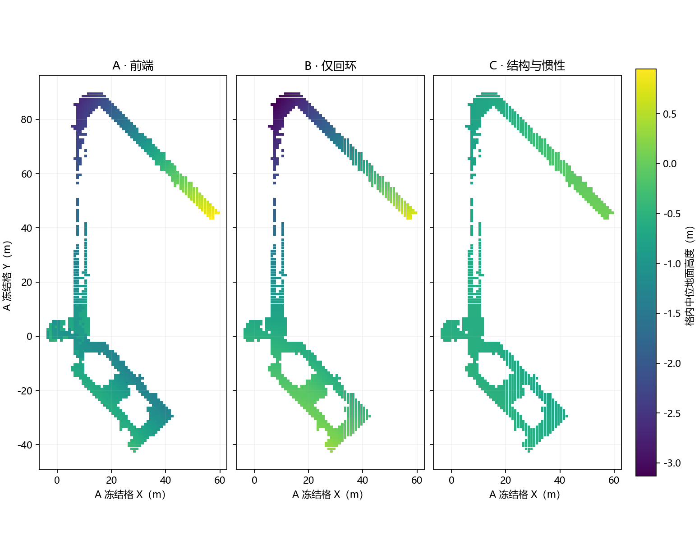

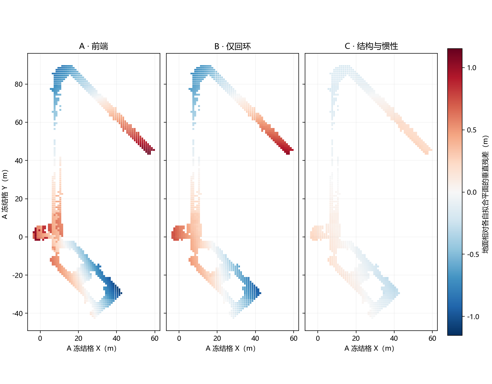

### 长直走廊、转角与相对净高

**按第三轮轨迹定区。** 先按 A 图关键帧时间顺序及 XY 轨迹选出连续直行区间，以二维正交回归拟合各段中轴，投影端帧限定两端。此步骤只读 XY。主干从下往上，上斜廊从北侧转角向东南行进。下部还有西、南、东三边、中央横廊与北侧返程廊。表中坐标、图中方位都是地图坐标。各转角另沿本轮实际经过的路径取折线。

| 走廊 | 拟合用 A 关键帧，含端帧 | 冻结中轴起点 → 终点 (X,Y) m | 长度 m |
|---|---|---|---|
| 主干走廊 | 163–325、644–833 | (8.2, -11.7) → (9.3, 82.8) | 94.5 |
| 上部斜廊 | 382–478、500–600 | (16.4, 87.1) → (55.0, 47.8) | 55.2 |
| 下部西斜廊 | 847–909 | (11.7, -17.0) → (29.8, -36.6) | 26.6 |
| 下部南侧连接廊 | 938–971 | (31.9, -37.1) → (39.6, -28.6) | 11.4 |
| 下部东斜廊 | 1004–1035 | (36.9, -25.2) → (26.8, -15.0) | 14.4 |
| 下部中央横廊 | 1056–1071、1130–1147 | (19.0, -24.6) → (26.1, -14.9) | 12.0 |
| 下部北侧返程廊 | 1154–1181 | (24.4, -12.4) → (17.3, -3.9) | 11.1 |

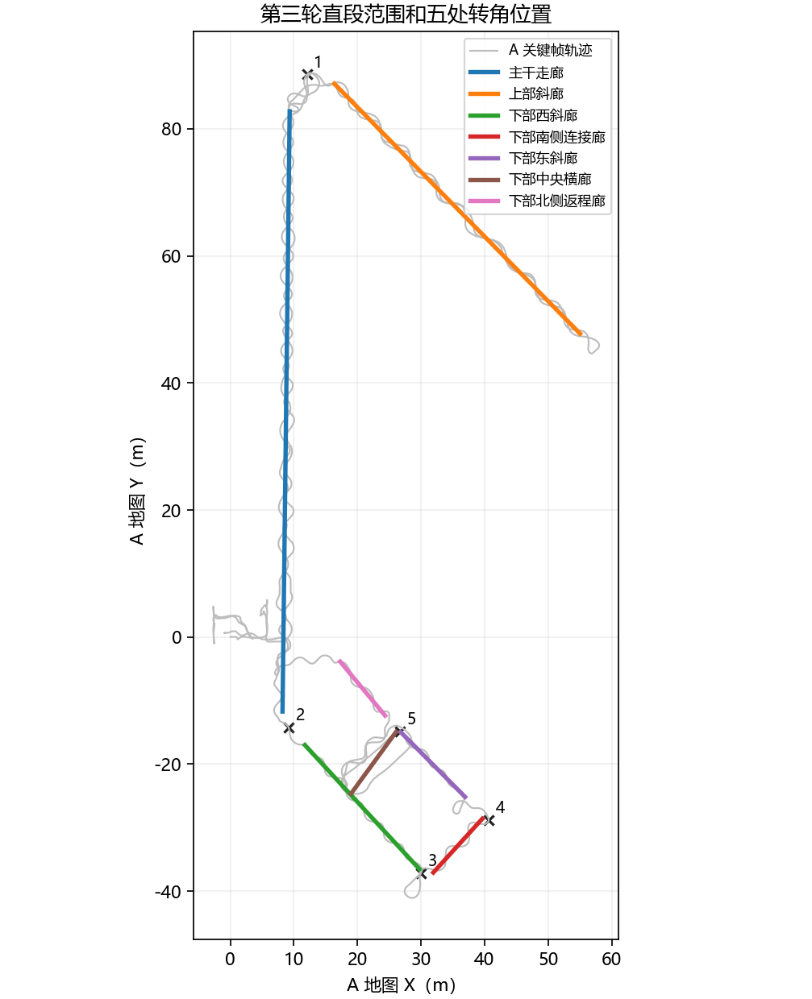

**沿程剖面。** 沿用历史剖面参数，在距 A 轨迹 3 m 内用 8 邻点识别水平面，地面高度窗仍为 −1.3 至 −0.2 m，顶面为 +1.6 至 +4.4 m，邻域距离、法向与特征值门限同 D.1。50,193 个地面和 45,542 个顶面候选均可零距离查回原生点，歧义排除 0 点。冻结中轴两侧各 1.8 m，按 A 中轴投影里程分 1 m 断面，每断面至少 8 点，三阶段追踪同一批原生点。坡度按断面中位高度拟合直线。高差取末个有效断面减首个有效断面。RMS 为去除该段直线后的垂直残差。方向取上表箭头。各列依次为 A / B / C。

| 走廊 | 表面 | 有效断面 | 全段坡度 ° | 末端减起端 m | 去线 RMS mm |
|---|---|---|---|---|---|
| 主干走廊 | 地面 | 73 | -1.070 / -1.625 / -0.142 | -1.811 / -2.633 / -0.199 | 120.6 / 50.7 / 12.5 |
| 主干走廊 | 顶面 | 84 | -1.148 / -1.656 / -0.193 | -1.723 / -2.580 / -0.183 | 186.5 / 179.2 / 175.9 |
| 上部斜廊 | 地面 | 56 | +3.005 / +3.287 / +0.787 | +2.862 / +3.141 / +0.696 | 14.4 / 14.6 / 25.5 |
| 上部斜廊 | 顶面 | 56 | +2.961 / +3.239 / +0.736 | +2.878 / +3.146 / +0.697 | 51.9 / 51.4 / 55.9 |
| 下部西斜廊 | 地面 | 27 | +0.030 / +0.567 / -0.099 | -0.001 / +0.256 / -0.038 | 5.4 / 11.8 / 7.4 |
| 下部西斜廊 | 顶面 | 27 | +0.022 / +0.577 / -0.083 | +0.001 / +0.254 / -0.033 | 8.1 / 12.4 / 9.5 |
| 下部南侧连接廊 | 地面 | 12 | -2.622 / -2.206 / -0.462 | -0.497 / -0.417 / -0.088 | 5.0 / 5.2 / 4.3 |
| 下部南侧连接廊 | 顶面 | 12 | -2.597 / -2.188 / -0.398 | -0.475 / -0.393 / -0.060 | 7.2 / 7.7 / 7.4 |
| 下部东斜廊 | 地面 | 15 | +0.012 / -0.268 / +0.222 | +0.009 / -0.062 / +0.044 | 13.2 / 13.1 / 10.0 |
| 下部东斜廊 | 顶面 | 15 | +0.125 / -0.194 / +0.252 | +0.011 / -0.075 / +0.024 | 18.2 / 17.2 / 13.2 |
| 下部中央横廊 | 地面 | 12 | -2.670 / -2.054 / -0.473 | -0.509 / -0.392 / -0.099 | 14.6 / 15.4 / 3.2 |
| 下部中央横廊 | 顶面 | 10 | -2.788 / -2.108 / -0.477 | -0.524 / -0.398 / -0.095 | 22.3 / 18.6 / 8.0 |
| 下部北侧返程廊 | 地面 | 11 | -0.099 / -0.405 / +0.121 | -0.023 / -0.076 / +0.022 | 5.6 / 5.1 / 5.5 |
| 下部北侧返程廊 | 顶面 | 12 | -0.025 / -0.343 / +0.146 | -0.006 / -0.057 / +0.028 | 9.7 / 7.7 / 4.9 |

主干地面高差从 B 的 −2.633 m 收到 C 的 −0.199 m，去线 RMS 从 50.7 降到 12.5 mm。上斜廊的地面高差从 +3.141 收到 +0.696 m，但去线 RMS 从 14.6 升至 25.5 mm，剩余起伏主要由沿程坡度变化反映。C 的主干顶面同点去线 RMS 仍有 175.9 mm。20 m 断面的候选顶面高度比附近断面低约 0.9 m，部分远端断面也测到偏低的水平面。当前分割能选中梁底、设备底面等水平构件，具体物体无独立标注。图中保留所有合格断面，缺测处断线。

**独立重选断面复核。** 三图分别按相同关键帧序号在自身坐标拟合中轴、重新抽取地面与顶面，以各自里程占段长的比例映射到 A 的 1 m 断面，取三者交集，分别用各自真实米制里程拟合。主干地面的独立可用断面 A/B/C 是 73/95/95 个，在共同 73 个上 B/C 坡度为 −1.602° / −0.134°、RMS 41.1 / 11.6 mm。独立顶面为 84/95/95 个，共同 84 个上 B/C 的 RMS 是 119.9 / 111.1 mm。上斜廊 56 个共同地面断面的去线 RMS 仍由 14.4 增至 25.8 mm。主干顶面 RMS 的数值对选点较敏感，上斜廊地面局部起伏增加在两种口径下都出现。

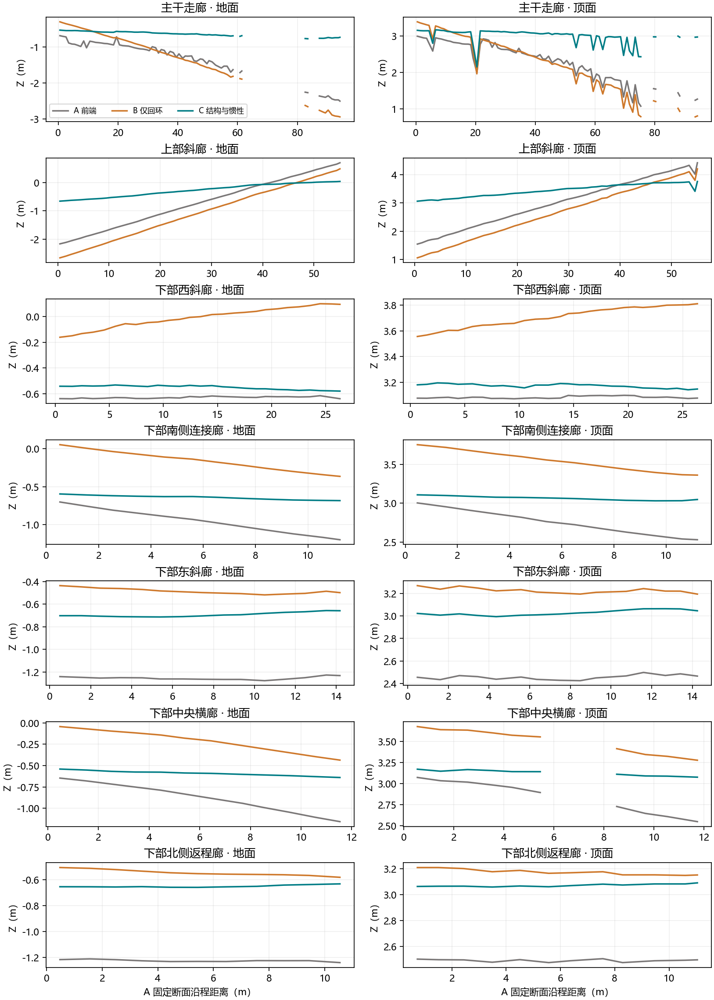

**同一长廊内部的坡度变化。** 下面把冻结中轴等分为前三分之一、中三分之一和末三分之一，数字按行进顺序排列，单位为度。每段至少需要 3 个有效断面。主干地面末段仅有 12 个有效断面，较短走廊每小段多为 3–5 个，局部拟合对所处位置和水平构件敏感。中央横廊顶面中段有效断面不足。

| 走廊 | 表面 | A 前 / 中 / 后 ° | B 前 / 中 / 后 ° | C 前 / 中 / 后 ° |
|---|---|---|---|---|
| 主干走廊 | 地面 | -0.47 / -1.25 / -1.24 | -1.37 / -1.60 / -1.71 | -0.11 / -0.17 / +0.00 |
| 主干走廊 | 顶面 | -0.56 / -1.47 / -0.98 | -1.37 / -1.95 / -1.46 | -0.11 / -0.49 / +0.22 |
| 上部斜廊 | 地面 | +3.05 / +3.01 / +2.85 | +3.34 / +3.28 / +3.12 | +0.80 / +0.87 / +0.42 |
| 上部斜廊 | 顶面 | +3.13 / +2.99 / +2.61 | +3.41 / +3.26 / +2.90 | +0.84 / +0.86 / +0.20 |
| 下部西斜廊 | 地面 | +0.02 / +0.07 / -0.04 | +0.87 / +0.54 / +0.43 | +0.01 / -0.13 / -0.14 |
| 下部西斜廊 | 顶面 | -0.00 / +0.20 / -0.17 | +0.75 / +0.74 / +0.28 | -0.10 / +0.13 / -0.19 |
| 下部南侧连接廊 | 地面 | -2.85 / -2.61 / -2.56 | -2.43 / -2.09 / -2.15 | -0.58 / -0.44 / -0.38 |
| 下部南侧连接廊 | 顶面 | -2.70 / -2.65 / -2.12 | -2.28 / -2.26 / -1.62 | -0.59 / -0.49 / +0.16 |
| 下部东斜廊 | 地面 | -0.14 / -0.07 / +0.79 | -0.48 / -0.35 / +0.41 | -0.17 / +0.31 / +0.39 |
| 下部东斜廊 | 顶面 | -0.05 / -0.17 / -0.11 | -0.49 / -0.40 / -0.46 | -0.36 / +0.42 / -0.09 |
| 下部中央横廊 | 地面 | -2.03 / -2.72 / -3.16 | -1.43 / -2.16 / -2.51 | -0.69 / -0.44 / -0.58 |
| 下部中央横廊 | 顶面 | -1.61 / 缺测 / -3.13 | -1.29 / 缺测 / -2.36 | -0.16 / 缺测 / -0.58 |
| 下部北侧返程廊 | 地面 | -0.19 / +0.01 / -0.27 | -0.54 / -0.31 / -0.42 | +0.00 / +0.10 / +0.36 |
| 下部北侧返程廊 | 顶面 | -0.47 / -0.33 / +0.02 | -0.67 / -0.60 / -0.33 | -0.09 / +0.05 / +0.17 |

**三维法向和净高。** 在相同原生点上建立 1 m 纵向 × 0.5 m 横向小格，至少 3 点。用每格 XYZ 中位数作 soft-L1 稳健平面拟合，尺度 0.03 m，法向统一朝上。下表给出相对主干地面的三维法向夹角、同走廊地顶夹角，以及在地顶均有支持的同一纵向断面上用顶面中位 Z 减地面中位 Z 得到的相对净高。净高按地图竖直方向计算，不同表面可能覆盖同一断面内不同横向位置。各列为 A / B / C。

| 走廊 | 地顶配对断面 | 地面相对主干 ° | 段内地顶法向夹角 ° | 净高中位 m | 净高 P95−P05 mm |
|---|---|---|---|---|---|
| 主干走廊 | 67 | 0.00 / 0.00 / 0.00 | 0.19 / 0.31 / 0.31 | 3.716 / 3.716 / 3.718 | 356.3 / 301.6 / 277.6 |
| 上部斜廊 | 56 | 1.57 / 1.71 / 0.59 | 0.13 / 0.16 / 0.25 | 3.717 / 3.716 / 3.714 | 41.8 / 39.7 / 37.6 |
| 下部西斜廊 | 27 | 4.22 / 1.32 / 0.69 | 0.27 / 0.11 / 0.28 | 3.714 / 3.714 / 3.726 | 25.0 / 27.3 / 29.2 |
| 下部南侧连接廊 | 12 | 4.76 / 1.85 / 0.48 | 0.30 / 0.30 / 0.30 | 3.706 / 3.705 / 3.704 | 26.2 / 25.4 / 22.8 |
| 下部东斜廊 | 15 | 5.06 / 2.12 / 0.71 | 0.14 / 0.13 / 0.09 | 3.712 / 3.707 / 3.722 | 62.6 / 51.5 / 29.6 |
| 下部中央横廊 | 10 | 5.00 / 1.90 / 0.66 | 0.16 / 0.03 / 0.12 | 3.720 / 3.719 / 3.719 | 41.4 / 30.5 / 28.6 |
| 下部北侧返程廊 | 11 | 5.11 / 2.14 / 0.86 | 0.31 / 0.34 / 0.35 | 3.716 / 3.721 / 3.720 | 29.6 / 22.4 / 15.3 |

上斜廊地面相对主干的夹角由 B 的 1.715° 减到 C 的 0.591°，下部五段从 1.32°–2.15° 收至 0.48°–0.86°。C 的七段净高中位在 3.704–3.726 m。主干净高的 P95−P05 仍为 278 mm，其余六段约 15–38 mm。局部地顶相对关系在多数支路较稳定。各段地面、顶面的全部两两法向夹角见 CSV。

**转角。** 图中 1–5 的中心依次取 A 关键帧 342、840、912、974、1036。每处将邻近关键帧 XY 连成折线，排除反复探查的小回转，取线两侧 1.6 m 和中心前后各 10 m。原生点在 A 上投影后，按有符号 1 m 里程分箱，跟踪 A/B/C 的同一地、顶面点。直接差为中心后 [0,1) m 与中心前 [−1,0) m 两箱中位高度之差。两侧外推差是用前侧 [−8,−2) m 和后侧 [2,8) m 的断面分别拟合纵向直线，再在同一个零里程位置取后线减前线。前者含约 1 m 自然坡降，后者对弯道内坡度变化和构件敏感。两项均为带符号形状诊断。

| 转角 | 表面 | 中心相邻两箱直接差 A / B / C mm | 两侧外推差 A / B / C mm | 相邻有效箱高度差绝对值 P95 A / B / C mm |
|---|---|---|---|---|
| 1 主干转上斜廊 | 地面 | -8.4 / -16.3 / +10.0 | -87.0 / -95.9 / -28.2 | 74.3 / 80.9 / 19.2 |
| 1 主干转上斜廊 | 顶面 | 缺测 / 缺测 / 缺测 | -163.6 / -177.3 / -49.0 | 366.6 / 358.3 / 377.4 |
| 2 主干转下部西廊 | 地面 | +9.3 / +21.5 / +0.9 | -96.6 / -9.5 / -33.2 | 145.5 / 32.1 / 12.6 |
| 2 主干转下部西廊 | 顶面 | -1.0 / +20.8 / +1.2 | -8.2 / +3.4 / +3.2 | 40.8 / 36.1 / 14.7 |
| 3 下部西廊转南侧 | 地面 | +25.3 / +29.2 / +5.4 | +7.1 / +13.3 / -2.5 | 58.1 / 52.6 / 16.2 |
| 3 下部西廊转南侧 | 顶面 | +3.9 / +13.5 / +1.3 | +55.8 / +61.6 / +6.6 | 373.3 / 378.9 / 378.3 |
| 4 南侧转下部东廊 | 地面 | -58.9 / -50.1 / -9.4 | +22.8 / +33.9 / +5.0 | 50.5 / 45.7 / 15.2 |
| 4 南侧转下部东廊 | 顶面 | -67.9 / -55.3 / -15.7 | +39.9 / +53.2 / +29.1 | 56.3 / 50.6 / 17.1 |
| 5 东廊转中央横廊 | 地面 | +37.0 / +23.2 / +9.2 | +11.2 / +9.4 / -3.9 | 70.7 / 54.0 / 13.2 |
| 5 东廊转中央横廊 | 顶面 | +48.4 / +37.9 / +14.9 | -63.5 / -56.2 / -43.3 | 67.5 / 50.9 / 17.4 |

五处地面的相邻箱跳差 P95 在 C 中均落在约 13–19 mm。北侧主干转上斜廊的地面外推差由 −95.9 收至 −28.2 mm，中心相邻箱差由 −16.3 变为 +10.0 mm。主干转下部西廊的直接差由 +21.5 收至 +0.9 mm，但外推差由 −9.5 扩至 −33.2 mm，不能概括为每种转角指标都改善。北侧转角顶面中心前后未同时满足点数门限。北侧和下部西转南的顶面相邻差 P95 仍接近 0.38 m，局部水平面变化明显。转角曲线保留各阶段相同的缺测位置。

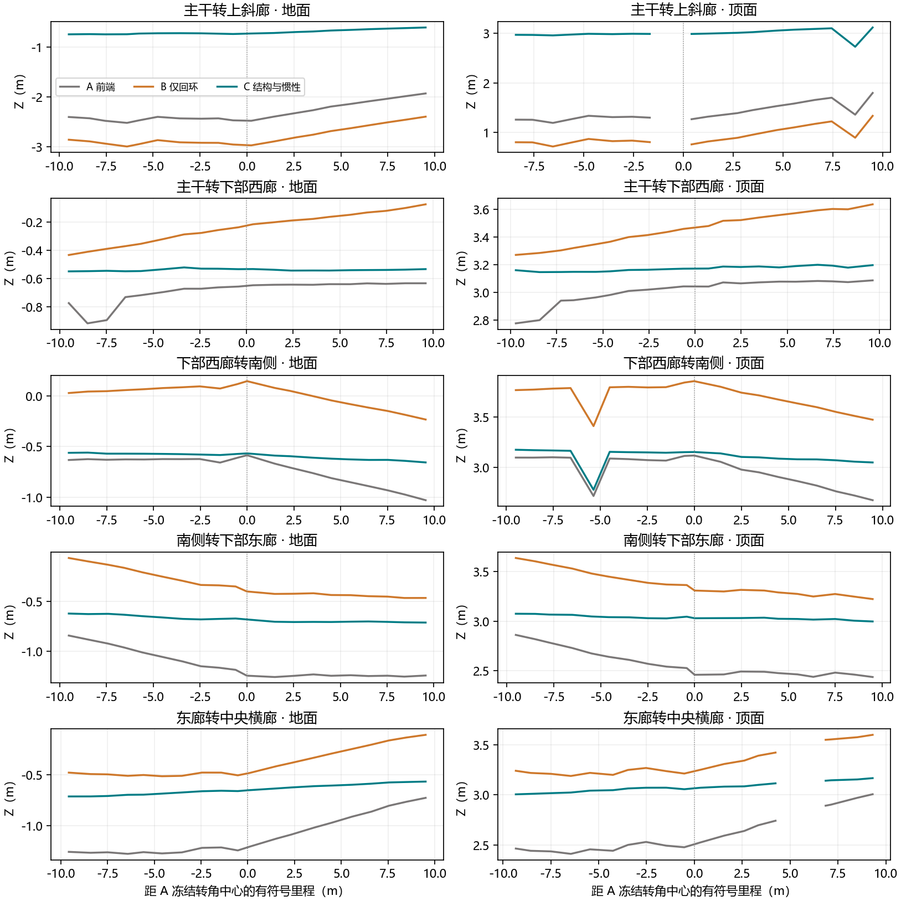

**复算与逐项结果。** 在分析资料目录运行下列命令，$maps 指向第三轮 Windows 地图目录。脚本读取已存档三份全分辨率 XYZI、优化前原图核对副本、三份 5 cm 几何点云和三条关键帧轨迹，输出本节 JSON、CSV 和 PNG。输入路径可用 `--data` 指定，输出支持 `--out`。

```powershell
python geometry/evaluate.py --data $maps
```

[复算脚本](corridor-third-20261128/geometry/evaluate.py) · [全部几何指标、边界与 SHA256](corridor-third-20261128/geometry/geometry_metrics.json) · [逐格坐标、高度、厚度与残差](corridor-third-20261128/geometry/floor_cells.csv) · [同点沿程剖面](corridor-third-20261128/geometry/long_profiles.csv) · [各图独立重选沿程剖面](corridor-third-20261128/geometry/independent_profiles.csv) · [地面与顶面各段两两法向夹角](corridor-third-20261128/geometry/segment_normal_angles.csv) · [转角逐箱剖面](corridor-third-20261128/geometry/corner_profiles.csv)

### 共享平面和惯性方向实际改变了什么

结构后端以 B 的 1,287 个位姿为初值，保留相邻位姿边、24 条自动回环的完整协方差及第一帧先验，加入有方向但位置未知的结构面和重力观测。各平面在本地支点有两个法向自由度、一个偏移自由度。一个地面可以倾斜，不相交的走廊也可有不同标高。结构块用三点代表同一帧局部面的中心和面内二阶矩，噪声尺度为 65 mm，Huber 阈值 1.8。惯性方向给地图上方向两个约束，保留偏航自由度。四次 LM 迭代使本图代价从 568.604 降到 79.300。该代价供同一图的收敛检查使用。

**复算方式。** 在板上复用 `local_patches` 从已有原生关键帧重取局部支撑。逐组核对支点、表面类别、训练和留出帧序号，与归档中的 268 组全部一致。随后固定三条归档轨迹，分别将每块的三个 IMU 系代表点变换到地图系；每种轨迹各用训练点重拟一张平面，再对其训练和留出点计算有符号正交残差。CSV 保存了 2,019 块在三个阶段的全部三点残差。B、C 的 409 块总体 RMS 均复现到归档输出的 0.00001 mm 内。A 列沿用在 B 上生成的同一关联，显示这些观测在原前端位姿下能否压在同一面上。[逐块残差](corridor-third-20261128/structure_eval/blocks.csv) · [分面统计](corridor-third-20261128/structure_eval/metrics.json)

| 表面 | 平面数 | 训练块 / 留出块 | 跨 75 s 访次 | 跨 30° 走向 | 两者兼有 | B→C 留出 RMS 下降的面数 |
|---|---:|---:|---:|---:|---:|---:|
| 地面 | 43 | 248 / 63 | 31 | 42 | 30 | 15 |
| 顶面 | 50 | 352 / 90 | 42 | 50 | 42 | 25 |
| 墙面 | 175 | 1,010 / 256 | 134 | 174 | 133 | 92 |
| 合计 | 268 | 1,610 / 409 | 207 | 266 | 205 | 132 |

归档跨访次的定义是最早和最晚观测相隔超过 75 s；跨走向由观察帧前后各两帧的水平弦方向判定，弦长超过 0.6 m，方向按模 180° 比较。两个标记原本都包含验证帧。只统计进入图的训练块，仍有 204 面跨时间、259 面跨走向。进一步按本轮七段直廊的已标定帧号区间检查，38 面有至少两个具名走廊段的训练观测，其中地、顶、墙为 5、8、25 面。这个更严格的数只覆盖明确划分的直段。北侧主干与上部斜廊共有墙面 83、95、96 和顶面 86、92，说明该转角有实际墙、顶连接。这里单靠方向差统计会将同一空间区域内推车弯行也计入。[每个平面的支点、走廊归属及留出变化](corridor-third-20261128/structure_eval/planes.csv)

| 每点正交残差 RMS，mm | 训练 A / B / C | 留出 A / B / C | 留出绝对残差 P95，B / C |
|---|---:|---:|---:|
| 地面 | 86.51 / 9.28 / 6.78 | 108.09 / 11.06 / 10.61 | 22.11 / 19.06 |
| 顶面 | 87.49 / 13.03 / 8.70 | 97.37 / 13.06 / 12.76 | 26.02 / 25.10 |
| 墙面 | 142.44 / 12.58 / 8.91 | 156.77 / 14.23 / 14.10 | 28.13 / 29.20 |
| 合计 | 124.71 / 12.23 / 8.57 | 138.82 / 13.530 / 13.328 | 27.44 / 27.78 |

A→B 已经完成了大部分局部重合改善。B→C 在地面格上减少约 288 mm 的非平面起伏，同时留出结构点面 RMS 仅下降 0.202 mm（1.49%）。二者支持一个具体判断：大尺度形状显著改变，厘米级的跨次表面重合总体维持。逐面留出 RMS 有 132 面改善、136 面增大，差的中位数为 +0.117 mm。变化幅度最大的一处改善在地面 265（支点 XY 约 22.84、−18.59 m），33.63→8.77 mm；最大退化在墙面 55（10.65、31.14 m），3.53→24.57 mm。墙面上尾略增与局部留出区的墙厚变化一致。各面拥有不同块数，每面统计与逐点汇总使用不同权重。

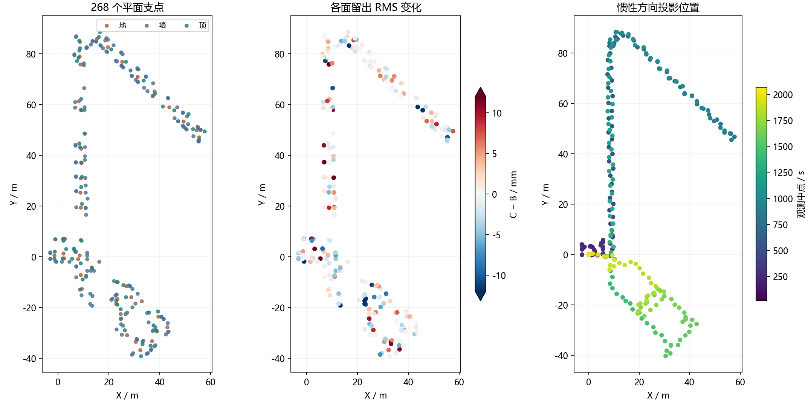

**运动补偿方向。** 在相互不重叠的八秒窗中，将扣除加计偏置的比力旋到里程计系后积分，减去端点速度差，再除以窗长。端点速度来自两侧 1.3 s 位置的局部二次拟合。程序要求原始 IMU 间隙不超过 25 ms、插值网格至少 1,400 项、补偿后模值距 9.81 m/s² 不超过 0.2 m/s²。254 个合格窗中点从 30 到 2,054 s，共覆盖 2,032 s。力模最小 / 中位 / 最大为 9.753 / 9.787 / 9.813 m/s²，端点速度差模中位 0.328、P95 0.627、最大 0.700 m/s。加上单独选取的两个静止方向，256 个因子落在 256 个不同关键帧，单位向量按测量时刻旋入相应帧。运动与静止方向的图内软约束尺度分别为 1.25°、0.7°。[逐观测时刻、模值、坐标与残差](corridor-third-20261128/structure_eval/directions.csv)

| 方向与地图竖直的角差 | A | B | C |
|---|---:|---:|---:|
| 起窗 / 末窗静止，° | 0.493 / 1.473 | 0.493 / 1.290 | 0.188 / 0.446 |
| 254 个运动方向 P50，° | 1.610 | 1.607 | 0.359 |
| 运动方向 P95，° | 3.123 | 3.401 | 1.044 |
| 运动方向最大，° | 4.482 | 4.676 | 1.826 |

这些方向使用了实测 IMU，也共用了前端姿态、加计偏置和估算速度。上表评价实际参与求解的方向。对独立于该方向代价的几何检验，本报告使用另外固定的原生地面点、重访子图和未进入平面因子的 409 块。第二轮机制实验提示方向约束对长尺度形态的影响较大；第三轮可直接量出的是**平面与方向的联合净收益**。[实际图构建源码](https://github.com/Nirvana110230/culvert-fast-livo2/blob/59c47ee53aa931bd7766ae0c9045ae8e48083969/backend/shared_planes.py)

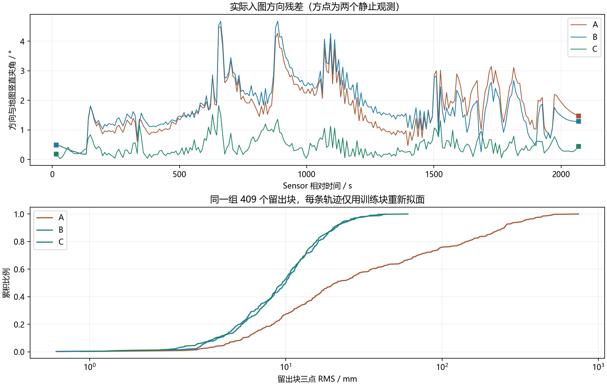

**首尾约束的代价。** 末关键帧减首帧的 XYZ，在 B 为 (−7.21, −9.76, −4.72) mm，在 C 为 (−8.86, +30.32, −11.34) mm。距离增加 20.54 mm，位移分量的主要变化是 Y 向 +40.08 mm。稠密静止窗中位位置的分离同时从 5.40 增至 20.32 mm。水平重访、全局姿态、局部结构与相邻里程计共享位姿自由度，首末两点也受其他因子影响。两组量仍远小于 A 的约 1.21 m；C 的 1,248 格拟合倾角从 B 的 1.998° 降到 0.575°，去平面残差同样下降。选 C 作先验图的依据是整条路线的历史几何、长廊和重访综合表现。


## 10　局部地图质量与五区留出评价

每区采用较早的一帧作目标，较晚时刻及相邻两帧作源。先按归档程序在各帧车体系内做 0.12 m 体素选点，以 A 裁出各自半径 4 m 圆柱，再用 A 中的 0.14 m 体素一次选定源、目标原始点身份。B/C 及两套在线对照使用相同点身份和相同目标局部坐标架，直接代入各自轨迹，无额外配准。A 的五个源向中位数均与归档基线相符。早先归档的 B/C 表会在各自变换后重新体素选点，点数及部分中位数与本表有差异。B/C 的回环、结构面拟合均排除了五处各自两访的 ±2 帧和空间圆柱；A 是参与建图的原前端，其局部重访读数作基线。留出独立性的范围限于 B/C 后端几何拟合。

| 区域 | 目标帧 / 源中心帧 | 原前端目标 XY，m | 固定目标 / 源点数 |
|---|---:|---:|---:|
| H1 | 298 / 666 | 9.04 / 70.54 | 1789 / 3559 |
| H2 | 345 / 610 | 12.55 / 88.80 | 1311 / 2648 |
| H3 | 868 / 1110 | 18.03 / −22.80 | 1652 / 3434 |
| H4 | 264 / 703 | 8.74 / 52.87 | 1780 / 3534 |
| H5 | 179 / 777 | 8.76 / 12.18 | 1845 / 3500 |

表中三值依次为 **A / B / C**。距离均为无截断欧氏最近邻距离，单位 m；覆盖是严格小于 0.32 m 的比例。双向分别计算，源由三帧组成，常能看见目标单帧未覆盖的表面，这会影响 P90、P95 与 RMS。

| 区域 | 方向 | 中位 m | P90 m | P95 m | RMS m | 覆盖 % |
|---|---|---|---|---|---|---|
| H1 | 源→目标 | 0.229 / 0.243 / 0.240 | 1.352 / 1.362 / 1.365 | 1.653 / 1.693 / 1.693 | 0.757 / 0.764 / 0.765 | 54.6 / 54.0 / 54.1 |
| H1 | 目标→源 | 0.116 / 0.085 / 0.085 | 1.023 / 1.044 / 1.044 | 1.237 / 1.305 / 1.307 | 0.515 / 0.527 / 0.529 | 73.3 / 72.8 / 72.9 |
| H2 | 源→目标 | 0.635 / 0.631 / 0.631 | 1.747 / 1.757 / 1.769 | 2.069 / 2.093 / 2.106 | 1.027 / 1.041 / 1.044 | 37.8 / 38.2 / 38.1 |
| H2 | 目标→源 | 0.350 / 0.360 / 0.366 | 1.448 / 1.460 / 1.466 | 1.668 / 1.665 / 1.672 | 0.825 / 0.824 / 0.828 | 49.4 / 48.9 / 49.0 |
| H3 | 源→目标 | 0.096 / 0.105 / 0.099 | 0.515 / 0.500 / 0.515 | 0.814 / 0.801 / 0.807 | 0.313 / 0.312 / 0.314 | 83.4 / 83.8 / 83.4 |
| H3 | 目标→源 | 0.062 / 0.075 / 0.064 | 0.112 / 0.119 / 0.114 | 0.137 / 0.141 / 0.139 | 0.082 / 0.090 / 0.083 | 99.8 / 99.7 / 99.8 |
| H4 | 源→目标 | 0.358 / 0.277 / 0.279 | 1.341 / 1.356 / 1.359 | 1.586 / 1.624 / 1.625 | 0.777 / 0.765 / 0.768 | 48.0 / 51.8 / 51.9 |
| H4 | 目标→源 | 0.242 / 0.087 / 0.088 | 1.014 / 1.047 / 1.049 | 1.232 / 1.300 / 1.299 | 0.537 / 0.533 / 0.534 | 72.4 / 72.4 / 72.4 |
| H5 | 源→目标 | 0.911 / 0.192 / 0.192 | 1.474 / 1.408 / 1.406 | 1.719 / 1.662 / 1.660 | 0.991 / 0.762 / 0.763 | 12.0 / 55.1 / 55.1 |
| H5 | 目标→源 | 0.884 / 0.084 / 0.084 | 1.105 / 1.032 / 1.038 | 1.288 / 1.281 / 1.283 | 0.842 / 0.543 / 0.544 | 17.2 / 71.8 / 71.7 |

H1 的目标向中位数变小而 P95 增大，H4 也有类似现象，改善集中在双访共同看见的墙面。H2 在三组中都有明显长尾，H3 的反向覆盖最高。H5 的双向中位与覆盖同时改善，但 C 的正向 P95 仍有 1.660 m。在线实际发布与终图也完成同一批点评价；在线时未冻结留出区，至少五条接受边的拟合帧或中心与事后留出范围重叠，其中 264/703 正是 H4 验证对。在线两列仅供回顾性对照。[五套结果的逐区双向指标](corridor-third-20261128/loops/holdout_bidirectional.csv)

### 地面高差、局部平面与代表截面

参考平面仅由目标帧拟合。对源侧要求法向差不超过 15°、目标支撑至少 42 点、源支撑至少 28 点，目标足迹覆盖至少 35%，并核查两切向跨度和密度主峰。H3 目标地面有 310 个支撑点，A/B/C 的法向一致源支撑为 509/508/511 点，目标足迹覆盖均为 100%。在三者实测足迹重合处的同一 XY（相对目标原点 +1.246、−1.546 m），两次拟合面的有符号垂直高差为 **+0.93 / +38.62 / −9.33 mm**。全足迹法向距离的中位偏移为 +1.75 / +38.13 / −4.88 mm。源点到目标拟合面的 RMS 为 6.22 / 38.66 / 14.21 mm，源点到各自拟合面的 RMS 为 5.68 / 5.66 / 5.49 mm。另四区源地面取样或足迹重叠不足，保留排除原因。[地面及墙面逐项支撑、覆盖、角度与残差](corridor-third-20261128/loops/holdout_surfaces.csv)

墙面观测厚度取两访各自等分位数后等权合并的 P90−P10，测量的是两次扫描沿参考法向的层厚。各区代表墙面和共同地面的值如下，单位 mm。

| 表面 | A | B | C |
|---|---:|---:|---:|
| H1 墙 a1 / a2 | 99.6 / 148.6 | 22.8 / 78.0 | 26.7 / 80.3 |
| H2 墙 b1 | 235.5 | 145.5 | 146.6 |
| H3 地面 / 墙 a1 | 14.4 / 23.4 | 48.3 / 24.2 | 25.7 / 24.4 |
| H4 墙 a1 / a2 | 246.8 / 253.8 | 16.9 / 23.3 | 23.9 / 32.2 |
| H5 墙 a1 / a2 | 支撑不足 | 91.3 / 23.7 | 92.7 / 29.1 |

局部点面误差另按目标点的 14 邻域拟合平面。第一组固定 A 下距离 <0.32 m 的平面目标邻域与源点对应，保留原始对应后计算绝对法向残差。第二组固定两边点集，但在每个解下重新寻找 <0.32 m 且具有平面邻域的对应，列出覆盖点数以免混读分母。三值依次为 A / B / C，误差单位 mm。

| 区域 | 固定对应数 | 固定对应 RMS | 固定对应 P95 | 各解重新匹配点数 | 重新匹配 RMS |
|---|---:|---|---|---|---|
| H1 | 1604 | 84.2 / 39.2 / 40.3 | 124.3 / 64.1 / 66.9 | 1604 / 1581 / 1574 | 84.2 / 31.8 / 35.0 |
| H2 | 830 | 107.0 / 45.7 / 47.3 | 147.0 / 81.8 / 84.7 | 830 / 833 / 823 | 107.0 / 46.0 / 44.4 |
| H3 | 2357 | 38.4 / 51.6 / 41.7 | 67.8 / 83.9 / 75.3 | 2357 / 2356 / 2364 | 38.4 / 52.9 / 40.8 |
| H4 | 1313 | 211.1 / 54.0 / 58.0 | 264.5 / 82.3 / 87.7 | 1313 / 1429 / 1424 | 211.1 / 40.2 / 44.0 |
| H5 | 296 | 187.0 / 478.5 / 483.1 | 309.4 / 1008.7 / 1011.0 | 296 / 1703 / 1704 | 187.0 / 42.9 / 44.8 |

H5 中 A 仅有 296 个源点找到近邻平面。B/C 把大量观测移到另一组近邻附近，沿 A 原有对应计算的残差上升，重新匹配后可用点增至约 1700、RMS 降至 43–45 mm。缺少逐点表面身份真值，保留两种口径更能说明结果依赖的对应关系。图中每行采用同一目标墙面决定截面方位，在墙面切向取共同的 ±0.35 m 厚度，以墙法向水平距离和相对重力高度绘图。蓝色为首次观测、橙色为重访，A/B/C 同行共用坐标尺度。[局部点面误差、样本数和 P95](corridor-third-20261128/loops/holdout_fixed_point_to_plane.csv)

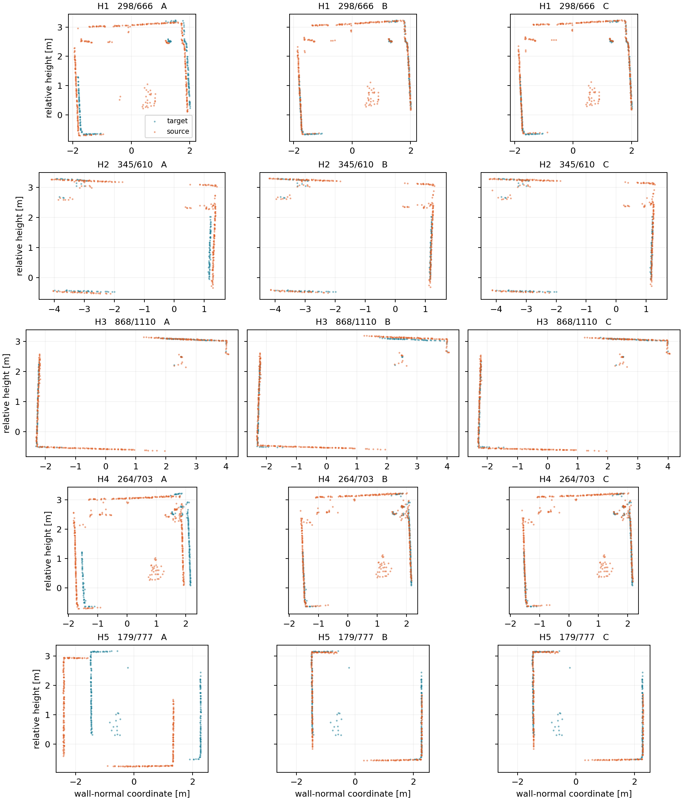

复算使用归档在线边、发布记录、关键帧索引、五区 20 个原生强度点云和现有离线轨迹。本次从严格校验的 SSH 别名获取白名单内 35 个文件，对远端 SHA256 与本地回读逐项比较。可在保有原始工作区的环境中先运行 `python fetch_inputs.py`，再运行 `python analyze.py`；若本地证据已在 `raw/`，第二条即可。分析脚本使用 NumPy、SciPy、Matplotlib 和本项目的帧读取、平面及资格检查函数。[获取脚本](corridor-third-20261128/loops/fetch_inputs.py) · [分析脚本](corridor-third-20261128/loops/analyze.py) · [远端与本地输入校验清单](corridor-third-20261128/loops/input_sha256.json) · [离线输入 SHA256](corridor-third-20261128/loops/offline_input_sha256.json) · [机器可读指标](corridor-third-20261128/loops/metrics.json)

## 11　CloudCompare 实际观察与相同尺度的地图

读取了用户保存的 41 张原始 PNG，每张保留原始像素，按阶段、通道和视角建立清单。几何图用屏幕中的蓝绿显示色，RGB 图多数墙面呈低饱和或暗色。两组显示对象和抽样密度不同。截图右下的比例标尺会变；例如几何 Front 的 A 为 35、B 与 C 为 30，几何 YZ 的 A、B 为 35、C 为 30，原图局部还存在平移和裁切。以下先对应建筑结构进行阅读，然后给出全分辨率 PCD 的正投影。[41 张原图逐图清单](corridor-third-20261128/visual/screenshots.csv)

| 来源与张数 | 从 Front、侧视、总体及局部视图得到的观察 |
|---|---|
| PGO before，几何 5、RGB 5 | 整体俯视中，上部斜支、长主干和下方两个连接廊的路线均可辨认。细看实验室与主干交接处，房间左侧、靠走廊一侧边界呈两套近似平行的线，RGB 局部图最清楚。XZ 内不同走廊叠投后底缘呈扇形分开，YZ 里长段边缘倾斜。 |
| PGO after，几何 5、RGB 5 | 相同房间墙角和其与主干的接合轮廓收紧；下部平行廊、中央横廊的实际结构继续能区分。XZ 的地面、顶面仍有明显斜向展开，侧视改善小于平面重影的改善。 |
| Structure before，几何 5、RGB 5 | 房间墙线重影、长廊侧投影的展宽与 A 一致。近景裁切和镜头位置与 PGO before 有差异。两份 before 几何记录和颜色记录全量逐行相同，二者同属 A。 |
| Structure after，几何 6、RGB 5 | XZ、YZ 中墙脚及顶边的长距离相对高度变化明显减小，主干与上部转角在整体、局部和 RGB 图中仍能连续辨认。额外的“局部2”覆盖下部双廊及其横向连接，可辨两侧墙和中间开敞区域。稀疏离群回波、顶面突出物和局部边界宽度仍可见。 |

下图保留各截图原视角，仅缩放至版面并加阶段字母。房间左缘、房间与主干的交界值得在原图比例下查看。不同走廊沿侧视方向互相遮挡，因此 XZ/YZ 中的多条边缘需要结合 XY 路线及固定薄截面判断。各个门框没有身份标注和独立量测；这批图中未见一整段新增的分叉或断廊，厘米级门框和局部墙面变化见五区点面评价。

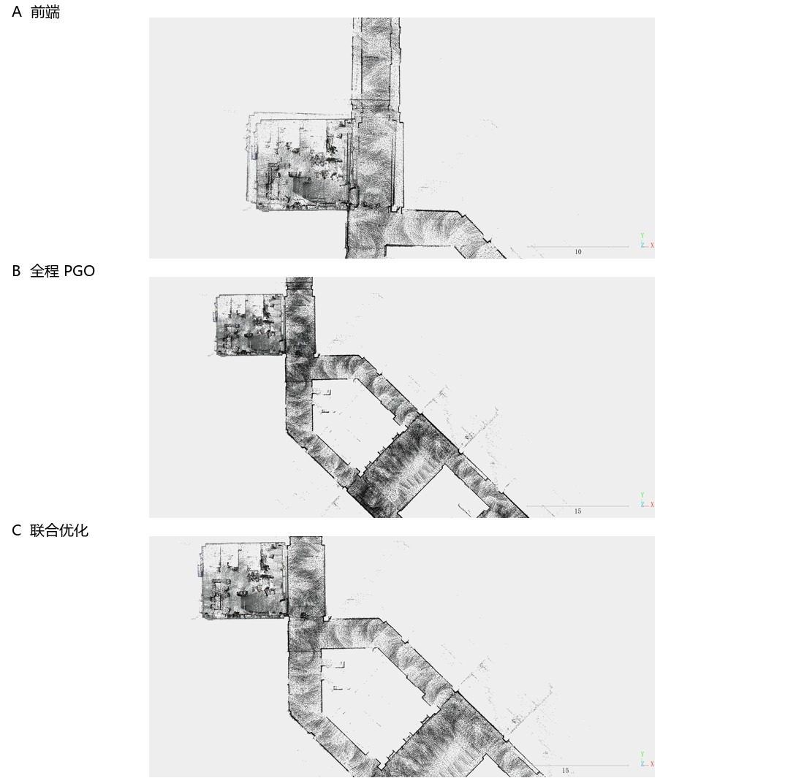

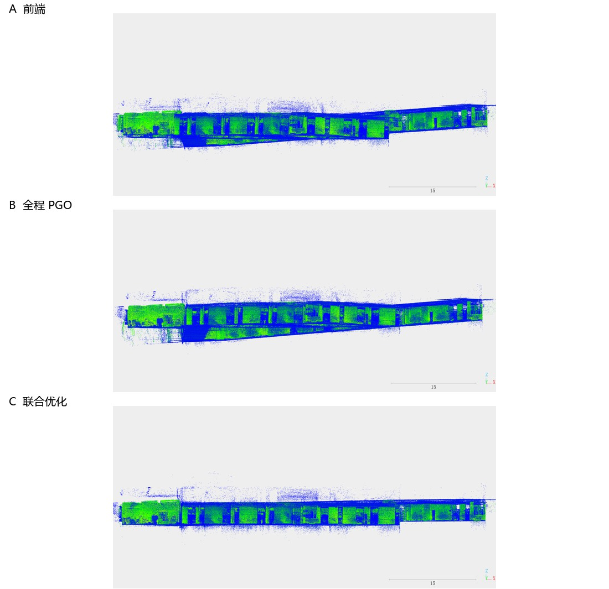

下图直接收录用户保存的联合图彩色 YZ 原始 PNG。原图与逐点 RGB 位比较相符，颜色随关键帧历史位置一起重建。RGB 局部稀疏、暗区和视角差异限制了对细薄门框的判断。

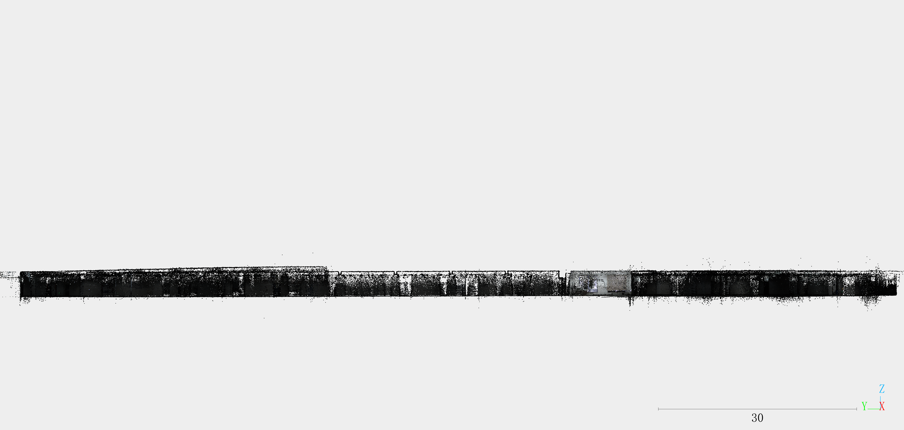

同视角的另外两张原始 PNG 可放大查看侧投影的轮廓及画面右下标尺。[A 前端 RGB 原图](corridor-third-20261128/visual/pgo_before_rgb_yz_original.png) · [B 回环 RGB 原图](corridor-third-20261128/visual/pgo_after_rgb_yz_original.png)

### 全分辨率点云的统一坐标投影

三幅图逐阶段读取全部 6,962,792 个原生几何点，不做 ICP、调平、去坡或额外旋转。每一投影取三图坐标并集，三面板共用物理范围、色标和 1:1 坐标轴；约 8 cm 的方形投影格内累加所有回波，色标按计数对数显示。XY 的 X / Y 显示域为 [−8,65] / [−48,102] m，侧视均用 Z=[−7,10] m。颜色较深表示投影格中有更多回波，不能等同于墙体厚度。原图全点 XYZ 的 Z 极值含突出物和杂点，地面指标另用平面和邻域资格判据。[全投影范围及计数](corridor-third-20261128/maps/metrics.json)

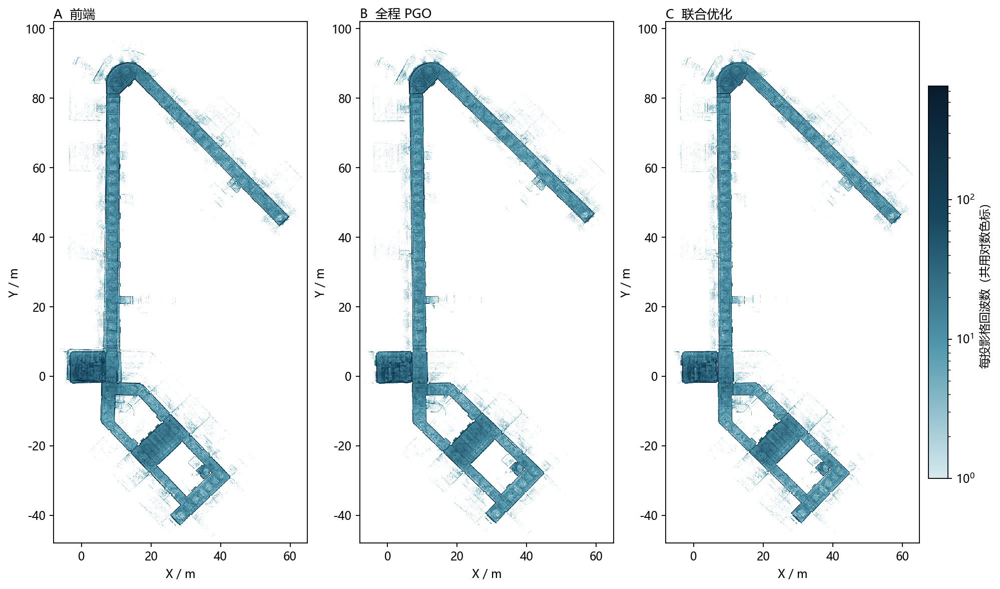

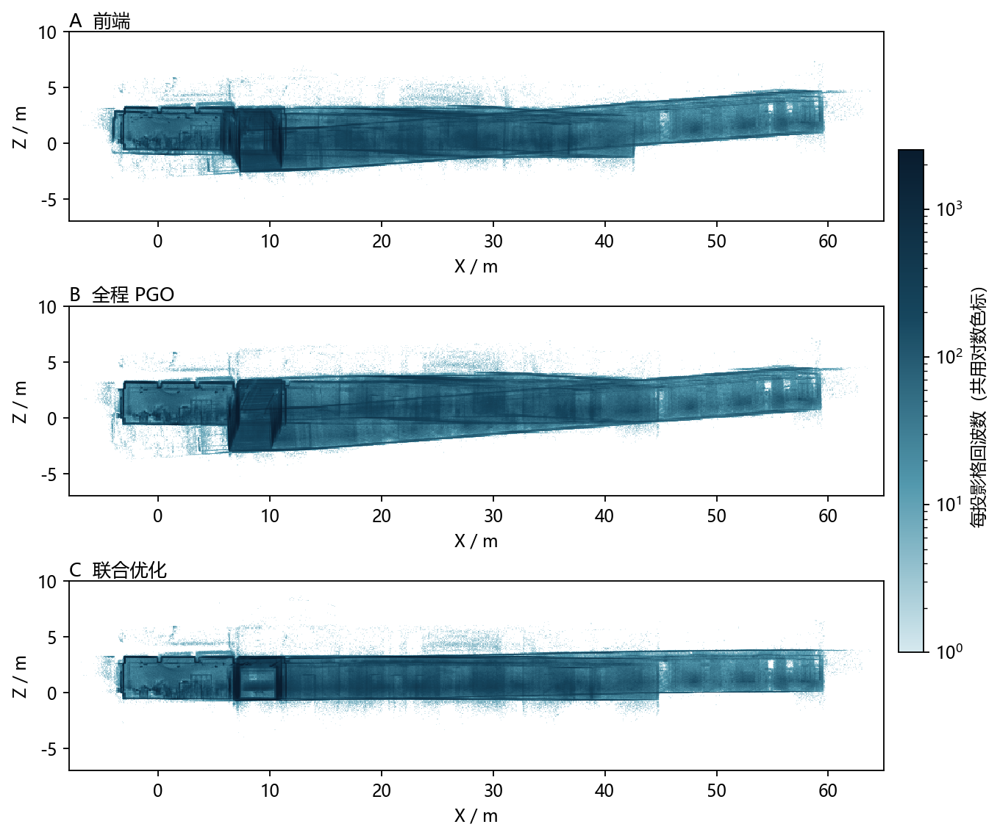

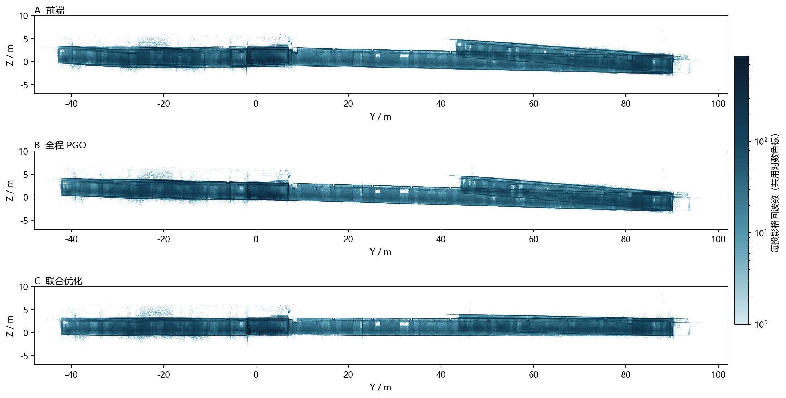

下两图给出固定空间薄层。第一幅固定地图 Z 在 0.20–1.25 m，X 在 −6 至 16 m，Y 在 −11 至 15 m，显示实验室与主干交界。A 的外墙反复成线，B、C 的主要轮廓接近。第二幅固定主干 Y=40±0.45 m，比较同一世界坐标下的横断面；A 在两侧墙和地面出现重边，B 收紧，C 在维持轮廓的同时改变整体高度。薄层内每图实际进入显示范围的点数不同，这是地图坐标变化的直接结果。同一源点的比较另见原生地面格与五处重访。

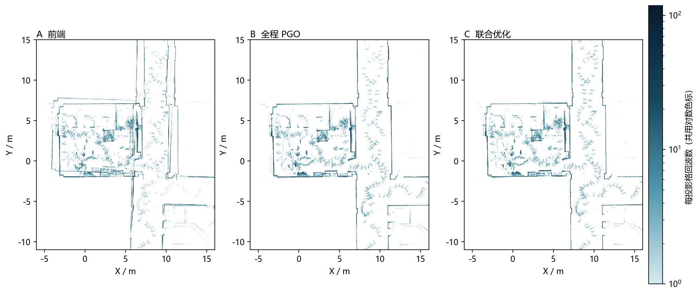

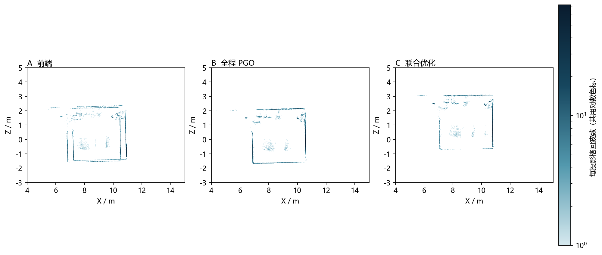

### 地图重建及独立查看文件

项目源码中 `structure_run.py` 取 `initial = B` 作为结构优化初值，又取 `raw[i] = G @ frame[i].odom`。两份输出的 before 均把相同 IMU 系局部点乘以 raw，结构后端写图时调用 `rebuild(out, frames, raw, after)`。实际内容回读中，`structure/map_before.pcd` 与 `pgo/map_before.pcd` 的全量四字段不同行数为 **0**，两份 RGB before 同样为 **0**。[结构导出](https://github.com/Nirvana110230/culvert-fast-livo2/blob/59c47ee53aa931bd7766ae0c9045ae8e48083969/backend/structure_run.py) · [关键帧重建顺序](https://github.com/Nirvana110230/culvert-fast-livo2/blob/59c47ee53aa931bd7766ae0c9045ae8e48083969/backend/frame_io.py)

按原生索引的每帧几何与彩色点数分段，把 A 每一行反变换回该帧 IMU 系，再用归档的 B 或 C 位姿各自变换，读取对应 PCD 行比坐标。B/C 几何 XYZ 差的 P95 为 4.180/4.183 µm，最大 8.273/8.345 µm；RGB 最大 7.974/8.309 µm。三阶段强度逐行一致，803,792 个颜色字逐行一致，只有 81,815 点的三个原色通道恰好相等。这个微米量级描述读写与位姿变换的一致性。它表明历史点在各自正确帧内移动，并保留颜色。[全点回读结果](corridor-third-20261128/maps/readback.json) · [每帧点数和最大差](corridor-third-20261128/maps/frame_readback.csv)

| 5 cm 空间抽稀成品 | A | B | C |
|---|---:|---:|---:|
| 几何点数 | 1,646,124 | 1,381,168 | 1,379,321 |
| RGB 点数 | 416,147 | 376,670 | 376,728 |

六份快速查看文件均由 CloudCompare 2.13.2 `-SS SPATIAL 0.05` 生成并完整解压读回。抽稀从原点集中选取空间样本，重合程度会影响保留下来的数量。Windows 数据根下的 `spatial_5cm/A_geometry.pcd`、`B_geometry.pcd`、`C_geometry.pcd` 可分别上传；同目录相应的 `*_rgb.pcd` 用于查看颜色。全量 PCD 仍在数据根的 `pgo`、`structure`。[抽稀命令脚本](corridor-third-20261128/maps/export_5cm.ps1)

## 12　三轮走廊实验的综合对照

第一、二轮是在现场运行正式 B1，候选前端、回环及结构算法的结果来自后来对既有 Bag 或关键帧的处理。第三轮是在新采集的数据上现场运行严格分窗、对应区间去畸变、静止陀螺更新及因果回环旁路，之后另用该轮完整关键帧求离线 B、C。三轮各有一次物理采集。下列时间均为北京时间 UTC+8。

### 12.1　三次现场的实际时间、数据量和资源

| 同一口径 | 第一轮 B1 现场 | 第二轮 B1 现场 | 第三轮候选现场 |
|---|---:|---:|---:|
| 实际会话起止 | 11-27 15:52:45.808–16:04:58.327 | 11-27 19:19:09.138–19:50:07.737 | 11-28 15:26:48.660–16:02:01.177 |
| 会话持续，含启停 s | 732.519 | 1,858.599 | 2,112.517 |
| Bag 记录跨度 s | 709.517 | 1,834.735 | 2,087.890 |
| 连续地图归档轨迹跨度 s | 703.525 | 1,825.108 | 2,080.819 |
| Bag 分片 / 合计 GiB | 57 / 28.65 | 148 / 74.11 | 169 / 84.47 |
| SQLite 文件字节 / Bag 秒，MiB/s | 41.34 | 41.36 | 41.43 |
| Bag 七话题累计条数 | 206,603 | 533,316 | 607,211 |
| Bag 雷达 / IMU / 图像条数 | 7,119 / 142,286 / 7,067 | 18,355 / 366,943 / 18,288 | 20,886 / 417,574 / 20,850 |
| 现场融合最终接收雷达 / IMU / 图像 | 7,045 / 140,896 / 7,039 | 18,293 / 365,840 / 18,256 | 20,818 / 416,367 / 20,812 |
| 现场连续归档位姿数 | 7,035 | 18,251 | 20,807 |
| 现场连续归档几何点 / RGB 点 | 12,879,873 / 2,130,867 | 30,984,944 / 4,935,054 | 35,912,381 / 5,883,721 |
| 现场轨迹全程按 1 s 采样的三维里程 m | 179.116 | 707.093 | 645.039 |
| 现场轨迹逐帧三维里程 m | 190.880 | 732.572 | 673.771 |
| 现场轨迹 Z 极差 / 去空间平面 RMS，m | 0.453 / 0.040 | 2.821 / 0.367 | 3.461 / 0.530 |
| 处理耗时采样 P50 / P95 / 最大值，ms | 29.73 / 59.06 / 78.94 | 31.79 / 62.61 / 110.87 | 32.91 / 63.26 / 110.87 |
| 算法进程 RSS 采样 P50 / P95 / 最大值，MiB | 701.42 / 751.26 / 757.64 | 777.76 / 810.27 / 876.84 | 799.79 / 929.20 / 1,059.24 |
| 系统可用内存采样最低值 GiB | 13.30 | 13.14 | 12.85 |
| 数据分区剩余空间采样最低值 GiB | 201.31 | 126.19 | 33.43 |

上表直接对三次现场的 `map/trajectory.tum` 使用相同算法，以各自首戳为零对 XYZ 做 1 s 线性插值，保留尾点，累加三维步长。逐帧里程还会累计短时位置波动。首轮报告另有“仅移动段，按 1 s 采样”的 178.950 m。轨迹去平面 RMS 使用每个原始位姿 Z 相对其 XY 最佳平面的垂直残差。第 9 节的地面去平面 RMS 则使用各空间格的地面高度。路线和推车运动不同，三轮长度、形状残差和温升不能当成同路况的算法对照。

Bag 中七话题的计数覆盖录包器的接收时段。现场融合计数覆盖各算法实际订阅时段，尾部队列另见各会话记录。两类计数的直接差值包括启动和收尾，不能据此求运行中丢帧率。处理耗时来自 `Log/processing.csv` 的抽样，三轮分别有 686、1,777、2,013 行。RSS 是约 2 s 间隔的采样峰值，现场资源摘要分别记录 358、915、1,041 次轮询。第三轮在 35 分钟量级、同时运行诊断和旁路时完成采集，前端 RSS 比第二轮采样峰值高 182.40 MiB。三轮 SQLite 文件量折算的平均写入量只相差 0.09 MiB/s。此结果没有提供长时间驻留内存上界。

第二轮通过已登记的 ED25519 严格主机校验重新读取原现场的会话、录包元数据、完整性检查与资源记录。主机标记 MOVE_START 为 19:20:07.414，RETURN_P0 为 19:49:40.946，相隔 1,773.532 s。外围 928 个资源样本中，全机 CPU 忙碌率 P50/P95/最大为 36.48% / 40.10% / 48.59%，SoC 热区峰值 60.076 ℃、各热区中的最高值 61.923 ℃。第一轮网页稿中的 58 ℃是现场时间点读数。第三轮归档里的进程 RSS 和可用内存可以逐样本核算，现有现场资源文件缺少同型全程 SoC 温度序列。三轮估计耗时和 RSS 均使用对应实际会话，排除了 RViz 离线查看点云的占用。

### 12.2　同一旧 Bag 的回放与第三轮新数据

| 数据及处理 | 前端与输入 | 关键帧 | 后端重建每图几何 / RGB 点数 | 已保存的几何结果 |
|---|---|---:|---:|---|
| 第一轮旧 Bag，复用既有关键帧 | 1× DDS 严格分窗候选 | 389 | 2,076,053 / 244,120 | 纯回环→结构联合，关键帧 Z 极差 0.374→0.147 m，轨迹去平面 RMS 36.57→13.96 mm |
| 第一轮旧 Bag，完整第三代前后端回放 | 新区间去畸变与静止更新，完整三路读包，36 次静止更新 | 393 | 2,097,083 / 247,039 | 联合后关键帧 Z 极差 0.120 m，轨迹去平面 RMS 12.89 mm。初次实采终点随意停车 |
| 第二轮旧 Bag，原关键帧主对照 | 上一代 watermark 前端，原有 1,519 帧及相同原生点 | 1,519 | 8,138,600 / 945,066 | 旧回环→联合，地面 975 同点格 RMS 363.12→122.58 mm。关键帧 Z 极差 3.374→1.065 m |
| 第二轮旧 Bag，完整第三代前后端回放 | 新区间去畸变与静止更新，完整三路读包，33 次静止更新 | 1,523 | 8,158,670 / 946,798 | 联合后关键帧 Z 极差 1.023 m。三图共同的 945 格上，旧回环 / 旧帧联合 / 新帧联合 RMS 为 364.05 / 123.19 / 118.12 mm |
| 第三轮现场新采集的关键帧 | 候选实际运行，静止更新获 18 条直接日志和早段 31 个状态阶跃支持；离线 B、C 沿用现场同一批帧 | 1,287 | 6,962,792 / 803,792 | B→C 的 1,248 个 B 冻结格 RMS 424.82→137.27 mm。关键帧 Z 极差 3.713→0.962 m |

现场连续地图累积高频输出，后端地图用导出的局部关键帧按各阶段位姿重建，因此 12.1 和 12.2 两表中的点数覆盖不同。第二轮的 **122.58 mm 与 118.12 mm 分母分别为 975、945 个格**。要估计重做前端在第二轮增加的收益，使用后一套共同 945 格比较，123.19→118.12 mm，约减少 5.07 mm。第三轮没有沿用第二轮坐标或格编号。在各轮以 B 地面为参考跟踪同点时，第二轮与第三轮的去平面 RMS 分别下降 66.2% 和 67.7%。这一跨轮现象支持长尺度起伏收缩能够在新采集中再现。第三轮上斜廊自身的去线 RMS 由 14.6 升至 25.5 mm，局部平顺度仍需按段核查。

**首尾复位与中途重访。** 第一轮首末静止质心距 0.208 m，终点随意停车。第二轮 B1 现场首末静止窗均值距 1.356 m，用户返回 P0 胶带。第二轮旧帧回放用稠密位置分量中位数评估，旧回环→联合为 10.44→20.37 mm，新前端新帧联合为 19.83 mm。第三轮按该轮 [5,25] s 和 [2059,2079] s 两窗，现场 A / 在线实际发布 / 在线终图 / 离线 B / 离线 C 的三维中位位置差分别为 1,208.94 / 6.00 / 3.68 / 5.40 / 20.32 mm。第二、三轮均出现结构联合后的全局地面改善与首尾差略增同时发生。三个现场起终位姿缺少独立测量，不能把它们换算为整段绝对定位精度。

第一轮新前后端的三个旧冻结区，用插值到相同源帧的位姿重算点距，中位数为 604.9 / 101.1 / 101.1 mm。其中第三处两面墙的重访厚度由 20.6 / 16.7 增至 27.6 / 23.3 mm。第二轮的 279 对固定重访高差绝对值 P95 从旧回环的 36.84 降至旧帧联合的 20.04 mm，新帧联合为 18.73 mm。第二轮区域 2 墙面双访厚度由旧回环的 26.1 增至旧帧联合的 41.7 mm，新帧联合为 33.0 mm。第三轮五处留出区来自新路线，其逐方向点距、有效表面和缺测原因见回环及结构章节。不同物理地点的点距不能当作相同题目的排名。

### 12.3　板端实际运行开销

| 板端工作 | 对应数据和范围 | 进程实耗 s | 峰值 RSS MiB |
|---|---|---:|---:|
| 1× DDS 候选回放 | 第一轮旧 Bag，标准真实 ROS 通路及启停 | 721.68 | 前端 781.82，在线旁路 176.26 |
| 新前端直接读包 | 第一轮旧 Bag，全袋，无 1× 播放限速 | 626.59 | 782.79 |
| 同一结构后端 | 第一轮旧 389 帧 / 新 393 帧 | 5.41 / 4.98 | 124.86 / 120.52 |
| watermark 前端直接读包 | 第二轮旧 Bag，全袋 | 1,053.48 | 843.46 |
| 旧版联合回环 / 修正协方差后的回环 | 第二轮旧 1,519 帧，两次独立离线运行 | 29.10 / 29.05 | 148.27 / 154.39 |
| 结构后端 | 第二轮旧 1,519 帧 | 27.94 | 177.76 |
| 新前端直接读包 | 第二轮旧 Bag，全袋 | 1,607.67 | 849.76 |
| 结构后端 | 第二轮新 1,523 帧 | 23.53 | 176.43 |
| 在线因果旁路 | 第三轮现场，含等待关键帧到达的在线历时 | 2,087.26 | 185.18 |
| 离线自动回环 B | 第三轮现场的 1,287 帧，含保存地图 | 22.21 | 148.41 |
| 离线结构联合 C | 第三轮现场的 1,287 帧，含保存地图 | 20.42 | 183.16 |

第三轮在线旁路另有收尾重建 4.12 s。离线自动回环的 22.21 s 中，配准 10.57 s、地图重建 2.05 s。结构联合的 20.42 s 中，关联与优化 16.50 s、地图重建 2.02 s。离线单进程耗时受关键帧规模、调度和已生成输入影响。新前端直接读包处理的是旧 Bag 的全部原始输入，不能只用后端的几十秒描述整袋重算。现场实时旁路等待时钟与离线求解时钟也不相加。

### 12.4　历史网页资料的对应关系

- 首轮网页稿记录了 7,035 姿态、703.525 s 轨迹和约 190.880 m 逐帧里程。正式指标给出的轨迹 SHA256 与网页稿中的上传文件相同。网页稿的算法 RSS 约 419 MiB 是早期静止快照，正式全程资源样本峰值为 757.64 MiB。
- 《两轮走廊建图实验与改进调研报告》记录第二轮 B1 的胶带复位三维差 1.355526 m。第二轮现场时间、三路消息、1 s 里程及内存，本次从会话、Bag、轨迹和资源文件分别核对。现场归档与后来的候选回放有不同的首尾窗口和接收边界。
- 《Z 轴四文件深度分析》针对旧回环前后的 5 cm PCD、数据 ZIP 和截图 ZIP。复算包中的深度报告及重算 JSON 均与同目录独立文件逐字节相同。原包 975 格的去平面 RMS 是 **370.84→363.12 mm**，形状相关 0.9873，说明当时仅回环后仍保有大尺度起伏。随后联合结构与惯性得到的 **363.12→122.58 mm** 使用该旧回环端点作为起点。第三轮按自己的关键帧重新得到 **424.82→137.27 mm**。三对数值依次回答旧回环、本轮方法作用于旧数据、以及新实采复现三个不同问题。

[三轮实测时间和资源、计量口径、历史文件路径与 SHA256](corridor-third-20261128/history/metrics.json)

## 13　版本定型及系统职责

**建议定型。** 将交付提交 `f6d0792`、核心 `59c47ee`、现场 ELF 和当前部署参数作为下一阶段的建图技术基线，结束以本层走廊为目标的 FAST-LIVO2 集中攻关。依据包括一次新采集现场长时运行、两轮历史回放、第三轮自动识别起终邻域、历史几何和颜色的全点回读，以及同点与独立重选两种方法得到的一致形变降幅。这个决定可以用于着手制作三维先验图、开发固定地图重定位和连接自主导航。现场建图入口和 B1 的实际部署状态按原件保留，本次交付为技术基线建议与版本证据。

| 系统职责 | 建议采用的本轮产物或接口 | 本轮支持这项选择的实测依据 |
|---|---|---|
| 运动估计、局部连续控制 | 实时前端在里程计坐标中发布同戳位置及局部扫描；底盘安装外参由导航系统转换到控制点 | 20,807 个 LIO 状态，严格窗点量闭合，帧间姿态/速度与资源均有连续记录 |
| 新环境建图时的在线全局参照 | 在线旁路发布 `map→odom`，可用于在线建图显示和识别重访 | 33 次修订；同一车体位置最大单次校正 0.254 m、1.076°，直接以该全局位置作连续控制会引入阶跃 |
| 建图完成后的正式先验地图 | 全历史 B 先处理重访几何，C 再求姿态、结构面与垂向一致性；固定 C 的坐标系、地图版本、轨迹和关键帧索引 | H4/H5 的重合收益与 1,248 格形态收紧并存，C 的 6,962,792 个几何点及 803,792 个 RGB 点已逐行复核 |
| 新一次任务中的固定先验重定位 | 前端继续提供连续里程计；独立定位器将新扫描匹配到已冻结的 C，维护唯一的全局到里程计变换。保留匹配时间戳、置信度、有效覆盖和失锁状态 | 地图生产与新访次定位有不同数据边界。在线建图旁路和固定地图定位器同时发布同一父子 TF 会让全局位姿来源含混 |
| 路径规划与执行 | 全局规划引用固定先验坐标，局部避障和控制使用连续里程计及当次障碍观测。大幅重新定位时重新核对全局路径 | 本轮走廊有重复墙面和相似路段，图校正既有明确收益，也有局部突变 |

**下一次同类建图前，无已证实必须先修的估计器或后端阻断缺陷。** 对两个仍有实际影响的实现位置，应分别处理。其一，相机在成功取帧后读取“最近一次”雷达共享值，程序按 100 ms 补偿；在读写交界观测到同一共享戳复用，前端对重复戳执行过滤。可在后续同步专项平行记录触发序号与扫描序号，建立一一对应，再用独立曝光事件验证；直接调整 100 ms 常数无法消除帧与扫描的身份歧义。其二，诊断轮转使早段 31 次静止更新缺少直接动作日志。若后续任务需要逐次验收，宜在会话摘要保留实际应用计数及轻量更新表。两项均未在此次分析中更改实现。[相机取帧及共享戳读取](https://github.com/Nirvana110230/culvert-fast-livo2/blob/59c47ee53aa931bd7766ae0c9045ae8e48083969/camera/camera_sync.cpp#L136-L148) · [雷达写入](https://github.com/Nirvana110230/culvert-fast-livo2/blob/59c47ee53aa931bd7766ae0c9045ae8e48083969/src/livox_ros_driver2/src/scan_timestamp_writer.hpp#L15-L24) · [重复头过滤](https://github.com/Nirvana110230/culvert-fast-livo2/blob/59c47ee53aa931bd7766ae0c9045ae8e48083969/src/fast_livo/src/LIVMapper.cpp#L1072-L1108)

## 14　证据边界及涵洞阶段应验证的能力

本报告量化的是现场连续运行、历史重建及地图内部几何一致性。首尾位置、地面去面 RMS、重复观测高差和局部点面残差使用的物理对象、空间尺度与分母不同。采集没有独立实测标高、地面真实坡度、全站仪轨迹或门框尺寸。联合优化保留了既有低频形态，也保留上斜廊的残余坡度；不能从这些内部量推回绝对地图精度。第三轮的 409 块留出是同批点云内的观测留出，五个自动重访区是采集内空间留出。对在线旁路，H4 验证帧对本身参与过回环。真正独立于算法研发的是整次第三轮采集。

| 下一步能力 | 应记录和比较的结果 |
|---|---|
| 涵洞重复截面、长直段与分岔 | 分开评价正确匹配、相邻重复截面错锁和明确拒绝。记录首次定位成功率、错误地图位置、最长失锁时长及恢复距离。在新访次冻结评价区域。 |
| 暗光、反光积水、低纹理、局部遮挡 | 保留视觉有效支持、激光弱方向、定位置信度及所处路段；在地图中检查水面/墙脚的重访一致性。验证跨光照或积水变化后仍能定位到同一先验图。 |
| 真坡、接缝、门槛及跨段高差 | 分段比较地顶法向、残差和净高，保留有实际高差的部位；条件允许时以少量独立尺寸或高差约束建立外部精度基准。 |
| 车体安装与导航闭环 | 在最终底盘上验证传感器到车体外参、固定图定位、起步/停车和失锁后的控制行为。用独立访次验证成功率、误报率和重复路线的横向分离。 |
| 比本轮更长的运行 | 按里程与阶段统计前端 RSS/PSS、受保护图像数、队列、可用盘、CPU 和温度。此次末五分钟 RSS 上升但数据仍连续、内存有余量；小时级上界和热降频尚缺连续证据。 |

本轮对版本的工程判断因此分为两步。走廊场景的建图基线可以冻结；导航的准入依据将来自固定地图上的独立重定位、失锁恢复和实车闭环。后续若重定位暴露同一部位的系统性错锁，可沿本报告的局部截面、留出帧和原始点索引回查地图，再决定是否重启有针对性的算法修改。

## 复核资料与原始位置

板端实验根为 `/data/robot/maps/fast_livo2/runs/corridor03_20261128T072245Z_tzunG9`。前端会话为其下 `20261128T072648Z_c05694da93`，原始包为 `raw_bag`；终图根为 `full_z_5R7iGB`，内含 `pgo`、`structure`、`imu.json`、`static_windows.txt`、`origin_ns.txt`。现场事件、录包和建图日志留存在实验根。Windows 全量地图位于工作区 `data/corridor_runs/20261128_third_mapping`，原始 41 张截图来自 `D:\桌面\建图效果\第三轮走廊建图`。原始数据、完整图集和 5 cm 点云在本地保存，精简复核包提供逐项重算所需的汇总与分析表。

[汇总 JSON](corridor-third-20261128/metrics.json) · [复算命令与输入说明](corridor-third-20261128/reproduction.md) · [逐图清单](corridor-third-20261128/visual/screenshots.csv) · [三轮来源与指标](corridor-third-20261128/history/metrics.json)
