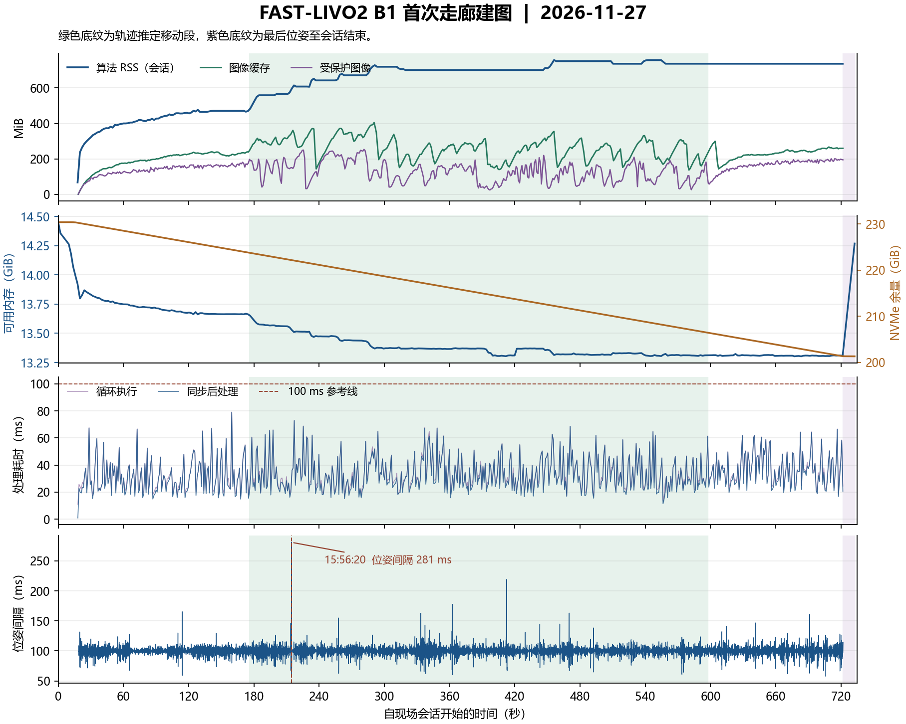
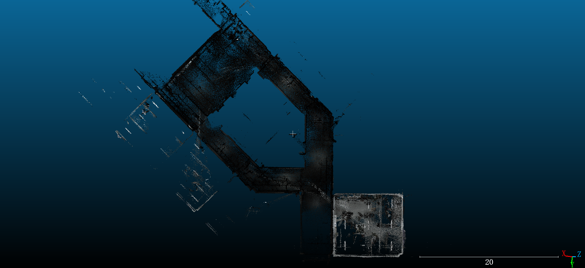
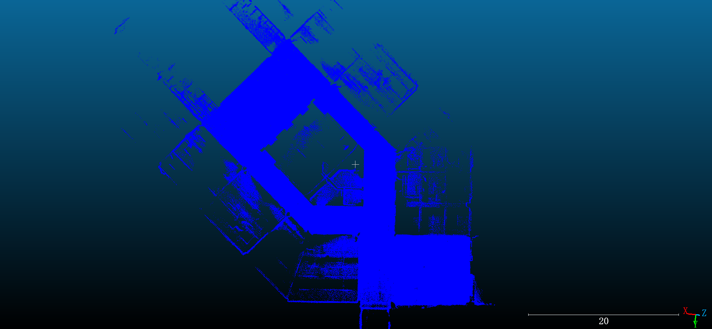

# FAST-LIVO2 B1 首次走廊移动建图实验技术报告

- **实验日期** 2026 年 11 月 27 日（北京时间，UTC+8）
- **实验基线** Baseline 01 · `corridor_20261127T075234Z_eiYOUs`
- **实验平台** 人工手推式四轮小推车 · Orange Pi 5 Ultra · FAST-LIVO2 B1

本轮在标称 **5 V / 3 A** 移动供电及无 USB 维护线的条件下，通过了**移动供电、板端独立运行、实时融合、原始数据录制和地图归档**验收。会话运行 **732.519 s**，移动段估计路程约 **180 m**。板端保存了 **57 个 SQLite 分片、28.646 GiB** ROS Bag、两份重力对齐点云和 **7,035 个位姿**。移动段算法处理采样 P95 为 **58.26 ms**，返回静止后 RSS 稳定在约 **737 MiB**。当前继续采用 B1 正式版本、Orange Pi 5 Ultra 和现有移动供电方案。[关键指标](首次走廊建图实验_关键指标.json)

## 1. 实验背景与目的

本项目需要在进入正式机器人平台前，验证便携式 LiDAR、IMU 与相机融合建图链路在真实环境中的运行能力。本次从 11 月 26 日的便携电源待机快检推进到带载实采，采用实际走廊路线，覆盖静止初始化、短停、转弯、人工越门槛、返回停止、数据保存和导出。验证对象为 RK3588 主控、传感器、供电与数据链路的组合；本阶段验收范围为手推式建图。

现场过程、装置和操作现象取自网页端记录，算法退出计数、资源、传感器时序和系统日志采用板端证据。轨迹运动阶段与静止稳定性沿用网页端的分析窗，并用同一份 TUM 的板端复算交叉核对。[现场记录](<FAST-LIVO2 B1 首次走廊移动建图实验总结(网页端).md>) · [板端复核](首次走廊建图实验总结_Codex板端.md)

## 2. 实验硬件平台及安装方式

| 项目 | 本轮装置 |
| --- | --- |
| 移动平台 | 人工手推式四轮小推车，收纳箱和纸箱临时承载，移动、转向及过门槛由人员操作 |
| 主控 | Orange Pi 5 Ultra 16 GB，RK3588，Ubuntu 22.04.5，Linux `5.10.160-rockchip-rk3588` |
| 传感器 | Livox Mid-360S（LiDAR／IMU）、海康 MV-CU013-A0UC 工业相机、硬件同步器 |
| 安装 | 雷达与相机共用支架并固定于箱盖，硬件同步器也在箱盖上；主控、充电宝、DP100 数字电源和线束放在箱内 |
| 存储 | 256 GB NVMe，`/dev/nvme0n1p1`，ext4，挂载在 `/data` |
| 场景 | 较亮的实验室和较暗的近环形走廊。出实验室门槛时人工抬起并放下推车，返回后在实验室随意停车 |

现场三张装置照片由网页端记录引用。截至整合时可定位的本地原图为四张本轮 CloudCompare 截图，均随报告归档。[现场装置记录](<FAST-LIVO2 B1 首次走廊移动建图实验总结(网页端).md#2-实际装置与场景>)

## 3. FAST-LIVO2 B1 软件部署与运行配置

| 项目 | 实际使用值 |
| --- | --- |
| 正式版本 | B1，标签 `stage-b1-20261127`，部署提交 `082098ff69052e02397807094cdfa9c4a412b9e7` |
| 现场 ELF SHA256 | `a4e4320cac0668987bf15a4a8199430c50a5a65cd008ef00aace1a960f70aeb2` |
| 当次解析配置 SHA256 | `92c6a9b4d22e5b26873d43b62e3915d1e33dcc42fac0fdb5ede9250eb791bd2d` |
| 正式入口与 ROS | `/home/orangepi/fast_livo2`，ROS 2 Humble，线上域 215，`ROS_LOCALHOST_ONLY=1`；离线 RViz 域 219 |
| 估计配置 | LIVO 模式，LiDAR、IMU、相机和视觉局部地图开启；Mid-360S 最近距离 0.5 m；算法内部重力对齐关闭，由归档器对点云和位姿施加同一个重力变换 |
| 时序配置 | `img_time_offset=0.1 s`，`imu_time_offset=0`，`lidar_time_offset=0`，`exposure_time_init=0` |
| 录包 | 板端独立 tmux 会话运行 rosbag2，SQLite3，512 MiB 分片，100 ms 发现轮询，七路话题 |

现场身份文件、同一会话的重力初始化记录和地图 manifest 中的算法 SHA256 一致。版本以这些随会话输出的记录为准。[B1 发布记录](https://github.com/Nirvana110230/culvert-fast-livo2/blob/stage-b1-20261127/deploy/release.json) · [会话身份与配置证据](首次走廊建图实验_证据索引.md#e1-实验身份与启动周期)

## 4. 充电宝移动供电及无线通信方案

主控采用充电宝 USB-A **标称 5 V / 3 A** 档，雷达与同步器由充电宝另一输出经 DP100 供电。雷达接板端专网，主机 `192.168.2.100`、雷达 `192.168.2.163`、接口 `enP3p49s0`。Windows 和香橙派接入 Xiaomi 15 Pro 手机热点，USB 维护线在移动前拔除。

Windows 留在实验室，通过 SSH 维护和导出数据。雷达驱动、相机采集、融合、归档、录包均在香橙派执行。建图与录包由两个独立板端 tmux 会话托管。返回后第一次 SSH 连接超时，第二次成功，出发前后实验 Boot ID 及四个核心 PID 一致，录包继续增长。16:03:44 重连附近 ±3 s，LiDAR、IMU、图像三路入包分别为 **60／1,200／60** 条，消息头最大间隔分别为 **100.323／5.996／100.323 ms**。[现场操作记录](<FAST-LIVO2 B1 首次走廊移动建图实验总结(网页端).md#4-实验实际操作流程>) · [系统日志](首次走廊建图实验_证据索引.md#e2-供电与历史系统日志)

## 5. 完整实验过程与时间线

表中时间为北京时间。运动区间由轨迹估计，现场的 `MOVE_START` 与 `MOVE_END` 为人工标记。

| 时间 | 操作及结果 |
| --- | --- |
| 15:44:31 | 建图前 chronyd 校时，向前拨快 1,632.168584 s。系统时钟同步后开展实采 |
| 15:51:49–15:51:56 | Windows 经热点登录。确认雷达专网、雷达 Idle、相机枚举、NVMe 可写及校时状态 |
| 15:52:34 | 创建独立实验目录，保存 `boot_id.txt`，启动录包 tmux 并监听 |
| 15:52:45.808 | 在另一 tmux 启动正式 `start.sh --runs-dir "$FIELD"`，运行驱动、采集、算法与归档 |
| 15:52:58.776–15:53:04.236 | Bag 首条、约 15:53:01.092 首张图像、约 15:53:03.136 算法启动及 TUM 首个位姿 |
| 15:54 左右 | 保持推车静止，确认重力与轨迹就绪、三路输入及视觉更新增长、七路录包及分片正常 |
| 15:55:34 | 写入 `MOVE_START`，开始实际推车流程 |
| 15:55:41.636–16:02:43.146 | 轨迹识别的移动阶段，包含走廊行进、转弯、短停和人工越门槛 |
| 16:03:44／16:04:07 | 回到实验室后无线重连，确认会话仍在，补记 `MOVE_END`；后者比估计停车晚约 84 s |
| 16:04:47.760–16:04:58.327 | 末个位姿、16:04:48.293 末条 Bag 消息，随后停止相机、雷达和算法，完成归档 |
| 16:05:09.112 | 发送 Ctrl+C 后 rosbag2 记录 `Recording stopped`，元数据落盘 |
| 16:06–16:20 | 校验保存结果，经 VNC／RViz 初看地图，再通过 SCP 导出地图目录，在 Windows CloudCompare 2.13.2 查看 |
| 16:34:53–54 | 系统结束登录会话，`wtmp` 记录正常 shutdown，现场随后切断供电 |

启动前记录到的 15:17:00 为校时前的板端墙钟，按校时事件和内核单调时间折算实际开机约 15:44:02。实验 Boot ID 为 `8160524b-808c-42d0-b2c5-6c7d62cbcd68`，后续适配器启动使用另一个 ID。现场使用 `status.sh`、`result.json`、`view.sh --run "$RUN" --check` 及 `ros2 bag info` 检查成品。[启动及时间线证据](首次走廊建图实验_证据索引.md#e1-实验身份与启动周期)

stop 后雷达从 Sampling 1 进入 Idle 2，ACK 返回 `ret_code=0, error_key=0`，回读目标和当前模式均为 2；2.0 s 网口验证期间点云和 IMU 包均为 0。相机退出并恢复原触发、帧率控制及 UserSet 状态。归档、驱动、相机、算法 PID 分别为 **3998／4029／4049／4089**，退出码均为 0、无强制终止。[收尾证据](首次走廊建图实验_证据索引.md#e5-地图轨迹与收尾)

## 6. 5 V / 3 A 供电稳定性分析

11 月 26 日待机快检观察 **243.11 s、25 次采样**，确认相机枚举、雷达待机应答和 NVMe 状态。本次同时执行雷达扫描、IMU、相机采集、实时融合、无线维护和地图归档。采集全过程中相机 USB 接收约 **8.63 GiB** Bayer 数据。原始录包文件量按有效时长折算为 **41.34 MiB/s**；按移动段文件系统空间变化估计为 **42.06 MiB/s**。NVMe 可用空间从会话开始的 **230.39 GiB** 降到归档完成的 **201.31 GiB**。同一启动、同一进程、录包和地图校验，以及关机记录共同支撑带载结论。

历史 journal 配置为 `Storage=volatile`，板端调查用 `kern.log`、`syslog`、`wtmp`、`sysstat` 和本轮会话日志恢复实验时段。现有记录未见导致运行中断的欠压、过流、NVMe/PCIe 复位、ext4/I/O 错误、雷达专网载波变化或 OOM。启动时的 USB reset 与三次 CMA 分配失败详见第 11 节，现有证据不足以归因于供电不足。建图前和返回后的 SoC 温度快照约 **40 ℃／58 ℃**，采集时段无节流警告记录；全程频率和温度曲线未采集。

**验收判断**。标称 5 V / 3 A 通过本轮约 12 min 的实际工作负载，当前方案可继续用于同条件短时试验。5 V / 3 A 对应额定输出 15 W。板端 5 V 输入缺乏可校验的欠压遥测，输入电压、电流、功率、线损、多口分配及低电量条件下的余量待在正式线束上实测。Orange Pi 官方推荐固定 5 V / 5 A 输入，作为最终平台供电设计参考。[历史系统与供电证据](首次走廊建图实验_证据索引.md#e2-供电与历史系统日志) · [Orange Pi 官方手册](http://www.orangepi.org/orangepiwiki/index.php/Orange_Pi_5_Ultra)

## 7. 算法实时性、CPU、内存及视觉缓存分析

### 7.1 处理节拍与计算负载

`processing.csv` 约每秒从成功同步循环采样一次，间隔中位数 **1.025 s**。`processing_ms` 量测成功同步后的 IMU、估计和建图处理；`cycle_ms` 另计该循环的回调与同步。LIVO 在同一图像时刻可先后执行 LIO、VIO 循环，100 ms 为 10 Hz 周期参照。数据支持本轮持续融合能力，逐帧最坏延迟需更密集的处理日志。

| 阶段与统计项 | 样本 | 均值 ms | 中位数 ms | P95 ms | P99 ms | 最大 ms | 超过 100 ms |
| --- | ---: | ---: | ---: | ---: | ---: | ---: | ---: |
| 全程处理 | 686 | 32.99 | 29.73 | 59.06 | 67.03 | 78.94 | 0 |
| 首个位姿后静止 | 153 | 30.73 | 27.77 | 55.42 | 67.20 | 78.94 | 0 |
| 移动时处理 | 410 | 32.86 | 29.10 | 58.26 | 67.04 | 72.77 | 0 |
| 返回后静止 | 122 | 36.49 | 34.52 | 60.47 | 64.17 | 66.36 | 0 |
| 全程循环 | 686 | 34.38 | 31.24 | 59.29 | 67.35 | 79.21 | 0 |

全程另含首个位姿前 1 条样本。最终成功同步 **14,076** 次。LiDAR／IMU／图像队列中位数 **0／21／0** 条，P95 **1／22／1** 条，采样最大 **1／24／1** 条，无持续积压；停机尾队列为 **5／134／0** 条。输出位姿平均 **9.998 Hz**，相邻发布间隔 P95 **110.655 ms**、P99 **118.833 ms**。

历史 `sysstat` 两个 10 min 窗（15:50:26–16:00:26、16:00:26–16:10:26）的全核平均非 idle 比例为 **26.31%／24.88%**，iowait 为 **0.12%／0.05%**，NVMe 写入为 **29.47／20.24 MiB/s**。这两个窗口包含采前、采集、收尾或显示时段。算法可独立完成本轮融合与归档，同时板端维持录包；精确的瞬时 CPU 占用及各核频点不在现存数据范围内。[资源原表](首次走廊建图实验_证据索引.md#e3-算法资源与视觉缓存)

### 7.2 内存水位与视觉缓存

会话采样 358 次，其中算法 RSS 351 次。首个位姿附近首个资源样本约 **236.9 MiB**，初始静止末约 **470 MiB**，移动段会话采样峰值 **757.64 MiB**，视觉内部采样峰值 **760.72 MiB**。返回后约 123 s 保持 **736.76–736.91 MiB**，线性斜率约 **−0.08 MiB/min**。最低系统可用内存约 **13.30 GiB**，两个 sysstat 时点交换空间使用均为 **512 KiB**。离线 RViz 同开两份点云时自身 RSS 约 3.55 GiB，属于之后的显示负载。

| 视觉缓存指标 | 观测结果 |
| --- | --- |
| 图像缓存 | 峰值 324 张／405 MiB，末次 208 张／260 MiB |
| 受保护图像 | 峰值 203 张／253.75 MiB，末次 156 张／195 MiB |
| 实际释放 | 最后采样在视觉第 7,033 帧，创建 4,962 张、释放 4,754 张；这些释放均记录为最后引用释放，累计约 5.80 GiB |
| 观测管理 | 累计淘汰 80,736 个点和 331,909 个特征，剪除 22,918 条历史观测 |
| LRU 维护开销 | 中位数 1.94 ms，P95 3.94 ms，最大 7.25 ms；系统内存短缺量和压力淘汰点数均为 0 |

B1 按距离、帧龄和系统余量管理视觉点和观测，保留参考、最新和近期观测，允许淘汰同一活跃点的冗余历史。系统压力门槛为 `MemAvailable < MemTotal/8`，本机约 **1.95 GiB**。本次在正常策略下产生大量实际图像释放，返回静止后内存形成平台。旧版 512 MiB 固定保护预算曾导致动态会话退出，B1 本轮未复现该故障。

退出计数确认图像接收 **7,039 帧**，进入 VIO **7,035 帧**，有光度残差／Jacobian 更新 **7,034 帧**、共 **106,561 步**。唯一未发生视觉更新的 VIO 首帧建立初始观测。网页端现场的 7,037／7,031 对应最后一次成功循环日志采样，正式验收采用退出计数。[算法计数与缓存证据](首次走廊建图实验_证据索引.md#e3-算法资源与视觉缓存)



## 8. 雷达、IMU、相机数据质量与时间同步

### 8.1 录包完整性与节拍

57 个 SQLite 分片的消息数、起点与时间跨度逐片与 `metadata.yaml` 互证，相邻分片时间范围无重叠。有效录制跨度 **709.516705433 s**，统计覆盖全部索引、核心消息头及三个小型诊断话题。

| 话题 | 消息数 |
| --- | ---: |
| `/livox/lidar` | 7,119 |
| `/livox/imu` | 142,286 |
| `/hik_camera/image_timeshare` | 7,067 |
| `/hik_camera/camera_info_timeshare` | 7,067 |
| `/hardware_sync/camera_metadata` | 7,067 |
| `/hardware_sync/camera_events` | 35,334 |
| `/hardware_sync/camera_clock` | 663 |
| 合计 | **206,603** |

| 数据与计时基准 | 中位数 ms | P95 ms | P99 ms | 最大 ms | 超阈值 |
| --- | ---: | ---: | ---: | ---: | ---: |
| LiDAR 接收时间 | 100.003 | 104.637 | 111.987 | 279.741 | 3 |
| LiDAR 消息头 | 99.840 | 100.320 | 100.322 | 100.360 | 0 |
| IMU 接收时间 | 4.936 | 7.015 | 11.061 | 89.923 | 5,629 |
| IMU 消息头 | 4.896 | 5.895 | 5.941 | 49.805 | 5 |
| 图像接收时间 | 100.051 | 115.533 | 127.504 | 321.633 | 8 |
| 图像消息头 | 99.840 | 100.320 | 100.322 | 200.160 | 2 |

间隔阈值取名义周期的 1.5 倍（LiDAR/图像 150 ms，IMU 7.5 ms）。图像另有两次零间隔，三路消息头均无倒序。Bag 接收时间受发布、传输及录包调度共同影响，首段有成批接收；mapper 与 Bag 的订阅及结束时点不同，计数差不作丢帧率。完整分位数、各阶段和跨片比较见指标 JSON。[Bag 与时序证据](首次走廊建图实验_证据索引.md#e4-bag-索引时钟与输入事件) · [逐阶段指标](首次走廊建图实验_关键指标.json)

### 8.2 同步链路及局部异常

LiDAR 发布前写共享扫描基准，7,119 个 Bag LiDAR 消息头全部匹配驱动写入记录。相机成功取帧后读此基准并赋给 Image／CameraInfo 消息头，7,067 帧与记录逐帧相符。B1 对图像头加 **100 ms** 形成融合候选，所有候选在 Bag IMU 消息头时间轴均可双侧夹住，夹持间隔中位数 **4.41 ms**；686 条估计器 `state_s` 与候选均在 **1 µs** 内对应。相机 SDK 帧号连续，设备时标约 100 ms 一帧。包内有 7,068 个 Line0 上升沿和 7,066 个 ExposureStart，仍缺逐曝光事件的可靠配对和独立物理参考。

`state_s` 使用传感器融合时间，`ros_s` 与 TUM 使用 ROS 发布墙钟，`wall_s` 为主机单调时间。主机单调时间以同一会话实测偏移对齐 ROS 墙钟。传感器域与墙钟域的绝对差不用于计算延迟。现有证据支持本次软件对时链路，绝对曝光相位与硬件同步精度留待专项验收。

- **两处相机共享戳重复。** 启动阶段的 1／2 号帧复用时间戳。15:56:20 移动中，1991 号帧从 SDK 取到至发布耗时 **226.91 ms**；随后图像消息头跳过 **199.68 ms**，1993／1994 号帧复用共享戳。该时间段 LiDAR、图像最长 Bag 接收间隔为 **279.74／321.63 ms**，LiDAR 消息头维持正常节拍，TUM 有全程最长 **281.168 ms** 间隔。
- **一处移动中 IMU 间隔。** 15:57:58.636–.727，IMU 接收间隔 **89.92 ms**、消息头间隔 **44.27 ms**，为移动段唯一超过 7.5 ms 的 IMU 消息头间隔；其余两路同期消息头连续。另四个超阈 IMU 消息头间隔发生在录包起始阶段。

上述移动事件均无对应的系统、雷达或相机重启记录。具体调度、处理或驱动链路原因需有界复核。[时间配对与事件证据](首次走廊建图实验_证据索引.md#e4-bag-索引时钟与输入事件)

## 9. 彩色点云与几何点云建图结果

| 成品 | 数量 | 归档格式 |
| --- | ---: | --- |
| 几何点云 | 12,879,873 点 | PCD v0.7 binary，XYZ／intensity／normal_xyz／curvature，32 B/点 |
| 彩色点云 | 2,130,867 点 | PCD v0.7 binary，XYZ／packed RGB，16 B/点 |
| 轨迹 | 7,035 位姿 | TUM，时间、XYZ、四元数 xyzw |

两份 PCD 均通过文件头、记录布局、载荷长度和 XYZ 有限值检查。归档根据初始化重力对 `camera_init` 施加约 **21.58°** 的单次旋转，平移为零，统一输出 `map_gravity`。点云和位姿使用同一变换，归档 TF 测试点误差为 **2.22×10⁻¹⁶ m**。板端、归档清单与 Windows 副本的三个文件 SHA256 全部一致。[地图校验](首次走廊建图实验_证据索引.md#e5-地图轨迹与收尾)

CloudCompare 实际截图可辨认实验室、长直段及近环形走廊的转角连续性，几何点云显示范围大于彩色点云。实验室亮、走廊暗与现场照明一致。几何点云图中的深蓝色是显示设置。局部几何量测见第 10 节。

| 彩色点云俯视 | 几何点云俯视 |
| --- | --- |
|  |  |

[彩色点云三维斜视](figures/彩色点云三维斜视图.png) · [几何点云三维斜视](figures/几何点云三维斜视图.png)

## 10. 轨迹、静止定位稳定性及局部几何质量

### 10.1 运动阶段与轨迹量化

全轨 **703.524834 s**，相邻间隔中位数 **100.159 ms**、最大 **281.168 ms**，逐帧三维／水平累计长 **190.880／187.861 m**。网页端用 1 s 位移速度、约 0.05 m/s 阈值识别移动并合并短停，得到首个位姿以后 **157.40–578.91 s** 的 **421.51 s** 移动窗。窗内逐帧三维轨迹长度 **186.838 m**，网页端 0.5 s／1 s 重采样长度 **180.503／178.952 m**，1 s 重采样平均估计速度 **0.425 m/s**。板端以含首末精确边界的栅格复算为 **180.498／178.950 m**。

首尾估计位置差 **20.881 cm**。两静止窗质心差 **20.825 cm**（XYZ 分量约 **20.653／2.646／0.368 cm**），平均姿态差 **12.613°**。推车随意停车，实际起终位姿有差异，以上记录为估计位姿差。轨迹 Z 极值 **−32.536／+12.813 cm**，极差 **45.349 cm**。两圈若干近似位置有重复起伏，门槛处确有人工抬升和放下，局部变化与整段高程变化须结合地图和地面量测分析。[网页端轨迹计算](<FAST-LIVO2 B1 首次走廊移动建图实验总结(网页端).md#7-轨迹定量复算>) · [轨迹复算证据](首次走廊建图实验_证据索引.md#e5-地图轨迹与收尾)

### 10.2 静止定位输出稳定性

以各自静止窗平均位置、平均旋转为参考。表中数值衡量短时静止估计波动。

| 指标 | 初始 10–150 s | 结束 585–703.525 s |
| --- | ---: | ---: |
| 样本数 | 1,400 | 1,186 |
| 三维位置波动 RMS | 0.473 mm | 1.646 mm |
| 位置偏移 P95 | 0.757 mm | 2.831 mm |
| 最大位置偏移 | 1.166 mm | 6.763 mm |
| 窗口首尾位置差 | 0.335 mm | 2.425 mm |
| 姿态波动 RMS | 0.0345° | 0.0349° |

### 10.3 局部几何拟合

在五个位姿附近用几何点云拟合局部主平面。地面窗口沿行进方向 ±1.5 m、横向 ±0.8 m；两侧墙面窗口沿行进方向 ±2 m、侧向距 0.55–3.3 m，地面以上 0.25–1.9 m。地面和墙面内点阈值分别为 35／25 mm。RMS／P95 由拟合内点计算。

| 相对首个位姿 | 地面 Z | 地面 RMS／P95 | 地面相对水平角 | 左／右近竖直平面 RMS |
| --- | ---: | ---: | ---: | ---: |
| 0 s | −0.560 m | 7.9／17.7 mm | 0.96° | 13.5／12.5 mm |
| 235 s | −0.494 m | 8.0／15.2 mm | 1.13° | 8.1／9.4 mm |
| 272 s | −0.580 m | 8.4／17.8 mm | 1.77° | 11.6／11.1 mm |
| 340 s | −0.849 m | 8.8／17.0 mm | 1.76° | 8.6／9.9 mm |
| 470 s | −0.827 m | 9.2／18.1 mm | 1.98° | 8.9／11.0 mm |

235 s 与 340 s 一带的拟合地面在地图内高差约 **35.5 cm**；四处移动截面的传感器中心距局部地面约 **0.574–0.588 m**。该变化同时体现在轨迹和地图地面上。实地高差、平台形变和地图形变的贡献尚无法拆分，表中平整度及倾角以单图内部量测为限。[拟合方法与数据来源](首次走廊建图实验_证据索引.md#e5-地图轨迹与收尾) · [窗口支持率与法向量](首次走廊建图实验_关键指标.json)

## 11. 实验问题及处理方式

| 问题 | 现场处理与证据 |
| --- | --- |
| 启动前状态显示历史 B0 | 用 B1 现场 ELF、会话身份及发布记录确认实际运行 B1 |
| 冷启墙钟偏差 | 实验前由 NTP 拨时，采集从同步后开始。无网冷启需单独验证 |
| 无线首次重连超时 | 第二次 SSH 成功，恢复本轮变量并核对原 Boot ID、PID 和录包增长。超时原因待查 |
| 相机启动 USB reset | 15:52:59 有一次 high-speed reset，约 15:53:00.851 MVS 成功打开。稳定采集阶段未记录重置或重枚举，收尾统计 USB 错误帧为 0；另有 1 次未标时的 500 ms SDK 等待超时 |
| 三次 CMA 分配失败 | 15:53:01、15:53:50、15:54:40 出现连续物理内存相关的 512／1,024／1,024 页分配失败。后两次附近三路消息头节拍正常，归档完成。调用者与根因待查 |
| 相机共享戳异常与 IMU 间隔 | 已定位到具体时点、帧号和分片，列入下一阶段定向复核 |
| 相机诊断 CSV 列错位 | `frames.csv` 19 列表头含 `sdk_host_timestamp_raw`，7,067 行正文为 18 列。统计按实际列布局解析，并以 timeshare 和 ROS metadata 核对，原文件供复现 |
| RViz 窗口不可见及全图卡顿 | 修正 VNC 的 `DISPLAY=:1` 后窗口可见；两份大点云同开渲染不足，改在 Windows 查看 |
| CloudCompare 按 BIN 读取异常 | 重新按 PCD 格式打开两份点云并完成查看 |
| 导出后关机 | 完成成品检查与导出后正常停机，已经记录；后续现场作业保留这一收尾项 |

USB reset 和 CMA 调查记录归入故障证据，现有材料支持继续使用现供电方案。[网页端现场问题](<FAST-LIVO2 B1 首次走廊移动建图实验总结(网页端).md#8-点云可视化与问题处理>) · [板端系统证据](首次走廊建图实验_证据索引.md#e2-供电与历史系统日志)

## 12. 实验验收结论

| 验收项 | 结论 | 判定依据 |
| --- | --- | --- |
| 5 V / 3 A 移动供电 | 本轮通过 | 实采、持续写盘、归档及导出完成，同一启动周期无中断 |
| 无 USB 维护线的独立运行 | 本轮通过 | 两个 tmux 会话持续运行，Wi-Fi 重连后身份与数据进度一致 |
| RK3588 实时融合 | 本轮通过 | 移动段 P95 58.26 ms，队列未持续积压，位姿平均 9.998 Hz |
| 视觉缓存管理 | 本轮通过 | 持续释放图像，返回静止阶段 RSS 平台，无压力回收或进程失稳 |
| 原始数据录制 | 本轮通过 | 709.516705433 s，57 片均可读，全部索引与元数据吻合 |
| 地图归档与收尾 | 本轮通过 | `map_gravity` 双云及 TUM 哈希一致，雷达 Idle 与停流验证，正常结束 |

**继续采用 FAST-LIVO2 B1 正式版本、Orange Pi 5 Ultra 主控与当前标称 5 V / 3 A 移动供电方案，无需立即进行算法或供电硬件整改。** 定量建图精度、绝对曝光同步、最终线束下的长时供电与正式底盘集成进入后续验证。

## 13. 后续研发计划

1. **传感器时序与诊断。** 对分片 16、24 附近做有界复核，分别对照相机 SDK／发布、共享戳、IMU 原始报文与录包时间，补齐 CSV 字段和重复戳计数。用统一的外部参考量测 Line0 相对实际曝光的相位。
2. **精度与重访。** 布设起终位姿复位标记和外部测距、高程参照，比较两圈共视区域、墙距、地面和平面重影。静止窗口稳定性与外部定位误差分别统计。
3. **正式平台集成与长时负载。** 按最终支架和线束开展振动、转向、暗光和持续运行试验。在主控供电口测量稳态及最低瞬态电压、电流峰值与多口分配，同时记录温度、频率、RSS/PSS、磁盘写入和可持久化系统日志。

## 14. 实验数据及证据索引

板端根路径如下。完整 Bag 和 PCD 原件按既有位置保存，常规 Git 只收录报告、截图、指标及精简证据。

```text
FIELD=/data/robot/maps/fast_livo2/runs/corridor_20261127T075234Z_eiYOUs
BAG=$FIELD/raw_bag
RUN=$FIELD/20261127T075245Z_f64f306a96
MAP=$RUN/map
Windows 地图副本=E:/涵洞巡检轮式机器人/orangepi-dev/data/corridor_runs/20261127_first_mapping/map/
```

| 数据 | 大小及格式 | 已有 SHA256 ／校验范围 |
| --- | --- | --- |
| `BAG/raw_bag_0.db3` 至 `raw_bag_56.db3` | 30,758,715,392 B（28.646 GiB），ROS 2 Bag SQLite3 | 未做全量载荷 SHA256。证据包提供 `metadata.yaml`、逐片字节与时间范围及 206,603 条索引复核 |
| `MAP/map_geometry.pcd` | 412,157,984 B，PCD v0.7 binary | `f2970b872711c8f3c45e5ae7163253d6f0bddb2c9de6e5dbee896006636c5027` |
| `MAP/map_rgb.pcd` | 34,095,920 B，PCD v0.7 binary | `2a113df0399f99611e009b10beb2da5f41a4aa3a1610e5bce2272bdb0752c7c8` |
| `MAP/trajectory.tum` | 1,165,919 B，TUM 文本 | `86bfc17d2fcaf4804ab08b472e2f66beab2cd14e0998e191cb7624f48f8b499f` |
| 实验证据包 | 6,286,526 B，ZIP，83 个带成员散列的文件 | `cad960d788f9a0eb37850d08a5544123cf97834e4163d4104d835979afdfabe6` |

证据按 E1–E5 汇总会话身份、历史系统、算法资源、传感器时序和地图收尾。ZIP 包含规模受控的日志、全消息索引和核心消息头抽取、归档 TUM 和复算脚本。可先用 `SHA256SUMS.txt` 校验成员，再复算统计。现场报告中的图像和视觉更新计数保留其原观察时点，正式值见第 7 节。[证据索引](首次走廊建图实验_证据索引.md) · [指标 JSON](首次走廊建图实验_关键指标.json) · [证据包](首次走廊建图实验_证据包.zip) · [网页端独立总结](<FAST-LIVO2 B1 首次走廊移动建图实验总结(网页端).md>) · [Codex 板端独立总结](首次走廊建图实验总结_Codex板端.md)
