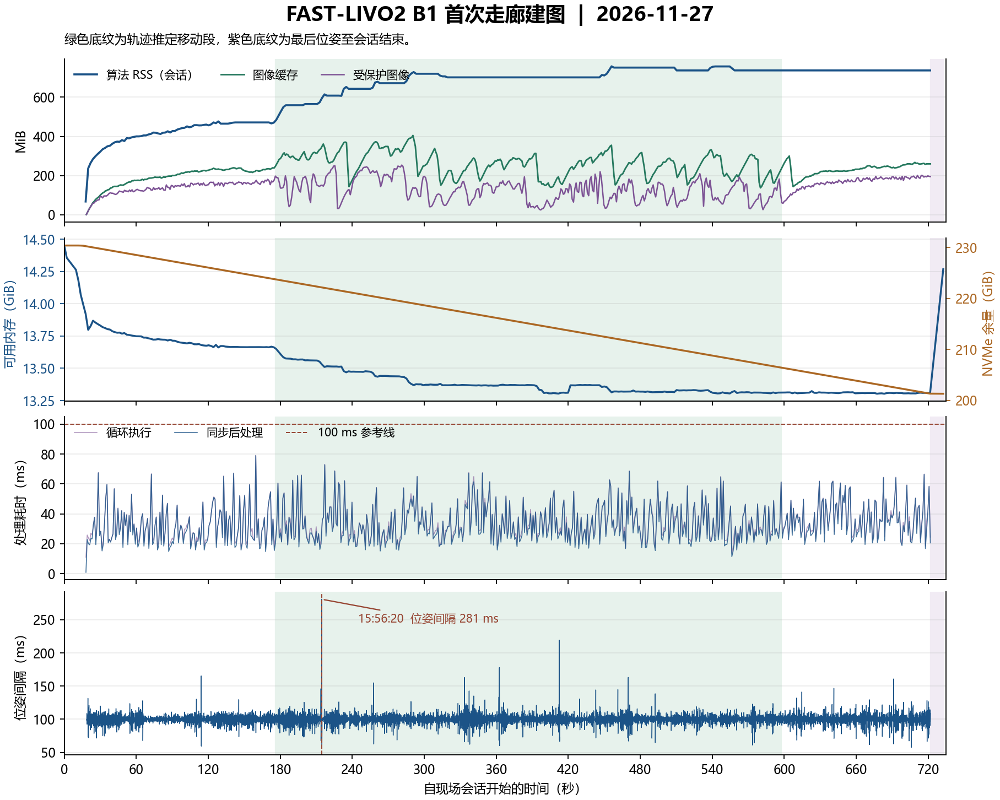

# FAST-LIVO2 B1 首次走廊移动建图实验总结

2026 年 11 月 27 日，北京时间。本文是 Codex 板端复核报告，与网页端现场报告独立保留。

## 1. 总体结果

**标称 5 V / 3 A 的香橙派供电方案通过了本轮实际带载验证，无需因本轮结果立即更换。** 人工推车全程完成 LiDAR–IMU–相机融合、板载 NVMe 录包、无线维护、地图归档和导出。会话运行 **732.519 s**，原始 Bag 有效时长 **709.516705433 s**，含 **57 个 SQLite 分片、206,603 条消息、28.646 GiB** 数据。归档为 `complete`，两份 PCD 和 7,035 位姿 TUM 的板端哈希、归档清单与 Windows 副本一致。约 180 m 是估计轨迹的移动段长度。[关键指标](首次走廊建图实验_关键指标.json) · [网页端现场报告](<FAST-LIVO2 B1 首次走廊移动建图实验总结(网页端).md>)

发现了启动相机 USB 重置、静止阶段 CMA 分配失败、两次相机共享戳重复、一处移动中的 IMU 消息头间隔异常，以及相机诊断 CSV 的字段错位。日志、进程和输入数据均没有把这些事件指向移动供电故障。移动段采样处理时间 P95 **58.26 ms**，结尾静止段 RSS 稳定在约 **737 MiB**。本轮没有必须修改 B1 融合算法的证据。[证据索引](首次走廊建图实验_证据索引.md)

实验平台为人工推动的四轮小推车和收纳箱。雷达、相机和同步器在箱盖，香橙派和电源在箱内。香橙派由充电宝 5 V / 3 A 档供电，雷达和同步器经 DP100 供电。Windows 和板端使用手机热点，USB 维护线在出发前物理断开。复核时按用户说明恢复适配器，用严格 ED25519 校验通过 `opiss-usb` 登录原板。分析只读，使用原会话记录和 Windows 已有地图副本。[现场平台及过程](<FAST-LIVO2 B1 首次走廊移动建图实验总结(网页端).md>) · [取证范围](首次走廊建图实验_证据索引.md)

## 2. 启动周期与现场时间线

实验 `boot_id.txt` 为 `8160524b-808c-42d0-b2c5-6c7d62cbcd68`。`processes.json` 的全部子进程都绑定到这个 ID。适配器启动为 `e602edf5-1e54-4d7f-9d3c-efe34cd82c49`，`journalctl --list-boots` 仅列出这个当前启动，按实验 ID 查询返回历史记录不可用。配置为 `Storage=volatile`，持久 journal 目录无条目，当前 journal 保存在 `/run`。幸存的 `kern.log`、`syslog`、`wtmp` 和 `sysstat` 可以覆盖实验时段与关机，无法恢复历史 journal 的全部事件和元数据。板端 rsyslog 信息按校时事件、内核单调时间和进程日志交叉绑定到历史启动。[E1–E2](首次走廊建图实验_证据索引.md#e1-实验身份与启动周期)

`wtmp` 将历史启动记为 **15:17:00**，这是开机初期的板端墙钟。**15:44:31**，chronyd 将其向前拨快 **1,632.168584 s**。校时后的内核单调时间与相机、算法日志对应，折算历史启动约为 **15:44:02**。采集在校时后约 8 min 开始，采集中无同类墙钟跳变记录；`wtmp` 的旧墙钟不可用于计算实际运行时长。[E1–E2](首次走廊建图实验_证据索引.md#e1-实验身份与启动周期)

| 北京时间 | 板端证据 |
| --- | --- |
| 15:51:49 | `wtmp` 记录手机热点 SSH 登录 |
| 15:52:45.808 | 建图会话开始 |
| 15:52:58.776 | Bag 最早记录（IMU）；15:53:01.092 首张图像入包 |
| 15:53:03.136 / 15:53:04.236 | 算法启动／TUM 首帧。至移动段开始约 157.40 s，含静止初始化和静止观测 |
| 15:55:34 | 现场写入 `MOVE_START` |
| 15:55:41.636–16:02:43.146 | 按网页端移动区间对齐到 TUM 发布墙钟，含转弯和短停 |
| 16:03:44 / 16:04:07 | `wtmp` 记录返回后 SSH 会话；现场补记 `MOVE_END`。估计停车至此已约 84 s |
| 16:04:47.760–16:04:58.327 | TUM 末帧至会话完成。相机、雷达、算法依次收尾，归档最终完成 |
| 16:05:09.112 | rosbag2 记录 `Recording stopped`；末条有效消息在 16:04:48.293 |
| 16:06–16:20 | 后续 RViz／VNC 和 Windows 下载；sysstat 也记录 Wi-Fi 传输 |
| 16:34:53–54 | 系统停止登录会话，`wtmp` 记录正常 shutdown |
| 17:05:45 起 | 适配器供电后的新启动，当前 journal 从 17:05:48 开始 |

板端最终身份表保留 `archive=3998`、`driver=4029`、`camera=4049`、`algorithm=4089` 及同一 Boot ID，退出码均为 0，`forced=false`。网页端的出发前、重连后现场快照与这四个 PID 相符。会话参数域为 215。旁路 observer 是启动期检查，15:53:03 正常退出，其短窗数据只用于启动就绪判断。[E1、E3](首次走廊建图实验_证据索引.md)

## 3. 5 V / 3 A 供电调查

### 本轮故障证据

| 项目 | 历史证据及判断 |
| --- | --- |
| 欠压／电源 | 建图、导出时段的落盘日志中无欠压、过流或整板电源故障记录。启动有 `vcc5v0_sys` 等 device link `-ENOENT` 和无设备使用的 regulator 被关闭，文义分别是驱动依赖登记及启动清理，不能作为输入电压测量。 |
| 相机 USB | 15:52:59，`usb 2-1` 对设备号 2 执行一次 high-speed reset，随后 PID 4049 出现两条 interface claim 提示。MVS 在 15:53:00.851 成功打开，同号设备后的运行窗口无相机断开、重枚举或再次 reset 日志。SDK 最终统计 7,067 帧、USB 错误帧 0，报告 1 次 500 ms 等待超时但未留该次时间。 |
| 内存／进程 | 15:53:01、15:53:50、15:54:40 分别出现 CMA 512、1024、1024 页的分配失败 `-12`。后两次的 ±3 s 窗口内三路消息头维持正常节拍。CMA 是连续物理内存的分配路径，已有日志无法定位调用者或失败原因；未发现 OOM kill、相关 ROS 进程崩溃或重启。 |
| NVMe／PCIe／ext4 | 历史启动中 NVMe 枚举、分区和 ext4 挂载有记录，采集至关机窗口内无 NVMe 控制器复位、PCIe 链路故障、块 I/O 错误或 ext4 报错。全部分片可读且结果完整。 |
| 雷达专网／Wi-Fi | 建图时段无雷达专网载波变化记录，雷达启动和结束的开机计数均为 496。用户遇到无线 SSH 超时，历史日志记录了 16:03:44 新会话，附近三路消息头连续。16:08:19 的 Wi-Fi 扫描、16:14:23 的 DHCP 续租在采集结束后。掉线侧及超时的具体原因未能确定。 |
| 热／显示 | 建图时间窗无温控节流警告或 CPU 故障降频记录。网页端现场仅有启动前约 40 ℃、返回约 58 ℃的 SoC 温度快照。启动日志另有约 40.7–42.5 ℃的短暂监测，雷达核心温度从 Sampling 回读的 45.52 ℃ 到停止前 52.78 ℃。16:07:30 后的 HDMI I²C／EDID 错误发生在查看阶段。系统缺少建图全程逐秒温度和频率记录。 |

当前系统的 `hwmon` 仅给出温度和风扇信息，`power_supply` 无设备，板端设备树的 `vcc5v0_sys` 和 `vcc5v0_usbdcin` 为 `regulator-fixed`。SARADC 存在，设备树已见的 IIO 消费用途为音频、按键等；未找到可校验为板端 5 V 输入的测量项或欠压标志。当前系统可看内核及 PMIC 驱动有上报的事件，**尚无可靠的板端输入欠压检测与日志能力证据**。历史 journal 的缺失进一步限制了排查范围。未发现故障日志、未确认检测能力、历史 journal 不可用，三项分别成立。[E2](首次走廊建图实验_证据索引.md#e2-供电与历史系统日志)

### 工作负载与工程结论

11 月 26 日 PB200 快检记录 243.11 s、25 次采样，海康 USB 设备号和雷达 Idle 应答稳定，NVMe SMART 在该观察窗无新增相关错误。那次未拉起雷达采样、相机取流、实时融合或连续录包。此次记录了相机 USB 成功收取约 **8.63 GiB** 原始 Bayer 数据、全部三路输入和 NVMe 带载写入。Bag 文件量／有效录制时长为 **41.34 MiB/s**，会话采样的移动阶段文件系统空间下降约 **42.06 MiB/s**。两者是不同口径的平均值。sysstat 的 15:50:26–16:00:26 和 16:00:26–16:10:26 平均全核非 idle 分别为 **26.31% / 24.88%**，NVMe 写入约 **29.47 / 20.24 MiB/s**，十分钟平均混合了采集准备、移动、停机或查看，无法反推瞬态负载或功耗。采集期间系统可用内存记录最低约 **13.30 GiB**。[E2–E4](首次走廊建图实验_证据索引.md) · [11 月 26 日快检](https://github.com/Nirvana110230/culvert-inspection-robot/blob/4ac2ecd54bca61c8657211d12380fcd9effa719e/knowledge/history/sessions/H069.md)

**工程判断**。本轮的供电接法、线束和温度下，5 V / 3 A 足以执行该约 12 分钟工作流。供电路径上未见影响完成度的实际异常，现方案可用于后续同条件短时采集。5 V / 3 A 对应铭牌功率 15 W，已有数据无法确认板端输入静态或瞬态最低电压、电流峰值、线损、实际功耗、充电宝多口分配和电量较低时的余量。正式车体长时验证应使用最终电源与线束并实测，官方推荐固定 5 V / 5 A 输入。[工作负载与电源证据](首次走廊建图实验_证据索引.md#e2-供电与历史系统日志) · [Orange Pi 官方手册](http://www.orangepi.org/orangepiwiki/index.php/Orange_Pi_5_Ultra)

## 4. 算法实时性、队列与内存

### 处理耗时与队列

`processing.csv` 覆盖会话的 **686 条**成功同步后的循环采样，采样间隔中位数 **1.025 s**，源码设置约每秒一采。LIVO 在同一图像时刻先 LIO 后 VIO，两者可各形成一个成功同步循环，`processing_ms` 含同步后的 IMU、估计与建图处理，`cycle_ms` 再含本轮 `spin_some` 和同步执行。它们均为被采中的单次循环耗时，不覆盖等待下一批输入的时间。100 ms 是 10 Hz 输入周期参照，采样分布无法证明每个图像、每对循环都在 100 ms 内完成。最后阶段无处理耗时采样。[E3](首次走廊建图实验_证据索引.md#e3-算法资源与视觉缓存)

| 区间 | 样本 | 处理均值 | 中位数 | P95 | P99 | 最大 | >100 ms |
| --- | ---: | ---: | ---: | ---: | ---: | ---: | ---: |
| 全段同步成功采样 | 686 | 32.99 | 29.73 | 59.06 | 67.03 | 78.94 | 0 |
| 启动至首个位姿 | 1 | 0.85 | 0.85 | 0.85 | 0.85 | 0.85 | 0 |
| 首个位姿后静止 | 153 | 30.73 | 27.77 | 55.42 | 67.20 | 78.94 | 0 |
| 移动 | 410 | 32.86 | 29.10 | 58.26 | 67.04 | 72.77 | 0 |
| 返回后静止 | 122 | 36.49 | 34.52 | 60.47 | 64.17 | 66.36 | 0 |
| 全段 `cycle_ms` | 686 | 34.38 | 31.24 | 59.29 | 67.35 | 79.21 | 0 |

耗时单位为 ms。最终成功同步 **14,076** 次。LiDAR、IMU、图像队列中位数为 **0 / 21 / 0** 条，P95 为 **1 / 22 / 1** 条，全程采样最大 **1 / 24 / 1** 条。停机剩 **5 / 134 / 0** 条，采集停止后边界上没有新数据推进完整同步段；运行期间未见队列持续增长。位姿平均 **9.998 Hz**，相邻间隔中位数 **100.159 ms**，P95 **110.655 ms**，P99 **118.833 ms**，有最长 **281.168 ms** 的瞬态间隔，详见第 5 节。[E3–E4](首次走廊建图实验_证据索引.md)

### RSS、交换空间与视觉缓存

会话资源日志 358 组，算法 RSS 样本 351 组。首次图像输出后第一个资源样本 RSS 约 **236.9 MiB**，初始静止末约 **470 MiB**；移动中升至会话采样峰值 **757.64 MiB**（16:00:21.893）。视觉内部的独立采样观察到 **760.72 MiB**。最后 123 s 静止稳定在 **736.76–736.91 MiB**，窗口线性斜率约 **−0.08 MiB/min**。全段有明显的初始化和运动增长，此次末段形成平台，长期运行寿命仍须验证。两套日志的系统可用内存采样最低分别为 **13.303 GiB**（会话）和 **13.298 GiB**（视觉）。收尾时回升到 **14.269 GiB**。sysstat 在 16:00:26 和 16:10:26 都记录交换空间使用 **512 KiB**（总量约 7.80 GiB），说明有少量 swap；16:20:26 的 20 MiB 已过建图。无同会话 PSS 曲线。NVMe 会话可用量从 **230.39 GiB** 到 **201.31 GiB**，图中可见停机前的持续下降。[E2–E3](首次走廊建图实验_证据索引.md)

| 视觉指标 | 本轮实测 |
| --- | --- |
| 缓存图像、活跃及历史图像 | 缓存峰 324 张 / **405 MiB**，活跃峰 118 张、历史峰 262 张。峰值发生在各自不同采样。最后一条 208 张 / **260 MiB** |
| 受保护图像 | 峰 203 张 / **253.75 MiB**，最后 156 张 / **195 MiB** |
| 视觉点、特征、patch | 各列样本峰为 3,948 点、15,894 特征、约 **3.88 MiB** patch |
| 回收累计 | 最后采样到第 7,033 帧，缓存创建 4,962 张、释放 4,754 张；4,754 张均记录到最后引用释放路径，累计约 **5.80 GiB**。累计淘汰 80,736 点、331,909 特征，剪除 22,918 条历史观测 |
| 压力与开销 | `system_shortfall_bytes=0`、压力淘汰点 0、外部引用脱离 0、借用点采样 0；维护中位数／P95／最大 **1.94 / 3.94 / 7.25 ms** |

旧版 11 月 14 日动态实验曾在 410 张受保护图像占 **512.5 MiB** 时撞上 512 MiB 固定预算并以 −6 退出。B1 当前源码按 **30 m、远处未使用 30 帧、未使用 100 帧、近期 10 帧** 管理局部视觉点和观测。它保留参考、最新和近期观测，同一活跃点的冗余旧观测仍可淘汰；正常历史剪枝保留 11 个观测，系统内存压力量启用时至少保留 6 个。压力依据系统 `MemAvailable` 是否低于 `MemTotal/8`（本板约 1.95 GiB），本轮该机制没有被触发。**512 MiB 是历史方案阈值**，本轮同时证实了正常 LRU 有实际回收、保留集没有挤占整机余量，以及末段 RSS 平台。内核 CMA 分配失败与视觉缓存不是同一内存指标。[E3](首次走廊建图实验_证据索引.md#e3-算法资源与视觉缓存) · [历史动态归档](https://github.com/Nirvana110230/culvert-inspection-robot/blob/4ac2ecd54bca61c8657211d12380fcd9effa719e/knowledge/history/sessions/H052.md)

**最终视觉计数**。会话结束时回调接收图像 7,039 次，VIO 处理 7,035 帧，其中 **7,034 帧**有接受的光度残差／Jacobian 更新步骤，共 **106,561 步**，按 VIO 帧计更新率 **99.986%**。首帧视觉子图可用点为 0，只建立观测，解释了唯一一个进入 VIO 但没有更新的帧。图像回调在过滤前计数。源码会丢弃与最近已接受时间相差 <1 ms 的输入；两处重复戳中一处在 mapper 启动前，另一处在运行中。缺少 mapper 逐帧接收与拒绝原因，无法把接收与 VIO 的四帧差额逐一归因。网页端数字 **7,037 / 7,031** 与板端最后一条按秒 `processing.csv` 完全一致，为真实运行快照；最终数来自退出时的 `input_counters.json`，并与 `session.json` 一致。[E3–E4](首次走廊建图实验_证据索引.md)

## 5. 原始 Bag、传感器连续性与时间基准

### 分片与间隔统计

在板端以只读不可变模式打开 57 个分片。各分片用 `timestamp_idx` 读取数量和范围，再读取消息目录，三路核心消息及 CameraInfo 以 SQLite 增量 BLOB 接口仅读 CDR 前 12 字节。同步诊断三路体积小，读取序列化 JSON 核对。**57/57** 与 `metadata.yaml` 的单片数量、起点和时长一致，相邻分片时间戳不重叠。结果核到索引、记录头及诊断消息层。图像和点云完整载荷未逐帧解码，数据库页未做全量校验。分片文件长度合计 **30,758,715,392 B**。七路计数如下。[E4](首次走廊建图实验_证据索引.md#e4-bag-索引时钟与输入事件)

| 话题 | 条数 |
| --- | ---: |
| `/livox/lidar` | 7,119 |
| `/livox/imu` | 142,286 |
| `/hik_camera/image_timeshare` | 7,067 |
| `/hik_camera/camera_info_timeshare` | 7,067 |
| `/hardware_sync/camera_metadata` | 7,067 |
| `/hardware_sync/camera_events` | 35,334 |
| `/hardware_sync/camera_clock` | 663 |

| 话题／时间基准 | 中位数 ms | P95 ms | P99 ms | 最大 ms | 超阈值 |
| --- | ---: | ---: | ---: | ---: | ---: |
| LiDAR／Bag 接收时间 | 100.003 | 104.637 | 111.987 | 279.741 | 3 |
| LiDAR／消息头 | 99.840 | 100.320 | 100.322 | 100.360 | 0 |
| IMU／Bag 接收时间 | 4.936 | 7.015 | 11.061 | 89.923 | 5,629 |
| IMU／消息头 | 4.896 | 5.895 | 5.941 | 49.805 | 5 |
| 图像／Bag 接收时间 | 100.051 | 115.533 | 127.504 | 321.633 | 8 |
| 图像／消息头 | 99.840 | 100.320 | 100.322 | 200.160 | 2 |

阈值取名义周期的 1.5 倍，即 LiDAR／图像 **150 ms**、IMU **7.5 ms**。图像另有两条相邻零差；三路均无倒序。接收时间包含板端消息传输与录包订阅调度，首段也可能成批接收。若按消息头统计，IMU 五个超阈值中四个在录包最初约 48 ms 的接收窗口，一个在移动中。各话题的实际覆盖区间不同，Bag 与 mapper 接收数不可直接相减计算丢帧率。[E4](首次走廊建图实验_证据索引.md#e4-bag-索引时钟与输入事件)

| 阶段 | LiDAR：接收／消息头最大值 ms | IMU：接收／消息头最大值 ms | 图像：接收／消息头最大值 ms |
| --- | ---: | ---: | ---: |
| 启动至首姿态 | 108.47 / 100.36 | 17.88 / 49.81 | 166.06 / 200.16 |
| 开始静止 | 132.93 / 100.32 | 30.26 / 6.04 | 148.60 / 100.32 |
| 移动 | 279.74 / 100.32 | 89.92 / 44.27 | 321.63 / 199.68 |
| 结束静止 | 127.07 / 100.32 | 28.21 / 6.03 | 153.14 / 100.32 |
| 停止与归档过渡 | 103.81 / 100.32 | 8.96 / 6.03 | — |

阶段以同一话题相邻两条均在该段为准。56 个分片边界处，LiDAR／IMU／图像消息头的最大值分别约 **100.322 / 6.026 / 100.322 ms**。Wi-Fi 重连（16:03:44 ±3 s）三路消息数 **60 / 1,200 / 60**，消息头最大 **100.323 / 5.996 / 100.323 ms**，支持板端在无线维护不连续时仍独立采集。[E4](首次走廊建图实验_证据索引.md#e4-bag-索引时钟与输入事件)

### 两处移动中事件

- **15:56:20**。相机取帧序号 1991 在 20.1767 s 从 SDK 取到，20.4036 s 发布，耗时 **226.91 ms**。LiDAR 和图像的最长 Bag 接收间隔分别 **279.74 / 321.63 ms**，LiDAR 对应消息头仍正常。图像发生 **199.68 ms** 跳步，随后 1993／1994 号帧使用同一共享戳；相机帧号连续且设备戳周期稳定。TUM 最大间隔 **281.168 ms**，从 20.1388 s 到 20.4200 s。证据能定位到板端发布延迟和共享戳取值，无法确定线程调度、内部处理或其他瞬时原因。相似的接收延迟簇在 15:58:48 和 15:59:38 有出现，三处均无与其对应的历史硬件 reset 或断连日志。
- **15:57:58.636–.727**。IMU 相邻 Bag 接收间隔 **89.92 ms**，对应消息头间隔 **44.27 ms**，是本轮唯一移动段 >7.5 ms 的 IMU 源头记录间隔。其余两路同期消息头连续，邻近位姿最大间隔约 **105.46 ms**。现有记录无法分辨这段 IMU 样本间隔源自设备、驱动或订阅链路，亦无供电、系统或雷达重启证据。

启动时的另一处图像跳步 **200.16 ms** 随后重复于帧 1／2。两次重复对应 7,067 个连续的物理相机取帧序号。它们说明相机时钟持续、但共享戳有时不能区分相邻帧；绝对曝光同步还需要独立测量。[E4](首次走廊建图实验_证据索引.md#e4-bag-索引时钟与输入事件)

### 时钟和同步链路

1. Livox 驱动给 LiDAR `CustomMsg.header.stamp` 填入扫描基准，给 IMU 填入驱动报文时标；源码存在同步报文时间与主机时间后备分支，本轮 Bag 没有原始报文的时间类型。观测中两路消息头约为 **1.5901925×10⁹ s**，共同推进。LiDAR 发布前写 timeshare，7,119 个 Bag LiDAR 头 **全部命中** 7,124 行发布前记录，后者扫描序号连续。
2. 相机在 SDK 成功取帧后立即读共享扫描基准，并赋给 Image／CameraInfo 头。**7,067/7,067** 个 Bag 图像头与读记录逐条一致，CameraInfo 同样一致。每次读的共享戳都可匹配雷达写记录，写完至读到的中位数约 **58.42 ms**，它对应主机软件路径。2026 年实验的相机设备计数约按 10 ns 每 tick 推进（由记录推得），帧间隔约 **100.000 ms**。Bag 还录得 7,068 个 Line0 上升沿与 7,066 个 ExposureStart，内部事件总输出比录包多 8 条，缺少可靠的 block ID 逐曝光配对。
3. B1 的本轮实际参数 `img_time_offset=0.1 s`、`imu_time_offset=0`、`lidar_time_offset=0`、`exposure_time_init=0`。mapper 对图像头加 **100,000,000 ns** 后形成融合候选。7,067 个候选在 Bag IMU 头时间轴都可双侧夹住，夹持区间中位数约 **4.41 ms**。686 条 `processing.state_s` 都命中候选的 **1 µs** 邻域，严格递增。启动记录的 `common_time_axis_verified=false` 表示启动闸门只验传输节拍，本轮补充证明了软件对时路径；硬件触发相对实际曝光、绝对相位和同步精度仍待外部基准。
4. `ros_s` 是节点墙钟，约 **1.795766×10⁹ s**；`wall_s` 实际为 steady clock，与相机记录的主机单调钟一致。以 `ros_s - wall_s` 中位差 **1,795,765,446.329507 s** 对齐视觉 LRU 单调时间与 TUM 墙钟。LIVO 模式下原生 `/aft_mapped_to_init.header.stamp` 在发布时取节点墙钟，归档器拆 sec/nanosec 原样拼为十进制，空间位姿再转为 `map_gravity`。因此 `state_s` 与 TUM 相差约 **205,573,451 s** 源于两个时钟域，不能作为延迟，未见由这项差值引起的时间跳变。现有 TUM 适合墙钟事件对齐，如需同传感器时刻匹配应保存原生状态时间。

相机 `frames.csv` 的 19 列表头包含 `sdk_host_timestamp_raw`，7,067 行正文均只有 18 列，源码也只在 ROS metadata 发这个字段。统计按缺列后的正确位置解析，并用 `timeshare_reads.csv` 和 ROS metadata 独立核对。正式文件未编辑。[E3–E4](首次走廊建图实验_证据索引.md)

## 6. 地图和轨迹完整性

### 版本、归档与收尾

现场 `algorithm_identity.json`、`gravity_events.jsonl` 和地图清单的 ELF SHA256 均为 `a4e4320cac0668987bf15a4a8199430c50a5a65cd008ef00aace1a960f70aeb2`。它对应发布 `stage-b1-20261127`、组件提交 `082098ff69052e02397807094cdfa9c4a412b9e7`。正式参数按本会话 `resolved.yaml` 和运行回读，解析文件 SHA256 为 `92c6a9b4d22e5b26873d43b62e3915d1e33dcc42fac0fdb5ede9250eb791bd2d`。当次实际启用图像、LiDAR、IMU 与视觉局部地图，算法内部重力对齐关闭。实际 ELF 运行路径、会话 ID、重力初始化事件 PID 4089 与成品清单相互吻合。[E1、E5](首次走廊建图实验_证据索引.md) · [B1 发布记录](https://github.com/Nirvana110230/culvert-fast-livo2/blob/stage-b1-20261127/deploy/release.json)

| 文件 | 实际格式 | 数量 | 字节 |
| --- | --- | ---: | ---: |
| `map_geometry.pcd` | PCD v0.7 binary，XYZ/intensity/normal_xyz/curvature，32 B/点 | 12,879,873 | 412,157,984 |
| `map_rgb.pcd` | PCD v0.7 binary，XYZ/packed RGB，16 B/点 | 2,130,867 | 34,095,920 |
| `trajectory.tum` | 文本，每行时间、XYZ、xyzw | 7,035 | 1,165,919 |

两份 PCD 的 2,048 字节头、记录布局、点数与载荷长度相符，逐点扫描 XYZ 均为有限值。TUM 时间严格递增，全部位置及四元数有限，四元数模长误差为双精度舍入量级。TUM SHA256 为 `86bfc17d2fcaf4804ab08b472e2f66beab2cd14e0998e191cb7624f48f8b499f`，与网页端上传文件一致。[E5](首次走廊建图实验_证据索引.md#e5-地图轨迹与收尾)

归档使用初始估计重力 `[3.60655, 0.08629, -9.12258] m/s²`，对 `camera_init` 施加约 **21.58°** 的单次旋转，使重力成为 `[0, 0, -9.81] m/s²`；平移为零，航向无绝对参考。归档器对点云和位姿使用同一个变换，`T_GB=T_GC×T_CB`。会话 TF 的测试点误差 **2.22×10⁻¹⁶ m**，结果文件、归档清单、归档日志和会话记录 均指向 `map_gravity` 和 `complete`。PCD 头附有 frame 注释和 VIEWPOINT。网页端已在 CloudCompare 成功打开两份点云。[E5](首次走廊建图实验_证据索引.md#e5-地图轨迹与收尾)

雷达工作模式由 **Sampling 1** 退到 **Idle 2**，ACK `ret_code=0, error_key=0`，再查询目标与当前模式均为 2；网口观察 **2.0 s**，点云包 0、IMU 包 0、抓包丢弃 0。相机结束后恢复原触发开关、枚举和帧率控制，核对前后 `TriggerMode=0`、帧率控制开启、`UserSetSelector=UserSetDefault=1`；曝光模式仍为自动，曝光瞬时数值可变化。相机正常退出，板端关机另由 wtmp 与用户确认。[E2、E5](首次走廊建图实验_证据索引.md)

### 轨迹复算与内部几何

全轨时长 **703.524834 s**，逐帧三维／水平累计 **190.880 / 187.861 m**。移动段 **421.51 s**，逐帧三维 **186.838 m**，0.5 s／1 s 固定栅格线性重采样长度 **180.498 / 178.950 m**，后者估计平均速度 **0.425 m/s**。与网页端的 180.503 / 178.952 m 相差 5 mm 和 2 mm，本文使用首末精确边界都纳入的线性重采样栅格。前后静止窗质心差 **20.825 cm**，平均姿态角差 **12.613°**，首末点差 **20.881 cm**。初始 10–150 s、终末 585–703.525 s 的三维位置波动 RMS 为 **0.473 / 1.646 mm**。Z 极值 **−32.536 / +12.813 cm**，范围 **45.349 cm**。这些是估计轨迹自身指标；用户返回没有复位到原停车点及朝向，不能将首末差作为闭合误差。[E5](首次走廊建图实验_证据索引.md#e5-地图轨迹与收尾)

基于同一哈希的 Windows 几何点云，在轨迹五处取不改动原件的局部截面。地面沿行进方向取 ±1.5 m、横向 ±0.8 m、传感器下方候选点；两侧墙取 ±2 m 的沿向窗口、0.55–3.3 m 的侧向距离、地面以上 0.25–1.9 m。固定种子拟合局部主平面，地面／墙面内点阈值为 35／25 mm，RMS 和 P95 仅评估入选平面点。初始房间两侧的近竖直平面占候选点约 16%／25%，只作为室内局部结构，不据此评估整面墙。[E5](首次走廊建图实验_证据索引.md#e5-地图轨迹与收尾)

| 相对首姿态时间 | 地面 Z（窗口中心） | 地面 RMS / P95 | 地面相对水平角 | 左／右近竖直平面 RMS |
| --- | ---: | ---: | ---: | ---: |
| 0 s | −0.560 m | 7.9 / 17.7 mm | 0.96° | 13.5 / 12.5 mm |
| 235 s | −0.494 m | 8.0 / 15.2 mm | 1.13° | 8.1 / 9.4 mm |
| 272 s | −0.580 m | 8.4 / 17.8 mm | 1.77° | 11.6 / 11.1 mm |
| 340 s | −0.849 m | 8.8 / 17.0 mm | 1.76° | 8.6 / 9.9 mm |
| 470 s | −0.827 m | 9.2 / 18.1 mm | 1.98° | 8.9 / 11.0 mm |

235 与 340 s 一带的拟合地面在地图内高差约 **35.5 cm**；四处移动截面传感器中心距拟合地面约 **0.574–0.588 m**，高度变化也体现在点云地面上。这个结果仍可能混合真实地面高差、姿态和地图尺度内的变形，无法据此给出外部高程精度。门槛处人工抬升／放下会改变传感器高度，箱盖和推车几何也有影响。走廊偏暗、实验室较亮是现场照明条件，颜色差不能直接归因算法。缺少外部高程、尺寸参考和精确复位，局部平面结果限定为地图内部几何质量指标。[E5](首次走廊建图实验_证据索引.md#e5-地图轨迹与收尾)

## 7. 优先后续工作

1. **继续沿用现移动供电做同条件短测。** 正式底盘长时测试时，在板端供电口测带载电流、稳态和最低瞬态电压，覆盖多口共供、线损和低电量；同步留存 SoC 温度、各 CPU 频点、进程 CPU/RSS/PSS、盘写和持久系统日志。
2. **优先复核 15:56:20 和 15:57:58。** 在现有 Bag 里围绕分片 16、24 做有界回放，联合排查相机取帧至发布延迟、共享戳消费、雷达/IMU 报文时间和 recorder 调度。下一轮单独补相机诊断 CSV 缺列及重复戳计数，外部触发与曝光关系用独立物理时间基准验证。
3. **测外部几何参考。** 在有重复起终位姿标记的场地复跑，量测两三处地面高度、墙面截距和实际路线长度；用同一处走廊分别比较两圈。现有 TUM 和 PCD 可作后续基线。

本轮维持 B1 正式部署。已证实的问题集中在观测、诊断格式及个别短间隔异常，没有证据要求立即修改估计器或更换供电。[复核与证据索引](首次走廊建图实验_证据索引.md)
